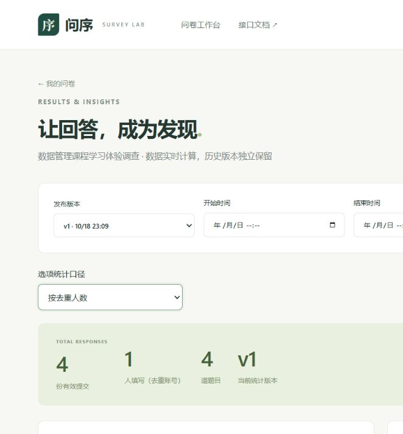

# 系统说明

## 一 系统目标与范围

问序实现从问卷创建、配置、发布、链接填写、保存恢复到结果统计的完整流程。课程重点是MongoDB文档建模与后端逻辑，界面用于真实操作和验收。应用版本1.1.0，提交材料均采用Markdown。

第一阶段支持注册登录、个人问卷管理、四种输入形式、可配置跳转、发布快照、截止关闭、匿名与重复策略、自动保存恢复和整卷/单题统计。尚未实现文件题、循环问卷、共同编辑、跨版本合并和本地持久恢复缓存。没有把未来方案写成现成功能。

## 二 用户角色与权限

创建者与填写者是同一用户系统中的两种行为，不是两套账号。一个人可创建自己的问卷，也可填写他人的问卷。

| 行为 | 创建者 | 填写者 |
| --- | --- | --- |
| 查看工作台列表 | 仅本人创建 | 同样仅本人创建，不能浏览所有问卷 |
| 编辑、发布、关闭 | 必须匹配owner_id | 非所有者拒绝 |
| 填写分享链接 | 登录后可填自己的或他人的 | 登录、开放且符合策略才可开始 |
| 读取填写草稿 | 只能读属于当前账号的过程 | 同样检查本人关联键 |
| 查看统计与正式内容 | 仅自己的问卷 | 非所有者拒绝 |
| 查看他人未提交内容 | 没有此接口 | 不能访问他人草稿 |

分享码是入口标识，不是管理权限。匿名表示不向创建者暴露直接账号身份，填写仍需登录；人数统计指去重账号数，不是可证明的自然人数。

## 三 总体架构与模块

```text
Vue浏览器界面 ──同源JSON API──→ FastAPI请求和身份检查
                                    ↓
                       问卷 / 填写过程 / 统计服务
                                    ↓
                      题型校验 / 条件解释 / 路径计算
                                    ↓
                       PyMongo集合、索引与事务
                                    ↓
                         MongoDB survey-rs
```

前端生产构建由后端提供，登录使用HttpOnly Cookie；开发前端可通过Vite代理访问API。数据库不由填写者直接访问。模块围绕职责组织，未为每个集合创建空的Repository包装。

| 模块 | 输入 | 主要处理 | 输出及文件 |
| --- | --- | --- | --- |
| 认证 | 用户名密码、会话Cookie | 规范化唯一、密码验证、会话到期检查 | 安全用户摘要；main.py、security.py |
| 问卷管理 | 当前用户、ID、draft、revision | 所有权、草稿条件更新、完整发布 | 管理文档、快照与元数据；services/surveys.py |
| 填写过程 | 分享码/过程ID、原始输入、revision | 固定版本、自动保存、恢复、终态 | 本人过程或回执；services/attempts.py |
| 规则领域 | 问卷定义与答案 | 配置检查、条件和路径、按题校验 | 规范化答案、路径或逐题错误；domain/ |
| 统计 | 所有者、版本、时间、题目 | 只聚合正式答卷，人数/次数分开 | 整卷、单题与分页内容；services/statistics.py |
| 旧客户端兼容 | 签名token和答案 | 旧式凭证提交 | 回执；services/participation.py |
| 编辑状态 | 本地定义、服务器元数据 | 不覆盖新输入、待发布截止提示 | 保存/发布/关闭反馈；useSurveyEditor.ts |
| 填写状态 | 本地输入、服务器草稿 | 600ms/5秒调度、串行同步、401/409处理 | 已保存状态和恢复；useAttempt.ts |

接口、模型、领域校验和服务不是同一职责。浏览器即时提示不替代后端校验，MongoDB基本约束也不代替路径或权限检查。各层边界和事务详见[关键逻辑](关键逻辑说明.md)。

## 四 页面与入口

| 页面 | 路由 | 可操作内容 | 关键状态 |
| --- | --- | --- | --- |
| 登录/注册 | /login | 登录、注册，之后回到目标入口 | 错误密码、重复用户名、加载会话 |
| 工作台 | / | 新建、分页查看自己的问卷，进入编辑统计 | 草稿/发布/关闭，累计正式份数 |
| 问卷编辑器 | /surveys/{id}/edit | 改标题说明策略、加题、排序、限制、规则、预览、保存、发布、关闭、复制链接 | 未保存草稿、截止待发布、操作中、错误 |
| 填写页 | /survey/{share} | 开始、匿名选择、继续草稿、放弃、上一题/下一题、提交 | 保存中、未同步、登录过期、冲突、只读、回执 |
| 统计页 | /surveys/{id}/statistics | 版本、时间、题目筛选，次数/人数切换，查看内容 | 空数据、查询中、错误、分页 |

未登录进入业务页面会被引导登录，服务器仍独立验证身份。界面中的题目预览用于配置观察，不能当作实际提交或完整发布检查。

## 五 主要状态

### 5.1 问卷状态

```text
新建draft → 配置、保存 → 发布published
                             ├─ 修改draft：当前发布版本仍有效
                             ├─ 再发布：追加新版本
                             └─ 关闭closed → 可按合法发布流程重新开放
```

截止不是另一个存储status，而是published状态配合deadline判断是否允许写入。截止与关闭都保留已保存草稿和历史答案。保存创建者草稿不会保存独立截止输入；截止在发布时生效。

### 5.2 填写过程

```text
无过程 → in_progress ──保存──→ in_progress
                 ├─ 合法提交 → submitted，关联回执，清空草稿内容
                 └─ 明确放弃 → abandoned，清空草稿内容
```

同账号同问卷最多一份进行中过程，不因版本或匿名选择不同而另开一份。允许重复填写指可完成多次过程，不是同一账号同时开无限份草稿。终态不接受晚到保存。

## 六 一份问卷的完整操作示例

以下是可操作说明，不是声称本轮再次执行了人工验收。推荐创建独立验收问卷，避免更改既有样例。

1. 注册账号A，进入工作台，创建“学习体验调查”。
2. 配置身份单选（student/worker），工具多选（至少2项、最多2项），年龄数字（0～120整数），建议文本（可选，非空2～100码点）。
3. 将worker规则指向年龄题，其他答案按顺序；保存草稿，再发布，复制链接。
4. 在独立浏览器配置中登录账号B打开链接，按问卷设置选择匿名。普通同浏览器标签通常共享会话，不能用于假装两个独立账号。
5. 选择worker，确认跳过工具题；年龄输入“-”后等待已保存。它是可保存的原始输入，但不能通过下一步正式校验。
6. 关闭页签，再进入同一链接，选择继续填写；应保持原版本、匿名选择和原始输入，回到未完成年龄题。
7. 改为20，填写建议后提交，获得版本和提交时间回执。重复网络请求不产生第二份答卷。
8. 账号A查看对应版本统计：新增一份；身份worker、年龄20计入，工具题不计入。人数按账号去重。
9. A修改题目发布v2，历史v1仍可解释原答案；再关闭问卷，尚未提交的保存进度可只读查看，不能继续写入。

题目ID由编辑器生成，界面显示顺序不代表数据库ID。删除或排序后应重新检查规则，发布会拒绝非法引用，不静默猜测新含义。

## 七 自动保存与恢复体验

停顿600ms安排保存，持续输入最长5秒安排一次；切题、页面隐藏、路由离开和主动退出登录时尝试立即保存。请求串行发送。页面只有当前最新修改确认后显示已保存，响应期间继续编辑仍保留未同步标记。

登录过期使用原页同账号重新登录，不清空输入；冲突暂停自动写入，重新加载前确认是否丢弃本页未同步部分。主动退出若保存失败，需要明确选择是否离开。强制关闭、断电或断网之前未确认的内容不保证恢复；没有本地持久缓存。

## 八 统计与数据口径

整卷“份”是正式答卷数，“人”是所选范围内去重账号数；单题排除跳过和null。选项可按次数或人数展示比例，重复填写可能使单选各项人数集合交叉。数字平均值按有效作答次数，不把空白当0。内容每页20项。

详情默认当前发布版本，可选择历史版本及含时区时间范围；各版本不自动合并。工作台累计份数可包括所有版本，不能直接与单版本详情总数比较为错误。未完成过程不参与统计，多次聚合不是严格同一时点快照。

## 九 异常场景与用户处理

| 场景 | 系统行为 | 用户处理 |
| --- | --- | --- |
| 发布配置非法 | 不产生新版本，指出错误 | 修正题目、范围或规则，再发布 |
| 保存响应期间继续输入 | 保留本地新内容 | 等待最新内容确认，不仅看旧成功提示 |
| 数字/多选/文本不合要求 | 草稿可存，前进或提交阻止 | 按逐题提示修正 |
| 会话失效401 | 暂停同步、保留输入 | 原页同账号登录 |
| 草稿冲突409 | 不覆盖服务器，暂停自动保存 | 核对后明确重载 |
| 已关闭或截止 | 保留本人草稿，只读 | 查看已保存内容，不能提交 |
| 放弃 | 确认后清空该过程内容 | 不能恢复放弃内容；需要时重新开始 |
| 他人问卷管理或草稿 | 拒绝访问，通常404 | 使用自己的资源和账号 |
| 网络失败 | 未同步提示和重试入口 | 保持页面，不把未确认内容当已保存 |

## 十 扩展入口与边界

题型处理器注册、前端组件映射、有限规则解释、稳定题目ID和发布快照用于继续扩展。新增题型可能还需改变编辑器、答案schema和统计；多人共同编辑需要新的权限及冲突设计；跨版本统计需要语义映射。已有扩展点不表示未来无需修改核心。

本地单节点副本集已验证事务与8用户并发正确性，不代表云部署、高吞吐或多节点容灾。运行和排错见[代码README](../1_代码/README.md)，详细接口见[API说明](API说明.md)，数据模型见[数据库设计](数据库设计.md)。

## 十一 已保存页面证据

截图来自当时独立验收数据



图示用于说明同账号重复填写时，份数与人数必须分别展示。


图示显示重新进入后保留数字“-”、匿名和v1；该中间状态可保存但不能作为合法正式数字提交。
