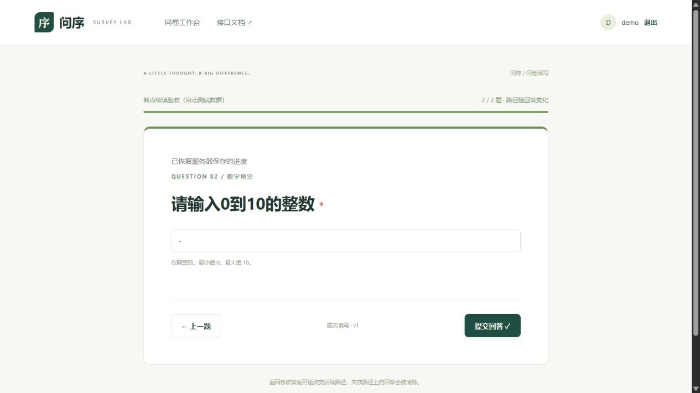

# 测试用例与结果

## 一 执行范围与记录来源

应用1.1.0现有结果：后端97项、普通前端单元16项、组件/路由43项，共156项通过。独立源码目录另执行97项后端复核，不重复计数。当前材料扩写核对源码和证据，没有重新运行这些业务测试；不能把材料整理日期当作新的测试日期。

Windows、Python3.12、MongoDB8.3.11单节点survey-rs副本集；后端FastAPI TestClient真实连接MongoDB，前端Node单元和Vitest/jsdom组件。慢请求、错误和计时由受控Promise/假时钟模拟，浏览器操作另列。

测试只创建并清理随机survey_lab_test_*数据库，不清空survey_lab。运行前具备本机测试库权限，MongoDB已经启动。全量后端执行脚本run-tests.ps1；前端进入frontend执行pnpm test，构建pnpm run build。只跑某个后端文件可在1_代码目录执行`.\.runtime\Scripts\python.exe -m pytest backend/tests/test_attempts.py -q`。

## 二 公共输入与断言阅读

后端公共fixture定义与数据库设计教学示例不是同一数据集：q1身份student/worker，worker跳q3；q2工具a/b/c，恰好2项；q3年龄0～120整数；q4可选文本，非空2～20码点。允许匿名、默认不允许重复。新用例按需调整策略。若某行写“公共定义”，指这一fixture，不把MongoDB详版的mongo/python/java示例混入。

每个场景列目标、前置、步骤、输入、预期、实际、结果、源码与证据。一个场景可能包含多个参数化自动测试，以下场景编号不是新增测试数量。实际输出依据已通过的源码断言与原始结果整理，没有留存HTTP正文时明确说明，不重造响应抓包。

## 三 场景用例

### S01 创建问卷

**测试目标：** 创建问卷。

**前置条件：** 随机账号注册并登录。

**测试步骤：**

1. POST创建。
2. 读取管理文档。
3. 记录返回ID和revision。

**输入：** title=测试问卷。

**预期输出：** 创建201，ID独立、draft状态、revision1、current_version0。

**实际输出：** 公共publish_survey被集成用例实际执行，创建状态201断言通过；未单独留存完整HTTP正文。

**结果：** 通过（对应已有执行记录，非本轮重跑）。

**对应测试：** [backend/tests/conftest.py](../1_代码/backend/tests/conftest.py)；`publish_survey`。

**证据：** [后端JUnit](测试证据/自动测试结果/test-results.xml)；多个参数记录在逐项索引保留独立名称。

### S02 添加四种题目和发布

**测试目标：** 添加四种题目和发布。

**前置条件：** S01创建成功，使用公共四题定义。

**测试步骤：**

1. PUT草稿。
2. 取新revision。
3. POST发布。
4. GET管理文档。

**输入：** q1单选、q2恰好2项、q3整数0～120、q4可选2～20字符。

**预期输出：** 保存200，发布200；完整版本与当前指针有效。

**实际输出：** 公共fixture在提交、统计、恢复测试中通过，发布元数据另由test_editor_metadata.py验证。

**结果：** 通过（对应已有执行记录，非本轮重跑）。

**对应测试：** [backend/tests/conftest.py](../1_代码/backend/tests/conftest.py)；`publish_survey`。

**证据：** [后端JUnit](测试证据/自动测试结果/test-results.xml)；多个参数记录在逐项索引保留独立名称。

### S03 注册 登录 退出

**测试目标：** 注册 登录 退出。

**前置条件：** 随机用户名，密码StrongPass123。

**测试步骤：**

1. 注册。
2. 大小写变体注册。
3. 退出。
4. /me。
5. 错误及正确密码登录。

**输入：** 原用户名、lower变体、WrongPass123。

**预期输出：** 201/409；退出后401，错误密码401，正确登录200，Cookie HttpOnly。

**实际输出：** 对应测试通过，断言状态码与Cookie属性。

**结果：** 通过（对应已有执行记录，非本轮重跑）。

**对应测试：** [backend/tests/test_integration.py](../1_代码/backend/tests/test_integration.py)；`test_auth_casefold_logout`。

**证据：** [后端JUnit](测试证据/自动测试结果/test-results.xml)；多个参数记录在逐项索引保留独立名称。

### S04 管理权限隔离

**测试目标：** 管理权限隔离。

**前置条件：** A拥有已发布问卷，B为独立账号。

**测试步骤：**

1. B读取问卷/版本/统计/内容，尝试关闭，查自己的列表。

**输入：** A的sid，B的Cookie。

**预期输出：** 越权404，B列表total0。

**实际输出：** 对应测试通过，不根据404推断他人是否真实存在。

**结果：** 通过（对应已有执行记录，非本轮重跑）。

**对应测试：** [backend/tests/test_integration.py](../1_代码/backend/tests/test_integration.py)；`test_permission_isolation`。

**证据：** [后端JUnit](测试证据/自动测试结果/test-results.xml)；多个参数记录在逐项索引保留独立名称。

### S05 创建者草稿revision冲突

**测试目标：** 创建者草稿revision冲突。

**前置条件：** 已发布问卷，取得同一revision。

**测试步骤：**

1. 两次用相同revision保存；再保存非法回跳并发布。

**输入：** 第一次合法draft，随后target=q1。

**预期输出：** 第一次200、第二次409；非法发布422，仍仅一份旧版本。

**实际输出：** 对应测试通过；草稿允许暂存业务非法配置但发布拒绝。

**结果：** 通过（对应已有执行记录，非本轮重跑）。

**对应测试：** [backend/tests/test_integration.py](../1_代码/backend/tests/test_integration.py)；`test_optimistic_edit_and_invalid_publish`。

**证据：** [后端JUnit](测试证据/自动测试结果/test-results.xml)；多个参数记录在逐项索引保留独立名称。

### S06 数字类型与边界

**测试目标：** 数字类型与边界。

**前置条件：** q3必答0～120整数。

**测试步骤：**

1. 逐个调用题型正式校验。

**输入：** 0、120、-1、121、18.5、true、字符串18、null。

**预期输出：** 仅0/120合法，其余BusinessError。

**实际输出：** 8个参数化记录均通过；此处是领域校验，不伪造HTTP状态。

**结果：** 通过（对应已有执行记录，非本轮重跑）。

**对应测试：** [backend/tests/test_domain.py](../1_代码/backend/tests/test_domain.py)；`test_number_bounds`。

**证据：** [后端JUnit](测试证据/自动测试结果/test-results.xml)；多个参数记录在逐项索引保留独立名称。

### S07 多选数量与非法选项

**测试目标：** 多选数量与非法选项。

**前置条件：** q2必答且恰好2项。

**测试步骤：**

1. 逐个传入数组并校验。

**输入：** [a,b]、[a]、[a,b,c]、[a,a]、[a,bad]。

**预期输出：** 仅[a,b]合法，其余拒绝。

**实际输出：** 5个参数记录通过。

**结果：** 通过（对应已有执行记录，非本轮重跑）。

**对应测试：** [backend/tests/test_domain.py](../1_代码/backend/tests/test_domain.py)；`test_multiple`。

**证据：** [后端JUnit](测试证据/自动测试结果/test-results.xml)；多个参数记录在逐项索引保留独立名称。

### S08 可选文本与规范化

**测试目标：** 可选文本与规范化。

**前置条件：** q4可选，非空至少2字符。

**测试步骤：**

1. 校验空白、带首尾空白文本和短文本。

**输入：** 空白、 你好 、a。

**预期输出：** 空白为null，文本为你好，过短拒绝。

**实际输出：** 对应测试通过。

**结果：** 通过（对应已有执行记录，非本轮重跑）。

**对应测试：** [backend/tests/test_domain.py](../1_代码/backend/tests/test_domain.py)；`test_optional_text`。

**证据：** [后端JUnit](测试证据/自动测试结果/test-results.xml)；多个参数记录在逐项索引保留独立名称。

### S09 单选 多选 数字条件运算

**测试目标：** 单选 多选 数字条件运算。

**前置条件：** 调用有限解释器，不写数据库。

**测试步骤：**

1. 逐个比较单值、集合、区间和缺失答案。

**输入：** eq/ne/gt/gte/lt/lte、between[2,4]上界4、集合条件、未回答ne。

**预期输出：** 按参数expected布尔值；缺失ne=false。

**实际输出：** 11个参数记录通过，完整输入在源装饰器，未冒充11次浏览器操作。

**结果：** 通过（对应已有执行记录，非本轮重跑）。

**对应测试：** [backend/tests/test_domain.py](../1_代码/backend/tests/test_domain.py)；`test_operators`。

**证据：** [后端JUnit](测试证据/自动测试结果/test-results.xml)；多个参数记录在逐项索引保留独立名称。

### S10 组合条件

**测试目标：** 组合条件。

**前置条件：** role=student，条件含all和any。

**测试步骤：**

1. 分别传年龄18和17。

**输入：** all(student, any(age>=18,age<0))。

**预期输出：** 18满足，17不满足。

**实际输出：** 对应断言通过。

**结果：** 通过（对应已有执行记录，非本轮重跑）。

**对应测试：** [backend/tests/test_domain.py](../1_代码/backend/tests/test_domain.py)；`test_combination`。

**证据：** [后端JUnit](测试证据/自动测试结果/test-results.xml)；多个参数记录在逐项索引保留独立名称。

### S11 路径跳过与清理

**测试目标：** 路径跳过与清理。

**前置条件：** 公共定义worker跳q3。

**测试步骤：**

1. evaluate完整输入，检查clean/path。

**输入：** q1=worker，附带q2=[a,b]，q3=18。

**预期输出：** path=q1/q3/q4，q2不保存。

**实际输出：** 领域测试通过，服务端不信任附带旧答案。

**结果：** 通过（对应已有执行记录，非本轮重跑）。

**对应测试：** [backend/tests/test_domain.py](../1_代码/backend/tests/test_domain.py)；`test_routing_discards_skipped`。

**证据：** [后端JUnit](测试证据/自动测试结果/test-results.xml)；多个参数记录在逐项索引保留独立名称。

### S12 实际路径必答

**测试目标：** 实际路径必答。

**前置条件：** 公共定义student需要q2。

**测试步骤：**

1. 遗漏q2执行evaluate。

**输入：** q1=student，q3=18。

**预期输出：** BusinessError.details含q2。

**实际输出：** 对应测试通过。

**结果：** 通过（对应已有执行记录，非本轮重跑）。

**对应测试：** [backend/tests/test_domain.py](../1_代码/backend/tests/test_domain.py)；`test_routing_requires_visited`。

**证据：** [后端JUnit](测试证据/自动测试结果/test-results.xml)；多个参数记录在逐项索引保留独立名称。

### S13 非法目标 引用和ID

**测试目标：** 非法目标 引用和ID。

**前置条件：** 发布配置检查与答案计算。

**测试步骤：**

1. 分别回跳、缺失/数字目标、未来引用、重复ID、未知答案题。

**输入：** target=q1/missing/42；q1引用q3；重复q1；hacked=1。

**预期输出：** 配置或答案拒绝，不认为引用是数据库外键自动保证。

**实际输出：** 对应参数与独立测试全部通过。

**结果：** 通过（对应已有执行记录，非本轮重跑）。

**对应测试：** [backend/tests/test_domain.py](../1_代码/backend/tests/test_domain.py)；`test_invalid_targets`、`test_future_reference`、`test_duplicate_ids`、`test_unknown_question`。

**证据：** [后端JUnit](测试证据/自动测试结果/test-results.xml)；多个参数记录在逐项索引保留独立名称。

### S14 不可回答的必答配置

**测试目标：** 不可回答的必答配置。

**前置条件：** 独立新问卷。

**测试步骤：**

1. 保存配置。
2. 发布。
3. 检查版本数量和状态。

**输入：** 必答多选max0；必答整数0.1～0.9；必答文本max0。

**预期输出：** 草稿200，发布422，0快照，状态仍draft/current_version0。

**实际输出：** 3个参数记录通过；证据验证无部分发布。

**结果：** 通过（对应已有执行记录，非本轮重跑）。

**对应测试：** [backend/tests/test_review_fixes.py](../1_代码/backend/tests/test_review_fixes.py)；`test_unanswerable_required_questions_rejected`。

**证据：** [后端JUnit](测试证据/自动测试结果/test-results.xml)；多个参数记录在逐项索引保留独立名称。

### S15 极端数字

**测试目标：** 极端数字。

**前置条件：** 题型/草稿/正式提交各入口。

**测试步骤：**

1. 传巨大数或非有限数，检查异常和数据库变化。

**输入：** ±10^400、inf/-inf/nan；草稿10^20。

**预期输出：** 领域拒绝；HTTP非法输入422，revision/答卷不部分写入。

**实际输出：** 对应参数与接口测试通过，未编造巨大JSON原文日志。

**结果：** 通过（对应已有执行记录，非本轮重跑）。

**对应测试：** [backend/tests/test_review_fixes.py](../1_代码/backend/tests/test_review_fixes.py)；`test_extreme_domain_numbers_never_overflow`、`test_extreme_config_rejected_before_bson`、`test_extreme_submission_rejected_without_write`。

**证据：** [后端JUnit](测试证据/自动测试结果/test-results.xml)；多个参数记录在逐项索引保留独立名称。

### S16 非法正式答案不写入

**测试目标：** 非法正式答案不写入。

**前置条件：** 已发布，取得本人凭证。

**测试步骤：**

1. 提交越界年龄并查responses。

**输入：** worker，q3=121。

**预期输出：** 422，details含q3，正式记录0。

**实际输出：** 对应测试通过。

**结果：** 通过（对应已有执行记录，非本轮重跑）。

**对应测试：** [backend/tests/test_integration.py](../1_代码/backend/tests/test_integration.py)；`test_invalid_answer_no_write`。

**证据：** [后端JUnit](测试证据/自动测试结果/test-results.xml)；多个参数记录在逐项索引保留独立名称。

### S17 匿名提交与幂等回执

**测试目标：** 匿名提交与幂等回执。

**前置条件：** 允许匿名，旧兼容流程开始。

**测试步骤：**

1. 提交。
2. 同token重试。
3. 查库。
4. 统计与文本内容。

**输入：** worker，q3=20，q4=很好，anonymous=true。

**预期输出：** 同一回执、1份、无user_id，跳过q2，均值20，内容不暴露关联键。

**实际输出：** 测试通过；旧流程不创建持久草稿。

**结果：** 通过（对应已有执行记录，非本轮重跑）。

**对应测试：** [backend/tests/test_integration.py](../1_代码/backend/tests/test_integration.py)；`test_full_flow_idempotency_and_anonymity`。

**证据：** [后端JUnit](测试证据/自动测试结果/test-results.xml)；多个参数记录在逐项索引保留独立名称。

### S18 禁止重复 允许重复 同次并发

**测试目标：** 禁止重复 允许重复 同次并发。

**前置条件：** 分别配置重复策略。

**测试步骤：**

1. 两个不同token同账号并发；同token3线程；允许重复两次。

**输入：** 合法worker答案。

**预期输出：** 禁止重复200/409；同次全成功同ID；允许重复2份。

**实际输出：** 对应测试通过，区分同账号与不同账号并发。

**结果：** 通过（对应已有执行记录，非本轮重跑）。

**对应测试：** [backend/tests/test_integration.py](../1_代码/backend/tests/test_integration.py)；`test_concurrent_repeat_forbidden`、`test_concurrent_same_attempt`、`test_repeat_allowed`。

**证据：** [后端JUnit](测试证据/自动测试结果/test-results.xml)；多个参数记录在逐项索引保留独立名称。

### S19 关闭和截止拒绝提交

**测试目标：** 关闭和截止拒绝提交。

**前置条件：** 已开始但未提交。

**测试步骤：**

1. 设置过去deadline提交。
2. 清除deadline。
3. 关闭再提交。

**输入：** 过去时间，status=closed。

**预期输出：** 两次提交409，关闭200。

**实际输出：** 对应测试通过，凭证不绕过当前状态。

**结果：** 通过（对应已有执行记录，非本轮重跑）。

**对应测试：** [backend/tests/test_integration.py](../1_代码/backend/tests/test_integration.py)；`test_close_and_deadline`。

**证据：** [后端JUnit](测试证据/自动测试结果/test-results.xml)；多个参数记录在逐项索引保留独立名称。

### S20 历史版本解释

**测试目标：** 历史版本解释。

**前置条件：** v1已开始。

**测试步骤：**

1. 改题标题并发布v2。
2. 提交v1。
3. 分别统计。

**输入：** v1凭证和合法答案，v2改年龄标题。

**预期输出：** v1有1份且旧标题；v2该记录0份、新标题。

**实际输出：** 对应测试通过。

**结果：** 通过（对应已有执行记录，非本轮重跑）。

**对应测试：** [backend/tests/test_integration.py](../1_代码/backend/tests/test_integration.py)；`test_old_version_after_publish`。

**证据：** [后端JUnit](测试证据/自动测试结果/test-results.xml)；多个参数记录在逐项索引保留独立名称。

### S21 选项次数与数字平均

**测试目标：** 选项次数与数字平均。

**前置条件：** 允许重复的独立问卷。

**测试步骤：**

1. 提交两份student。
2. 查询统计。

**输入：** tools=[a,b]/[b,c]，数值0/20。

**预期输出：** 选项次数1/2/1，均值10。

**实际输出：** 断言通过，不把空值当0。

**结果：** 通过（对应已有执行记录，非本轮重跑）。

**对应测试：** [backend/tests/test_integration.py](../1_代码/backend/tests/test_integration.py)；`test_multiple_and_average`。

**证据：** [后端JUnit](测试证据/自动测试结果/test-results.xml)；多个参数记录在逐项索引保留独立名称。

### S22 人数与匿名实名去重

**测试目标：** 人数与匿名实名去重。

**前置条件：** 两个账号，允许重复。

**测试步骤：**

1. 同账号混合匿名实名3次，另账号1次。
2. 筛选统计。

**输入：** 4份来自2账号，含跳过/空白和版本筛选。

**预期输出：** 4份/2账号，题目/选项分开次数人数，不暴露内部标识。

**实际输出：** 对应测试通过，详细构造在源文件。

**结果：** 通过（对应已有执行记录，非本轮重跑）。

**对应测试：** [backend/tests/test_review_fixes.py](../1_代码/backend/tests/test_review_fixes.py)；`test_counts_people_anonymous_and_repeat`。

**证据：** [后端JUnit](测试证据/自动测试结果/test-results.xml)；多个参数记录在逐项索引保留独立名称。

### S23 时间范围与内容分页

**测试目标：** 时间范围与内容分页。

**前置条件：** 已有1份有效答卷。

**测试步骤：**

1. 未来start筛选。
2. 反向区间。
3. 查询第2页。

**输入：** 2100年start；start>end；page2。

**预期输出：** total0；反向422；items=[]。

**实际输出：** 对应测试通过，默认20项分页。

**结果：** 通过（对应已有执行记录，非本轮重跑）。

**对应测试：** [backend/tests/test_integration.py](../1_代码/backend/tests/test_integration.py)；`test_time_and_pagination`。

**证据：** [后端JUnit](测试证据/自动测试结果/test-results.xml)；多个参数记录在逐项索引保留独立名称。

### S24 直接写库结构约束

**测试目标：** 直接写库结构约束。

**前置条件：** 初始化了真实schema的测试库。

**测试步骤：**

1. 对多个集合插入类型/嵌套错误字段。

**输入：** 错误answers/value/version_id/respondent_key/definition/draft/share_code。

**预期输出：** MongoDB WriteError拒绝。

**实际输出：** 8个参数记录通过；其他基本缺字段检查见test_database_validation。

**结果：** 通过（对应已有执行记录，非本轮重跑）。

**对应测试：** [backend/tests/test_review_fixes.py](../1_代码/backend/tests/test_review_fixes.py)；`test_deep_database_constraints`。

**证据：** [后端JUnit](测试证据/自动测试结果/test-results.xml)；多个参数记录在逐项索引保留独立名称。

### S25 显式升级 预检与恢复

**测试目标：** 显式升级 预检与恢复。

**前置条件：** 独立旧约束数据库副本。

**测试步骤：**

1. 预检。
2. 应用。
3. 初始化。
4. 核对文档。
5. 恢复；注入失败；非法旧文档；未知约束。

**输入：** 已知旧schema，第三次collMod异常，share_code=42，未来validator。

**预期输出：** 成功后文档不变；失败日志rolled_back；预检零变更；未知拒绝覆盖。

**实际输出：** 4项通过；旧业务文档不由源码包备份替代。

**结果：** 通过（对应已有执行记录，非本轮重跑）。

**对应测试：** [backend/tests/test_migration.py](../1_代码/backend/tests/test_migration.py)；`test_upgrade_old_data_and_explicit_rollback`、`test_failed_upgrade_restores_constraints`、`test_preflight_invalid_data_leaves_every_validator_unchanged`、`test_startup_never_overwrites_unknown_or_future_schema`。

**证据：** [后端JUnit](测试证据/自动测试结果/test-results.xml)；多个参数记录在逐项索引保留独立名称。

### S26 编辑器慢请求与关闭

**测试目标：** 编辑器慢请求与关闭。

**前置条件：** 真实挂载Editor和内存路由，mock API。

**测试步骤：**

1. 发保存后继续编辑；取消/保存后关闭；保存失败；发布等待继续输入。

**输入：** 可控Promise及本地修改。

**预期输出：** 新输入不覆盖，失败不关闭，重复操作受限，旧反馈清除。

**实际输出：** 相关组件记录通过，完整19项见逐项索引；不是浏览器限速实测。

**结果：** 通过（对应已有执行记录，非本轮重跑）。

**对应测试：** [frontend/tests/components/editor.spec.ts](../1_代码/frontend/tests/components/editor.spec.ts)；见源码中的实际it用例名称与第五部分逐项索引。

**证据：** [组件JUnit](测试证据/自动测试结果/component-tests.xml)；多个参数记录在逐项索引保留独立名称。

### S27 规则JSON与组件保护

**测试目标：** 规则JSON与组件保护。

**前置条件：** 真实挂载RoutingEditor并使用普通规则测试。

**测试步骤：**

1. 输入缺condition配置、坏字段、取消或清空；调用高级检查。

**输入：** rules=[{}]，default_target=null及非法嵌套/引用。

**预期输出：** 不应用坏配置、不崩溃、明确清空恢复，完整检查拒绝非法结构。

**实际输出：** 组件与routing.test.mjs记录通过。

**结果：** 通过（对应已有执行记录，非本轮重跑）。

**对应测试：** [frontend/tests/components/inputs.spec.ts](../1_代码/frontend/tests/components/inputs.spec.ts)；见源码中的实际it用例名称与第五部分逐项索引。

**证据：** [组件JUnit](测试证据/自动测试结果/component-tests.xml)；多个参数记录在逐项索引保留独立名称。

### S28 Unicode和输入法

**测试目标：** Unicode和输入法。

**前置条件：** TextInput上限1等配置。

**测试步骤：**

1. 输入单个/两个表情、粘贴、composition和外部更新。

**输入：** 😀、😀😀及组合输入事件。

**预期输出：** 1个按1码点；超限保留并提示；组合完成更新且不重复。

**实际输出：** 5项文本组件及规则单元通过；真实浏览器截图另附。

**结果：** 通过（对应已有执行记录，非本轮重跑）。

**对应测试：** [frontend/tests/components/inputs.spec.ts](../1_代码/frontend/tests/components/inputs.spec.ts)；见源码中的实际it用例名称与第五部分逐项索引。

**证据：** [组件JUnit](测试证据/自动测试结果/component-tests.xml)；多个参数记录在逐项索引保留独立名称。

### S29 截止时间与保存反馈

**测试目标：** 截止时间与保存反馈。

**前置条件：** 编辑页加载原deadline。

**测试步骤：**

1. 只改时间。
2. 保存。
3. 尝试离开/发布失败。
4. 成功发布。

**输入：** 新的本地时间和原秒级ISO。

**预期输出：** 未发布标记保留、离开提醒、失败不清除、未改原时间保留秒。

**实际输出：** 相关组件测试通过。

**结果：** 通过（对应已有执行记录，非本轮重跑）。

**对应测试：** [frontend/tests/components/editor.spec.ts](../1_代码/frontend/tests/components/editor.spec.ts)；见源码中的实际it用例名称与第五部分逐项索引。

**证据：** [组件JUnit](测试证据/自动测试结果/component-tests.xml)；多个参数记录在逐项索引保留独立名称。

### S30 部分输入跨登录恢复

**测试目标：** 部分输入跨登录恢复。

**前置条件：** 独立账号，允许匿名。

**测试步骤：**

1. 匿名开始。
2. 保存。
3. 退出。
4. 独立客户端同账号登录。
5. GET恢复。
6. 尝试提交。

**输入：** worker，q3="-"，q4暂存，提示位置q4。

**预期输出：** 保存200、原始值保留、位置q3、匿名不变；提交422且0答卷。

**实际输出：** 真实MongoDB客户端测试通过；非多台物理设备实验。

**结果：** 通过（对应已有执行记录，非本轮重跑）。

**对应测试：** [backend/tests/test_attempts.py](../1_代码/backend/tests/test_attempts.py)；`test_partial_raw_input_resume_across_login_and_device`。

**证据：** [后端JUnit](测试证据/自动测试结果/test-results.xml)；多个参数记录在逐项索引保留独立名称。

### S31 填写revision冲突

**测试目标：** 填写revision冲突。

**前置条件：** 草稿revision1。

**测试步骤：**

1. 保存年龄22。
2. 旧revision保存。
3. 旧revision提交。
4. 读最新。

**输入：** 两个请求都基于1。

**预期输出：** 首次新revision2，后两次409，年龄保持22。

**实际输出：** 对应测试通过。

**结果：** 通过（对应已有执行记录，非本轮重跑）。

**对应测试：** [backend/tests/test_attempts.py](../1_代码/backend/tests/test_attempts.py)；`test_revision_conflict_does_not_overwrite`。

**证据：** [后端JUnit](测试证据/自动测试结果/test-results.xml)；多个参数记录在逐项索引保留独立名称。

### S32 五请求同时开始

**测试目标：** 五请求同时开始。

**前置条件：** 同账号同问卷。

**测试步骤：**

1. 5线程经Barrier开始。
2. 比ID与数量。
3. 直接重复键插入。

**输入：** 相同分享码，部分唯一键。

**预期输出：** 一个过程ID、一份in_progress，重复键插入拒绝。

**实际输出：** 真实接口与MongoDB测试通过。

**结果：** 通过（对应已有执行记录，非本轮重跑）。

**对应测试：** [backend/tests/test_attempts.py](../1_代码/backend/tests/test_attempts.py)；`test_parallel_begin_has_one_active_attempt`。

**证据：** [后端JUnit](测试证据/自动测试结果/test-results.xml)；多个参数记录在逐项索引保留独立名称。

### S33 路径清理与恢复位置

**测试目标：** 路径清理与恢复位置。

**前置条件：** 先填student路径及工具。

**测试步骤：**

1. 改worker并提示跳过位置。
2. 再改student。

**输入：** q2=[a,b]、q3=20，current=q2/q4。

**预期输出：** worker清q2，位置有效；改回student停缺失q2。

**实际输出：** 对应测试通过。

**结果：** 通过（对应已有执行记录，非本轮重跑）。

**对应测试：** [backend/tests/test_attempts.py](../1_代码/backend/tests/test_attempts.py)；`test_skip_cleanup_and_recover_valid_position`。

**证据：** [后端JUnit](测试证据/自动测试结果/test-results.xml)；多个参数记录在逐项索引保留独立名称。

### S34 关闭 截止后的只读恢复

**测试目标：** 关闭 截止后的只读恢复。

**前置条件：** 保存worker/20未提交。

**测试步骤：**

1. 分别关闭和设置过去时间。
2. GET。
3. PUT。
4. submit。
5. begin。

**输入：** 已有revision与raw答案。

**预期输出：** GET200/read_only，答案保留；写入提交409；begin返回原ID。

**实际输出：** 两个参数场景通过。

**结果：** 通过（对应已有执行记录，非本轮重跑）。

**对应测试：** [backend/tests/test_attempts.py](../1_代码/backend/tests/test_attempts.py)；`test_read_only_restore_but_no_save_submit`。

**证据：** [后端JUnit](测试证据/自动测试结果/test-results.xml)；多个参数记录在逐项索引保留独立名称。

### S35 原版本 匿名与并发提交

**测试目标：** 原版本 匿名与并发提交。

**前置条件：** v1匿名草稿年龄0。

**测试步骤：**

1. 发v2最小100。
2. 继续v1。
3. 3线程提交。
4. 旧revision重试。
5. 晚到保存。

**输入：** v1合法0，v2不接受0。

**预期输出：** 按v1成功，单一回执/答卷，无user_id，草稿清空，迟到保存409。

**实际输出：** 对应事务与回执断言通过。

**结果：** 通过（对应已有执行记录，非本轮重跑）。

**对应测试：** [backend/tests/test_attempts.py](../1_代码/backend/tests/test_attempts.py)；`test_pinned_version_and_anonymity_atomic_idempotent_submit`。

**证据：** [后端JUnit](测试证据/自动测试结果/test-results.xml)；多个参数记录在逐项索引保留独立名称。

### S36 放弃及迟到请求

**测试目标：** 放弃及迟到请求。

**前置条件：** 进行中已保存。

**测试步骤：**

1. 旧revision放弃。
2. 正确revision放弃。
3. 迟到保存/提交。
4. 重新开始。

**输入：** worker，q3="-"。

**预期输出：** 旧409、正确200；答案清空；旧写409；新ID不同。

**实际输出：** 对应测试通过。

**结果：** 通过（对应已有执行记录，非本轮重跑）。

**对应测试：** [backend/tests/test_attempts.py](../1_代码/backend/tests/test_attempts.py)；`test_abandon_clears_answers_rejects_late_save_and_allows_new`。

**证据：** [后端JUnit](测试证据/自动测试结果/test-results.xml)；多个参数记录在逐项索引保留独立名称。

### S37 草稿不进统计且账号隔离

**测试目标：** 草稿不进统计且账号隔离。

**前置条件：** A有未提交草稿，B独立登录。

**测试步骤：**

1. A查统计；B读/写/提交/放弃A草稿。

**输入：** A的aid，B会话。

**预期输出：** 0份/0人；B全部404，B查询自己的进行中返回null。

**实际输出：** 对应测试通过。

**结果：** 通过（对应已有执行记录，非本轮重跑）。

**对应测试：** [backend/tests/test_attempts.py](../1_代码/backend/tests/test_attempts.py)；`test_drafts_not_in_statistics_and_account_isolation`。

**证据：** [后端JUnit](测试证据/自动测试结果/test-results.xml)；多个参数记录在逐项索引保留独立名称。

### S38 原始结构非法不部分更新

**测试目标：** 原始结构非法不部分更新。

**前置条件：** 初始revision1草稿。

**测试步骤：**

1. 分别保存四种错误结构后读取revision。

**输入：** unknown题、嵌套对象、bool数字、20001字符。

**预期输出：** 全部422，revision仍1。

**实际输出：** 4参数记录通过。

**结果：** 通过（对应已有执行记录，非本轮重跑）。

**对应测试：** [backend/tests/test_attempts.py](../1_代码/backend/tests/test_attempts.py)；`test_bad_raw_structure_no_partial_write`。

**证据：** [后端JUnit](测试证据/自动测试结果/test-results.xml)；多个参数记录在逐项索引保留独立名称。

### S39 草稿schema直接拒绝

**测试目标：** 草稿schema直接拒绝。

**前置条件：** 已取得草稿文档。

**测试步骤：**

1. 更换ID并将status改broken直接插入。

**输入：** 非法状态枚举。

**预期输出：** WriteError拒绝。

**实际输出：** 真实数据库约束测试通过。

**结果：** 通过（对应已有执行记录，非本轮重跑）。

**对应测试：** [backend/tests/test_attempts.py](../1_代码/backend/tests/test_attempts.py)；`test_direct_database_schema_rejects_malformed_attempt`。

**证据：** [后端JUnit](测试证据/自动测试结果/test-results.xml)；多个参数记录在逐项索引保留独立名称。

### S40 插入答卷后故障回滚

**测试目标：** 插入答卷后故障回滚。

**前置条件：** 合法已保存草稿。

**测试步骤：**

1. 在responses插入后、attempts转submitted前注入RuntimeError。

**输入：** worker，年龄20；猴子补丁更新故障。

**预期输出：** 事务回滚，0份答卷，过程仍in_progress。

**实际输出：** 对应测试通过；不是实际生产故障。

**结果：** 通过（对应已有执行记录，非本轮重跑）。

**对应测试：** [backend/tests/test_attempts.py](../1_代码/backend/tests/test_attempts.py)；`test_submit_transaction_rolls_back_response_on_failure`。

**证据：** [后端JUnit](测试证据/自动测试结果/test-results.xml)；多个参数记录在逐项索引保留独立名称。

### S41 八个独立账号同时提交

**测试目标：** 八个独立账号同时提交。

**前置条件：** 8独立会话，各自开始保存，同一问卷。

**测试步骤：**

1. Barrier同步提交。
2. 读取全部答卷。
3. 创建者统计。

**输入：** 偶数worker匿名，奇数student实名，年龄20～27，文本各异。

**预期输出：** 全200，8份/8键，工具题4次，均值23.5，文本不串号。

**实际输出：** 真实MongoDB集成测试通过；没有吞吐或在线容量结论。

**结果：** 通过（对应已有执行记录，非本轮重跑）。

**对应测试：** [backend/tests/test_attempts.py](../1_代码/backend/tests/test_attempts.py)；`test_eight_users_parallel_mixed_paths_and_statistics`。

**证据：** [后端JUnit](测试证据/自动测试结果/test-results.xml)；多个参数记录在逐项索引保留独立名称。

### S42 自动保存调度与新输入反馈

**测试目标：** 自动保存调度与新输入反馈。

**前置条件：** 挂载useAttempt，假时钟与受控Promise。

**测试步骤：**

1. 600ms停顿；持续450ms编辑；A请求期间输入B；重复flush；失败重试。

**输入：** 原始部分文本与两个延迟响应。

**预期输出：** 最长5秒安排保存；串行补存；旧响应不标新内容成功；失败保留。

**实际输出：** 相关组件记录通过，假时钟不是网络延迟测量。

**结果：** 通过（对应已有执行记录，非本轮重跑）。

**对应测试：** [frontend/tests/components/attempt.spec.ts](../1_代码/frontend/tests/components/attempt.spec.ts)；见源码中的实际it用例名称与第五部分逐项索引。

**证据：** [组件JUnit](测试证据/自动测试结果/component-tests.xml)；多个参数记录在逐项索引保留独立名称。

### S43 认证过期 路由离开和原始数字

**测试目标：** 认证过期 路由离开和原始数字。

**前置条件：** 挂载填写页/内存路由和输入组件。

**测试步骤：**

1. 401后同账号认证；保存失败取消离开；提交等待保存；恢复只读；输入1.。

**输入：** 原始“-”/“1.”，401/409或网络错误。

**预期输出：** 输入保留，不允许错账号同步，取消仍原页，提交仅revision，字段禁用可只读。

**实际输出：** 相关16项组件记录通过。

**结果：** 通过（对应已有执行记录，非本轮重跑）。

**对应测试：** [frontend/tests/components/attempt.spec.ts](../1_代码/frontend/tests/components/attempt.spec.ts)；见源码中的实际it用例名称与第五部分逐项索引。

**证据：** [组件JUnit](测试证据/自动测试结果/component-tests.xml)；多个参数记录在逐项索引保留独立名称。

### S44 题型扩展入口

**测试目标：** 题型扩展入口。

**前置条件：** 临时注册继承Number的Rating。

**测试步骤：**

1. 临时添加处理器。
2. 校验评分5。
3. 完整定义检查。
4. finally清理。

**输入：** 临时type=rating。

**预期输出：** 复用数字配置和答案检查通过，测试后撤销注册。

**实际输出：** 对应领域测试通过；不代表产品已提供评分题UI。

**结果：** 通过（对应已有执行记录，非本轮重跑）。

**对应测试：** [backend/tests/test_domain.py](../1_代码/backend/tests/test_domain.py)；`test_extension_entry`。

**证据：** [后端JUnit](测试证据/自动测试结果/test-results.xml)；多个参数记录在逐项索引保留独立名称。

## 四 实际浏览器验收

以下为已保存操作证据，未把假时钟组件测试当成浏览器限速，也未宣称使用多台物理设备。

### B01 基本分支与越界提示

前置：demo登录，已有独立演示问卷。步骤：选工作身份→跳过工具题→输入41触发范围提示→改为合法6并提交。输入为身份worker、小时6及测试建议。预期合法答案获得回执、跳过题不计入；实际当时成功，见submission-success.jpg。该历史验收增加了构造答案，后续本机数量不固定为初始3份。

### B02 统计次数与人数

前置：允许重复的独立验收问卷。步骤：查看4份同账号提交统计→切换人数/次数。预期4份/1个去重账号，单选各项人数可交叉；实际页面展示符合，见review-statistics-people.jpg。此数据不同于自动测试的4份/2账号。

### B03 无效JSON与Unicode

前置：独立编辑器/输入验收问卷。输入rules=[{}]、default_target=null，原配置保留并提示；输入一个😀显示1/1可继续，两个不截断但阻止非法提交。实际页面和数据库验收已记录，见editor-json-rejected.jpg和editor-unicode-one-character.jpg。

### B04 关闭页签后恢复并提交

前置：独立断点验收问卷，必答文本最多100字符，数字0～10整数。步骤：匿名开始→输入“这是填到一半保存的内容😀”→切题输入“-”→等保存→关闭页签→重新进入→继续→改为7提交。预期原版本/匿名/原始“-”恢复，合法后只一份答卷、草稿清空。实际与预期一致，MongoDB只读复核JSON和截图见下。

[浏览器数据库复核](测试证据/自动测试结果/resume-browser-check.json)只针对独立验收数据，不改变原问卷。

## 五 自动测试逐项索引

下表从已保存JUnit和普通单元控制台结果读取，不依据文档场景数推算。长参数名在表内缩短显示，完整名称保留在[机器可读索引](测试证据/逐项测试索引.json)。

| 编号 | 类型 | 原始测试名 | 源码 | 结果 |
| --- | --- | --- | --- | --- |

| A001 | 后端 | test_partial_raw_input_resume_across_login_and_device | [源码](../1_代码/backend/tests/test_attempts.py) | 通过 |
| A002 | 后端 | test_revision_conflict_does_not_overwrite | [源码](../1_代码/backend/tests/test_attempts.py) | 通过 |
| A003 | 后端 | test_parallel_begin_has_one_active_attempt | [源码](../1_代码/backend/tests/test_attempts.py) | 通过 |
| A004 | 后端 | test_skip_cleanup_and_recover_valid_position | [源码](../1_代码/backend/tests/test_attempts.py) | 通过 |
| A005 | 后端 | test_read_only_restore_but_no_save_submit[closed] | [源码](../1_代码/backend/tests/test_attempts.py) | 通过 |
| A006 | 后端 | test_read_only_restore_but_no_save_submit[expired] | [源码](../1_代码/backend/tests/test_attempts.py) | 通过 |
| A007 | 后端 | test_pinned_version_and_anonymity_atomic_idempotent_submit | [源码](../1_代码/backend/tests/test_attempts.py) | 通过 |
| A008 | 后端 | test_abandon_clears_answers_rejects_late_save_and_allows_new | [源码](../1_代码/backend/tests/test_attempts.py) | 通过 |
| A009 | 后端 | test_drafts_not_in_statistics_and_account_isolation | [源码](../1_代码/backend/tests/test_attempts.py) | 通过 |
| A010 | 后端 | test_bad_raw_structure_no_partial_write[answers0] | [源码](../1_代码/backend/tests/test_attempts.py) | 通过 |
| A011 | 后端 | test_bad_raw_structure_no_partial_write[answers1] | [源码](../1_代码/backend/tests/test_attempts.py) | 通过 |
| A012 | 后端 | test_bad_raw_structure_no_partial_write[answers2] | [源码](../1_代码/backend/tests/test_attempts.py) | 通过 |
| A013 | 后端 | test_bad_raw_structure_no_partial_write[answers3] | [源码](../1_代码/backend/tests/test_attempts.py) | 通过 |
| A014 | 后端 | test_direct_database_schema_rejects_malformed_attempt | [源码](../1_代码/backend/tests/test_attempts.py) | 通过 |
| A015 | 后端 | test_submit_transaction_rolls_back_response_on_failure | [源码](../1_代码/backend/tests/test_attempts.py) | 通过 |
| A016 | 后端 | test_eight_users_parallel_mixed_paths_and_statistics | [源码](../1_代码/backend/tests/test_attempts.py) | 通过 |
| A017 | 后端 | test_number_bounds[0-True] | [源码](../1_代码/backend/tests/test_domain.py) | 通过 |
| A018 | 后端 | test_number_bounds[120-True] | [源码](../1_代码/backend/tests/test_domain.py) | 通过 |
| A019 | 后端 | test_number_bounds[-1-False] | [源码](../1_代码/backend/tests/test_domain.py) | 通过 |
| A020 | 后端 | test_number_bounds[121-False] | [源码](../1_代码/backend/tests/test_domain.py) | 通过 |
| A021 | 后端 | test_number_bounds[18.5-False] | [源码](../1_代码/backend/tests/test_domain.py) | 通过 |
| A022 | 后端 | test_number_bounds[True-False] | [源码](../1_代码/backend/tests/test_domain.py) | 通过 |
| A023 | 后端 | test_number_bounds[18-False] | [源码](../1_代码/backend/tests/test_domain.py) | 通过 |
| A024 | 后端 | test_number_bounds[None-False] | [源码](../1_代码/backend/tests/test_domain.py) | 通过 |
| A025 | 后端 | test_multiple[value0-True] | [源码](../1_代码/backend/tests/test_domain.py) | 通过 |
| A026 | 后端 | test_multiple[value1-False] | [源码](../1_代码/backend/tests/test_domain.py) | 通过 |
| A027 | 后端 | test_multiple[value2-False] | [源码](../1_代码/backend/tests/test_domain.py) | 通过 |
| A028 | 后端 | test_multiple[value3-False] | [源码](../1_代码/backend/tests/test_domain.py) | 通过 |
| A029 | 后端 | test_multiple[value4-False] | [源码](../1_代码/backend/tests/test_domain.py) | 通过 |
| A030 | 后端 | test_routing_discards_skipped | [源码](../1_代码/backend/tests/test_domain.py) | 通过 |
| A031 | 后端 | test_routing_requires_visited | [源码](../1_代码/backend/tests/test_domain.py) | 通过 |
| A032 | 后端 | test_operators[eq-2-2-True] | [源码](../1_代码/backend/tests/test_domain.py) | 通过 |
| A033 | 后端 | test_operators[ne-2-3-True] | [源码](../1_代码/backend/tests/test_domain.py) | 通过 |
| A034 | 后端 | test_operators[gt-2-2-False] | [源码](../1_代码/backend/tests/test_domain.py) | 通过 |
| A035 | 后端 | test_operators[gte-2-2-True] | [源码](../1_代码/backend/tests/test_domain.py) | 通过 |
| A036 | 后端 | test_operators[lt-2-1-True] | [源码](../1_代码/backend/tests/test_domain.py) | 通过 |
| A037 | 后端 | test_operators[lte-2-2-True] | [源码](../1_代码/backend/tests/test_domain.py) | 通过 |
| A038 | 后端 | test_operators[between-value6-4-True] | [源码](../1_代码/backend/tests/test_domain.py) | 通过 |
| A039 | 后端 | test_operators[contains_any-value7-answer7-True] | [源码](../1_代码/backend/tests/test_domain.py) | 通过 |
| A040 | 后端 | test_operators[contains_all-value8-answer8-False] | [源码](../1_代码/backend/tests/test_domain.py) | 通过 |
| A041 | 后端 | test_operators[set_equals-value9-answer9-True] | [源码](../1_代码/backend/tests/test_domain.py) | 通过 |
| A042 | 后端 | test_operators[ne-2-None-False] | [源码](../1_代码/backend/tests/test_domain.py) | 通过 |
| A043 | 后端 | test_combination | [源码](../1_代码/backend/tests/test_domain.py) | 通过 |
| A044 | 后端 | test_invalid_targets[q1] | [源码](../1_代码/backend/tests/test_domain.py) | 通过 |
| A045 | 后端 | test_invalid_targets[missing] | [源码](../1_代码/backend/tests/test_domain.py) | 通过 |
| A046 | 后端 | test_invalid_targets[42] | [源码](../1_代码/backend/tests/test_domain.py) | 通过 |
| A047 | 后端 | test_future_reference | [源码](../1_代码/backend/tests/test_domain.py) | 通过 |
| A048 | 后端 | test_duplicate_ids | [源码](../1_代码/backend/tests/test_domain.py) | 通过 |
| A049 | 后端 | test_unknown_question | [源码](../1_代码/backend/tests/test_domain.py) | 通过 |
| A050 | 后端 | test_optional_text | [源码](../1_代码/backend/tests/test_domain.py) | 通过 |
| A051 | 后端 | test_config_conflict | [源码](../1_代码/backend/tests/test_domain.py) | 通过 |
| A052 | 后端 | test_extension_entry | [源码](../1_代码/backend/tests/test_domain.py) | 通过 |
| A053 | 后端 | test_publish_returns_committed_metadata_without_embedding_it_in_version | [源码](../1_代码/backend/tests/test_editor_metadata.py) | 通过 |
| A054 | 后端 | test_close_revision_conflict_preserves_state_and_returns_metadata | [源码](../1_代码/backend/tests/test_editor_metadata.py) | 通过 |
| A055 | 后端 | test_full_flow_idempotency_and_anonymity | [源码](../1_代码/backend/tests/test_integration.py) | 通过 |
| A056 | 后端 | test_permission_isolation | [源码](../1_代码/backend/tests/test_integration.py) | 通过 |
| A057 | 后端 | test_token_other_user | [源码](../1_代码/backend/tests/test_integration.py) | 通过 |
| A058 | 后端 | test_invalid_answer_no_write | [源码](../1_代码/backend/tests/test_integration.py) | 通过 |
| A059 | 后端 | test_close_and_deadline | [源码](../1_代码/backend/tests/test_integration.py) | 通过 |
| A060 | 后端 | test_concurrent_repeat_forbidden | [源码](../1_代码/backend/tests/test_integration.py) | 通过 |
| A061 | 后端 | test_concurrent_same_attempt | [源码](../1_代码/backend/tests/test_integration.py) | 通过 |
| A062 | 后端 | test_repeat_allowed | [源码](../1_代码/backend/tests/test_integration.py) | 通过 |
| A063 | 后端 | test_old_version_after_publish | [源码](../1_代码/backend/tests/test_integration.py) | 通过 |
| A064 | 后端 | test_optimistic_edit_and_invalid_publish | [源码](../1_代码/backend/tests/test_integration.py) | 通过 |
| A065 | 后端 | test_multiple_and_average | [源码](../1_代码/backend/tests/test_integration.py) | 通过 |
| A066 | 后端 | test_no_login_and_csrf | [源码](../1_代码/backend/tests/test_integration.py) | 通过 |
| A067 | 后端 | test_auth_casefold_logout | [源码](../1_代码/backend/tests/test_integration.py) | 通过 |
| A068 | 后端 | test_token_tamper | [源码](../1_代码/backend/tests/test_integration.py) | 通过 |
| A069 | 后端 | test_time_and_pagination | [源码](../1_代码/backend/tests/test_integration.py) | 通过 |
| A070 | 后端 | test_database_validation | [源码](../1_代码/backend/tests/test_integration.py) | 通过 |
| A071 | 后端 | test_upgrade_old_data_and_explicit_rollback | [源码](../1_代码/backend/tests/test_migration.py) | 通过 |
| A072 | 后端 | test_failed_upgrade_restores_constraints | [源码](../1_代码/backend/tests/test_migration.py) | 通过 |
| A073 | 后端 | test_preflight_invalid_data_leaves_every_validator_unchanged | [源码](../1_代码/backend/tests/test_migration.py) | 通过 |
| A074 | 后端 | test_startup_never_overwrites_unknown_or_future_schema | [源码](../1_代码/backend/tests/test_migration.py) | 通过 |
| A075 | 后端 | test_unanswerable_required_questions_rejected[multiple] | [源码](../1_代码/backend/tests/test_review_fixes.py) | 通过 |
| A076 | 后端 | test_unanswerable_required_questions_rejected[integer] | [源码](../1_代码/backend/tests/test_review_fixes.py) | 通过 |
| A077 | 后端 | test_unanswerable_required_questions_rejected[text] | [源码](../1_代码/backend/tests/test_review_fixes.py) | 通过 |
| A078 | 后端 | test_integer_interval_with_valid_point[0.1-1] | [源码](../1_代码/backend/tests/test_review_fixes.py) | 通过 |
| A079 | 后端 | test_integer_interval_with_valid_point[-0.9-0] | [源码](../1_代码/backend/tests/test_review_fixes.py) | 通过 |
| A080 | 后端 | test_integer_interval_with_valid_point[1-1] | [源码](../1_代码/backend/tests/test_review_fixes.py) | 通过 |
| A081 | 后端 | test_extreme_domain_numbers_never_overflow[10000000000000000000000000000000000000000000000000000000000000000000000000000000000000000000000000000000000000000000000000000000000000… | [源码](../1_代码/backend/tests/test_review_fixes.py) | 通过 |
| A082 | 后端 | test_extreme_domain_numbers_never_overflow[-1000000000000000000000000000000000000000000000000000000000000000000000000000000000000000000000000000000000000000000000000000000000000… | [源码](../1_代码/backend/tests/test_review_fixes.py) | 通过 |
| A083 | 后端 | test_extreme_domain_numbers_never_overflow[inf] | [源码](../1_代码/backend/tests/test_review_fixes.py) | 通过 |
| A084 | 后端 | test_extreme_domain_numbers_never_overflow[-inf] | [源码](../1_代码/backend/tests/test_review_fixes.py) | 通过 |
| A085 | 后端 | test_extreme_domain_numbers_never_overflow[nan] | [源码](../1_代码/backend/tests/test_review_fixes.py) | 通过 |
| A086 | 后端 | test_extreme_config_rejected_before_bson | [源码](../1_代码/backend/tests/test_review_fixes.py) | 通过 |
| A087 | 后端 | test_extreme_submission_rejected_without_write | [源码](../1_代码/backend/tests/test_review_fixes.py) | 通过 |
| A088 | 后端 | test_nested_extreme_condition_rejected | [源码](../1_代码/backend/tests/test_review_fixes.py) | 通过 |
| A089 | 后端 | test_counts_people_anonymous_and_repeat | [源码](../1_代码/backend/tests/test_review_fixes.py) | 通过 |
| A090 | 后端 | test_deep_database_constraints[responses-answers-value0] | [源码](../1_代码/backend/tests/test_review_fixes.py) | 通过 |
| A091 | 后端 | test_deep_database_constraints[responses-answers-value1] | [源码](../1_代码/backend/tests/test_review_fixes.py) | 通过 |
| A092 | 后端 | test_deep_database_constraints[responses-answers-value2] | [源码](../1_代码/backend/tests/test_review_fixes.py) | 通过 |
| A093 | 后端 | test_deep_database_constraints[responses-version_id-42] | [源码](../1_代码/backend/tests/test_review_fixes.py) | 通过 |
| A094 | 后端 | test_deep_database_constraints[responses-respondent_key-False] | [源码](../1_代码/backend/tests/test_review_fixes.py) | 通过 |
| A095 | 后端 | test_deep_database_constraints[survey_versions-definition-value5] | [源码](../1_代码/backend/tests/test_review_fixes.py) | 通过 |
| A096 | 后端 | test_deep_database_constraints[surveys-draft-value6] | [源码](../1_代码/backend/tests/test_review_fixes.py) | 通过 |
| A097 | 后端 | test_deep_database_constraints[surveys-share_code-42] | [源码](../1_代码/backend/tests/test_review_fixes.py) | 通过 |
| A098 | 组件 | 填写自动保存状态 > 暂停输入后保存原始内容 | [源码](../1_代码/frontend/tests/components/attempt.spec.ts) | 通过 |
| A099 | 组件 | 填写自动保存状态 > 持续输入也在最长等待时间同步 | [源码](../1_代码/frontend/tests/components/attempt.spec.ts) | 通过 |
| A100 | 组件 | 填写自动保存状态 > 旧响应不把新输入标记为已保存，并串行补存 | [源码](../1_代码/frontend/tests/components/attempt.spec.ts) | 通过 |
| A101 | 组件 | 填写自动保存状态 > 重复触发保存复用正在执行的请求 | [源码](../1_代码/frontend/tests/components/attempt.spec.ts) | 通过 |
| A102 | 组件 | 填写自动保存状态 > 保存失败保留输入，重试后才清除未保存标记 | [源码](../1_代码/frontend/tests/components/attempt.spec.ts) | 通过 |
| A103 | 组件 | 填写自动保存状态 > 冲突暂停自动保存且取消重新加载不丢输入 | [源码](../1_代码/frontend/tests/components/attempt.spec.ts) | 通过 |
| A104 | 组件 | 填写自动保存状态 > 登录过期后原页同账号登录，再保存未同步输入 | [源码](../1_代码/frontend/tests/components/attempt.spec.ts) | 通过 |
| A105 | 组件 | 填写自动保存状态 > 保存响应不抢走用户返回的前题位置 | [源码](../1_代码/frontend/tests/components/attempt.spec.ts) | 通过 |
| A106 | 组件 | 填写自动保存状态 > 只读恢复不触发保存 | [源码](../1_代码/frontend/tests/components/attempt.spec.ts) | 通过 |
| A107 | 组件 | 恢复页面与输入 > 先选择继续，再恢复答案及固定匿名设置 | [源码](../1_代码/frontend/tests/components/attempt.spec.ts) | 通过 |
| A108 | 组件 | 恢复页面与输入 > 数字中间状态原样发送，恢复后仍可编辑 | [源码](../1_代码/frontend/tests/components/attempt.spec.ts) | 通过 |
| A109 | 组件 | 恢复页面与输入 > 提交前等待最新保存完成，提交只携带revision | [源码](../1_代码/frontend/tests/components/attempt.spec.ts) | 通过 |
| A110 | 组件 | 恢复页面与输入 > 主动退出前保存失败必须确认，取消则保留输入 | [源码](../1_代码/frontend/tests/components/attempt.spec.ts) | 通过 |
| A111 | 组件 | 恢复页面与输入 > 截止后的草稿仍可进入只读页面查看全部已保存内容 | [源码](../1_代码/frontend/tests/components/attempt.spec.ts) | 通过 |
| A112 | 组件 | 恢复页面与输入 > 路由离开先保存，失败且取消时仍停留原页面 | [源码](../1_代码/frontend/tests/components/attempt.spec.ts) | 通过 |
| A113 | 组件 | 恢复页面与输入 > 未完成前题不使用无效数值跳转，也不误删后续暂存内容 | [源码](../1_代码/frontend/tests/components/attempt.spec.ts) | 通过 |
| A114 | 组件 | 编辑器保存、关闭、发布和离开 > 继续编辑后清除过期的保存反馈，修改状态仍正确 | [源码](../1_代码/frontend/tests/components/editor.spec.ts) | 通过 |
| A115 | 组件 | 编辑器保存、关闭、发布和离开 > 保存响应不覆盖等待期间的新输入，下一次保存使用新revision | [源码](../1_代码/frontend/tests/components/editor.spec.ts) | 通过 |
| A116 | 组件 | 编辑器保存、关闭、发布和离开 > 保存失败保留草稿并恢复操作按钮 | [源码](../1_代码/frontend/tests/components/editor.spec.ts) | 通过 |
| A117 | 组件 | 编辑器保存、关闭、发布和离开 > 取消关闭不保存、不关闭、不覆盖草稿 | [源码](../1_代码/frontend/tests/components/editor.spec.ts) | 通过 |
| A118 | 组件 | 编辑器保存、关闭、发布和离开 > 有修改时先保存再关闭，关闭不重新GET覆盖内容 | [源码](../1_代码/frontend/tests/components/editor.spec.ts) | 通过 |
| A119 | 组件 | 编辑器保存、关闭、发布和离开 > 关闭前保存失败，不发送关闭请求 | [源码](../1_代码/frontend/tests/components/editor.spec.ts) | 通过 |
| A120 | 组件 | 编辑器保存、关闭、发布和离开 > 关闭前保存期间又编辑时中止关闭，保留新增输入 | [源码](../1_代码/frontend/tests/components/editor.spec.ts) | 通过 |
| A121 | 组件 | 编辑器保存、关闭、发布和离开 > 关闭请求期间输入仍保留，关闭失败也不覆盖 | [源码](../1_代码/frontend/tests/components/editor.spec.ts) | 通过 |
| A122 | 组件 | 编辑器保存、关闭、发布和离开 > 截止时间单独标记待发布，保存草稿不能假装已保存该时间 | [源码](../1_代码/frontend/tests/components/editor.spec.ts) | 通过 |
| A123 | 组件 | 编辑器保存、关闭、发布和离开 > 发布失败保留截止时间的待发布状态 | [源码](../1_代码/frontend/tests/components/editor.spec.ts) | 通过 |
| A124 | 组件 | 编辑器保存、关闭、发布和离开 > 发布等待期间的新草稿和时间不被响应覆盖 | [源码](../1_代码/frontend/tests/components/editor.spec.ts) | 通过 |
| A125 | 组件 | 编辑器保存、关闭、发布和离开 > 发布前保存期间新增输入，中止发布 | [源码](../1_代码/frontend/tests/components/editor.spec.ts) | 通过 |
| A126 | 组件 | 编辑器保存、关闭、发布和离开 > 有进行中的保存时，禁止重复操作和路由离开 | [源码](../1_代码/frontend/tests/components/editor.spec.ts) | 通过 |
| A127 | 组件 | 编辑器保存、关闭、发布和离开 > 损坏JSON拒绝应用，原配置与编辑器保持可用 | [源码](../1_代码/frontend/tests/components/editor.spec.ts) | 通过 |
| A128 | 组件 | 编辑器保存、关闭、发布和离开 > 关闭请求成功也保留等待期间的新输入 | [源码](../1_代码/frontend/tests/components/editor.spec.ts) | 通过 |
| A129 | 组件 | 编辑器保存、关闭、发布和离开 > 草稿已保存但关闭失败时保留成功保存的信息 | [源码](../1_代码/frontend/tests/components/editor.spec.ts) | 通过 |
| A130 | 组件 | 编辑器保存、关闭、发布和离开 > 截止时间未发布时关闭有明确确认，成功后仍保留待发布状态 | [源码](../1_代码/frontend/tests/components/editor.spec.ts) | 通过 |
| A131 | 组件 | 编辑器保存、关闭、发布和离开 > 成功发布清除本次截止时间标记，无新修改即可离开 | [源码](../1_代码/frontend/tests/components/editor.spec.ts) | 通过 |
| A132 | 组件 | 编辑器保存、关闭、发布和离开 > 未修改截止时间时发布保留服务器秒级精度 | [源码](../1_代码/frontend/tests/components/editor.spec.ts) | 通过 |
| A133 | 组件 | 文本组件与后端的码点长度口径 > 一个表情可实际输入，上限1时不使用UTF-16 maxlength | [源码](../1_代码/frontend/tests/components/inputs.spec.ts) | 通过 |
| A134 | 组件 | 文本组件与后端的码点长度口径 > 粘贴多个表情保留全文，显示超限且规则拒绝 | [源码](../1_代码/frontend/tests/components/inputs.spec.ts) | 通过 |
| A135 | 组件 | 文本组件与后端的码点长度口径 > 中文组合输入结束前不提交中间内容，不提前提示超限 | [源码](../1_代码/frontend/tests/components/inputs.spec.ts) | 通过 |
| A136 | 组件 | 文本组件与后端的码点长度口径 > 组合结束后的重复input不重复发出更新，计数去除首尾空白 | [源码](../1_代码/frontend/tests/components/inputs.spec.ts) | 通过 |
| A137 | 组件 | 文本组件与后端的码点长度口径 > 外部模型更新可以清空实际输入 | [源码](../1_代码/frontend/tests/components/inputs.spec.ts) | 通过 |
| A138 | 组件 | 规则组件防御性渲染 > 损坏配置显示错误且可明确清空：null | [源码](../1_代码/frontend/tests/components/inputs.spec.ts) | 通过 |
| A139 | 组件 | 规则组件防御性渲染 > 损坏配置显示错误且可明确清空：{"rules":[{}],"default_target":null} | [源码](../1_代码/frontend/tests/components/inputs.spec.ts) | 通过 |
| A140 | 组件 | 规则组件防御性渲染 > 损坏配置显示错误且可明确清空：{"rules":[{"condition":{"question_id":"q1","operator":"between","value":null},"target":"END"}],"default_target":null} | [源码](../1_代码/frontend/tests/components/inputs.spec.ts) | 通过 |
| A141 | 普通单元 | 规则缺少 condition 不允许应用 | [源码](../1_代码/frontend/tests/routing.test.mjs) | 通过 |
| A142 | 普通单元 | 结构、类型、引用、顺序与数值边界均检查 | [源码](../1_代码/frontend/tests/routing.test.mjs) | 通过 |
| A143 | 普通单元 | 有效组合条件保留不改变 | [源码](../1_代码/frontend/tests/routing.test.mjs) | 通过 |
| A144 | 普通单元 | 区间与多选值结构损坏不会进入渲染 | [源码](../1_代码/frontend/tests/routing.test.mjs) | 通过 |
| A145 | 普通单元 | 组合条件层数、空数组与超大数值不通过 | [源码](../1_代码/frontend/tests/routing.test.mjs) | 通过 |
| A146 | 普通单元 | 学生路径包含工具题，工作路径跳过工具题 | [源码](../1_代码/frontend/tests/rules.test.mjs) | 通过 |
| A147 | 普通单元 | 先前路径失效的答案不能参与后续条件 | [源码](../1_代码/frontend/tests/rules.test.mjs) | 通过 |
| A148 | 普通单元 | 数字范围包含边界并拒绝非整数 | [源码](../1_代码/frontend/tests/rules.test.mjs) | 通过 |
| A149 | 普通单元 | 必答与可选空值保持区分 | [源码](../1_代码/frontend/tests/rules.test.mjs) | 通过 |
| A150 | 普通单元 | 多选数量约束 | [源码](../1_代码/frontend/tests/rules.test.mjs) | 通过 |
| A151 | 普通单元 | 组合条件和区间边界 | [源码](../1_代码/frontend/tests/rules.test.mjs) | 通过 |
| A152 | 普通单元 | 未回答的非等于条件也不满足 | [源码](../1_代码/frontend/tests/rules.test.mjs) | 通过 |
| A153 | 普通单元 | Unicode 长度按码点计数 | [源码](../1_代码/frontend/tests/rules.test.mjs) | 通过 |
| A154 | 普通单元 | 重复作答的次数与去重人数分别选择分子和分母 | [源码](../1_代码/frontend/tests/statistics.test.mjs) | 通过 |
| A155 | 普通单元 | 空数据百分比为零 | [源码](../1_代码/frontend/tests/statistics.test.mjs) | 通过 |
| A156 | 普通单元 | 允许单选多次改变答案形成重叠人数 | [源码](../1_代码/frontend/tests/statistics.test.mjs) | 通过 |

## 六 构建 独立目录复核与结果解释

TypeScript检查和Vite生产构建通过，见[构建记录](测试证据/构建记录/build-log.txt)。在不含.env、业务数据的独立源码目录，确认实际导入位置并复用已安装依赖执行97项后端测试通过，见[delivery-tests.xml](测试证据/自动测试结果/delivery-tests.xml)；这不是新电脑安装验证，不重复计入156项。

后端保留一条TestClient依赖弃用提示，不影响本轮通过。没有执行压力容量、explain、渗透、Docker或多节点故障验证，不能写覆盖率100%。断网/断电前未确认的输入可能丢失，浏览器最终选择丢弃也是主动行为。

## 七 重现与证据定位

1. 安装启动见[README](../1_代码/README.md)，先确认数据库副本集。
2. 查看需要复现的S场景，使用其源码函数与fixture，不把教学示例ID当真实ID。
3. 运行对应测试文件或使用`python -m pytest 文件路径 -k 测试名`过滤；前端可用组件命令。每次结果记录新的执行时间，不覆盖归档后声称历史未变。
4. 核对API结果和最终数据库数量/字段；并发不只看200，还检查唯一性与统计。
5. 保存日志与必要截图；不要清空业务库恢复演示数字。

原始日志、修订差异和示例离线核对分别保存；MongoDB设计示例不是种子或真实业务数据，API调用链脚本本轮只静态语法核验，不纳入156项通过。
