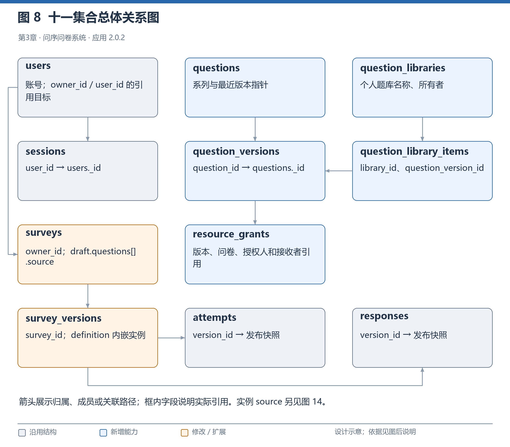
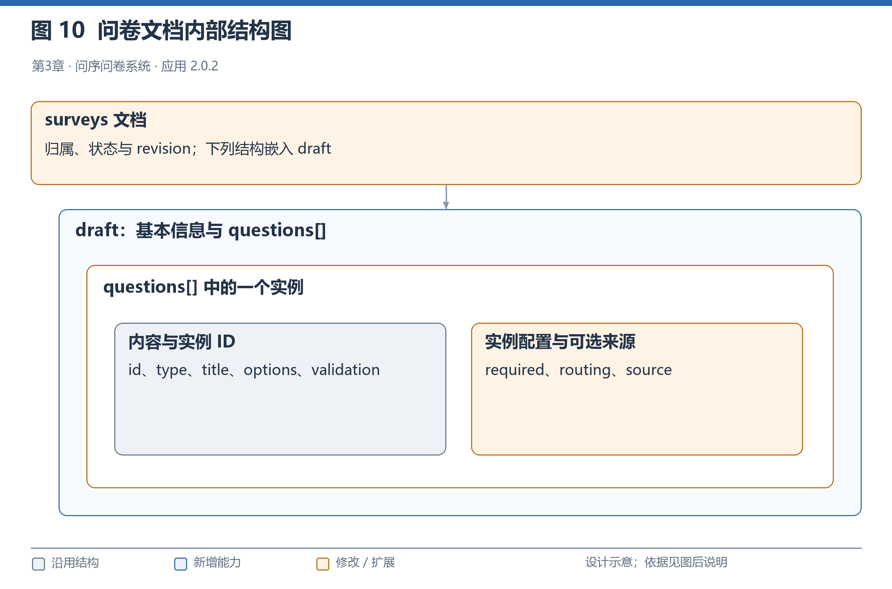
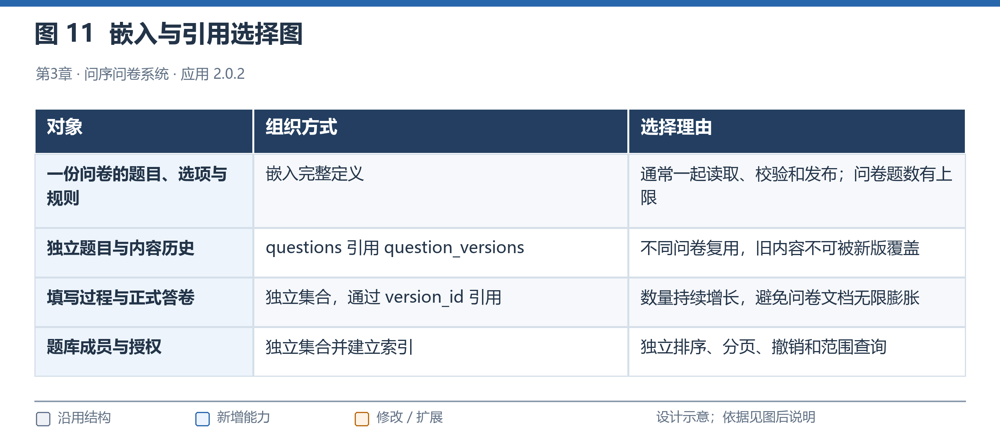
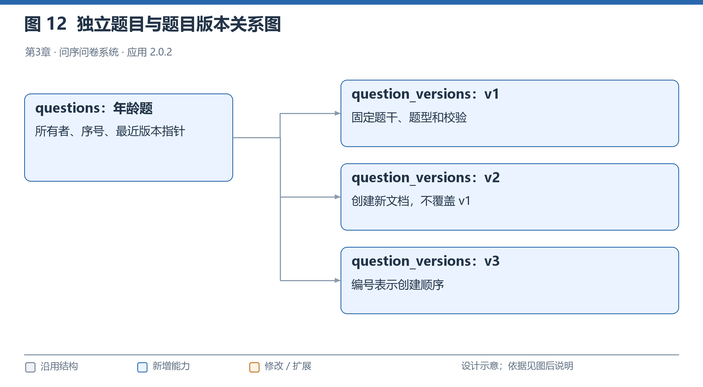
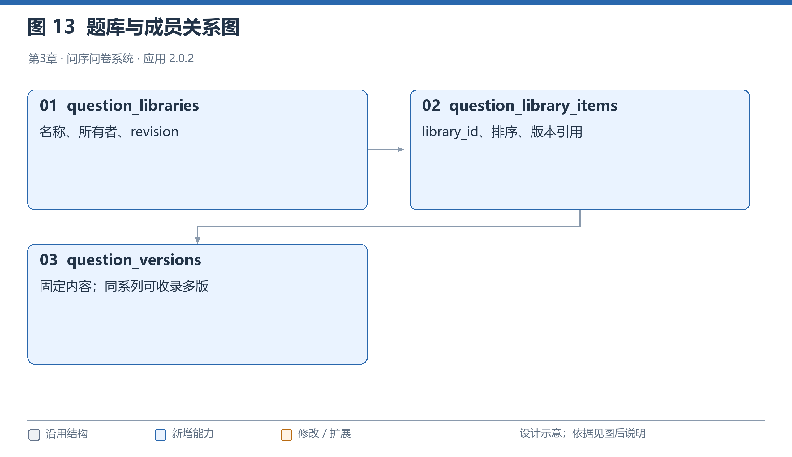
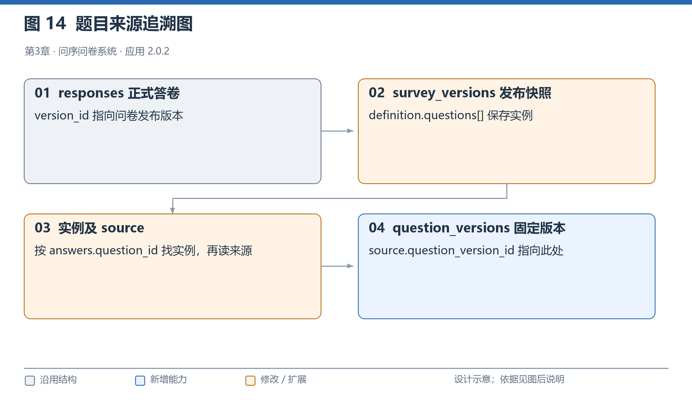
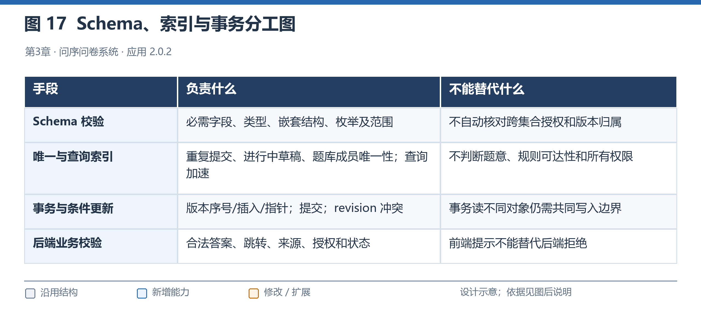

# 第二阶段 MongoDB 数据库设计

## 一、业务需求与设计目标

数据库设计首先要回答：系统经常读取什么、修改什么，以及哪些内容必须长期保持不变。

第一阶段主要围绕一份问卷的创建、发布、填写和统计组织数据。第二阶段增加常用题、版本、共享、题库和跨问卷统计，需要在原结构上补充题目的独立身份、来源和权限。

| 业务场景 | 主要读取 | 主要写入 | 必须保证的事情 |
|---|---|---|---|
| 编辑问卷 | 当前草稿、题目来源版本 | 问卷草稿 | 不能伪造来源或覆盖其他页面的新修改 |
| 发布问卷 | 完整草稿、来源和规则 | 发布快照、问卷状态 | 不能改变旧发布内容 |
| 填写与恢复 | 开始时绑定的发布快照 | 填写过程 | 不随题库最新版中途换题 |
| 正式提交 | 服务端已保存输入、原快照 | 正式答卷、过程终态 | 完整校验，避免重复或部分提交 |
| 管理常用题 | 题目系列和版本历史 | 新版本、最近版本指针 | 旧内容保留，版本号唯一 |
| 共享与导入 | 确定版本、当前授权 | 授权、协调记录、问卷实例 | 正确处理撤销与导入并发 |
| 管理题库 | 题库和成员版本 | 成员、排序、题库修订号 | 不重复收录，不扩大授权 |
| 使用查询与统计 | 草稿、发布快照、正式答案 | 通常只查询 | 先确定权限，明确计数口径 |

由这些访问方式确定三个设计目标：

1. **保留历史解释。** 过去的问卷和答案始终能够找到当时使用的内容。
2. **控制数据增长。** 答卷、版本、成员和授权分别保存，避免一个文档无限扩大。
3. **控制修改范围。** 修改题目、撤销授权或整理题库，不应直接改变其他问卷和旧答案。

## 二、第一阶段模型与第二阶段变化

### 2.1 第一阶段保留了什么

第一阶段已有六个集合：

| 集合 | 保存内容 |
|---|---|
| `users` | 用户账号与密码哈希 |
| `sessions` | 登录会话摘要与过期时间 |
| `surveys` | 问卷归属、草稿、状态及修订信息 |
| `survey_versions` | 发布时的完整问卷定义 |
| `attempts` | 尚未正式提交的输入和填写进度 |
| `responses` | 正式答案、实际路径和提交信息 |

这些集合继续使用。原来的完整发布快照、自动保存、恢复、跳转和提交事务，仍然是第二阶段的基础。

### 2.2 原设计缺少什么

第一阶段的题目属于具体问卷，题目 ID 主要用于区分问卷内部的题目。

这样可以知道旧问卷当时问了什么，却不能可靠判断不同问卷中的两道题是否采用同一个常用题版本。仅凭题干相同或局部 ID 相同，不能认定它们是同一道题。

第二阶段因此新增五个集合：

| 新集合 | 解决的问题 |
|---|---|
| `questions` | 为常用题提供稳定身份和所有者 |
| `question_versions` | 保存每次固定内容和演进关系 |
| `question_libraries` | 管理个人题库信息 |
| `question_library_items` | 管理题库收录的确定版本和排序 |
| `resource_grants` | 分开记录使用授权与统计授权 |

总计十一集合。问卷实例增加可选的 `source`，正式答卷和填写过程不增加重复来源字段。



**图 8 十一集合总体关系图**

图中的引用由后端维护。MongoDB 不会自动把这些 ID 当作关系数据库外键，版本归属、目标存在性和权限仍要由程序检查。

### 2.3 八项需求怎样落到数据结构

| 编号 | 需求 | 对应设计 |
|---|---|---|
| R01 | 保存常用题 | 独立系列与题目版本 |
| R02 | 共享题目 | 指定版本、接收者和用途的授权 |
| R03 | 修改不影响旧问卷 | 实例保留内容，发布保留完整快照 |
| R04 | 历史、比较和恢复 | 父版本与恢复来源分别记录 |
| R05 | 不同版本并存 | 系列、版本、实例分别标识 |
| R06 | 使用追踪 | 查询草稿及快照中的来源 |
| R07 | 题库管理 | 题库与独立成员集合 |
| R08 | 跨问卷统计 | 答卷关联原快照，再匹配实例来源 |

应用版本 `2.0.2` 与文档中的 `schema_version=1` 含义不同。前者表示程序发布版本，后者表示数据格式标识，不能看到格式号仍为 1 就认为没有进行结构扩展。

## 三、核心对象与标识怎样区分

| 对象 | 通俗解释 | 主要标识 |
|---|---|---|
| 题目系列 | 同一道常用题的整体记录 | `question_id` |
| 题目版本 | 某次保存下来的固定内容 | `question_version_id` |
| 问卷实例 | 题目在问卷中的一次具体使用 | 问卷内题目 `id` |
| 问卷发布版本 | 某次发布的完整问卷内容 | `version_id` |
| 填写过程 | 尚未正式提交的输入与进度 | `attempt` |
| 正式答卷 | 一次校验通过的提交 | `response` |

例如，年龄题 v1 可以放进问卷 A、问卷 B，也可以在问卷 A 中使用两次。它们的来源版本相同，但实例 ID 不同。

需要特别注意：正式答案中的 `question_id` 指向问卷实例，不是独立题目系列。

主要文档 ID 由服务器生成，现有生成方式使用 24 位十六进制字符串；题目实例、选项及示例中的标识仍以各字段的实际约束为准，不能笼统要求全部 ID 都是这种形式。

时间使用 BSON Date 保存，按 UTC 处理。JSON 示例中的 `$date` 是 Extended JSON 表达方式，普通字符串不能直接等同于数据库日期类型。

## 四、为什么这样拆分、嵌入与引用

### 4.1 一起使用的内容嵌入保存

编辑、发布和填写通常需要同时读取题目、选项、校验及跳转，因此继续把它们放在问卷定义中。



**图 10 问卷文档内部结构图**

问卷实例保存内容、必答与跳转，`source` 只补充来源，不替代内容。这样，填写不需要动态读取题库最新版。

### 4.2 独立管理和持续增长的数据分别保存

| 数据选择 | 为什么这样做 | 带来的代价 |
|---|---|---|
| 题目系列与版本分开 | 管理信息可变，历史内容需要保留 | 创建版本时需要维护序号和指针 |
| 发布快照独立保存 | 旧答案必须按旧内容解释 | 有目的地保存完整定义副本 |
| 答卷独立保存 | 数量随填写持续增加 | 查询时需要关联问卷和版本 |
| 题库与成员分开 | 成员需要分页、排序和更新 | 读取成员需要额外查询 |
| 授权独立保存 | 可以单独授予、撤销和核对 | 并发导入需要协调写入 |
| 使用情况直接查询 | 避免维护第二套使用缓存 | 大数据下查询代价需要测量 |



**图 11 嵌入与引用选择图**

本项目采用组合方式，而不是全部嵌入或全部引用。题库成员、答案和历史不会无限堆进一个大文档；需要稳定读取的完整问卷也不拆成大量零散记录。

## 五、为什么没有采用全关系式结构，为什么适合 MongoDB

关系数据库同样能够实现本系统。账号、授权和题库成员具有明确关系，可以拆表并使用外键；关系库加 JSON 保存问卷定义也是可行路线。

本项目继续使用 MongoDB，主要有三个原因：

1. **延续课程要求和第一阶段实现。** 第二阶段的任务是在原系统上扩展，更换数据库会扩大改动范围。
2. **适合表达嵌套和不同题型。** 选择题有选项，数字题有范围，文本题有长度限制，跳转还包含组合条件。
3. **适合按完整版本读取。** 发布时保存整份定义，填写和解释历史答案时读取对应快照。

全关系式拆分可以提供成熟的关系约束，但完整定义和历史版本通常需要关联或组装。本项目选择文档模型，是访问方式与维护成本的取舍，不代表关系数据库做不到。

同时，使用 MongoDB 不等于放弃结构约束。跨问卷统计也有 `$lookup` 等关联成本。当前没有大型性能基准或 `explain` 分析，不声称 MongoDB 比关系数据库更快，也不声称全部查询都已优化。

## 六、五个新增集合的字段与用途

以下说明字段的业务含义。精确 BSON 类型、必需性和限制，以提交的 Schema 为准。

五个新集合顶层采用严格字段约束。允许为 `null` 的字段仍需要按结构要求出现；“可为空字符串”和“可为 null”也要区分。

### 6.1 questions：题目系列

| 字段 | 用途 |
|---|---|
| `_id` | 系列 ID |
| `owner_id` | 题目所有者 |
| `title` | 最近创建版本的题干缓存，用于自有管理 |
| `latest_version_id` | 最近创建的版本 |
| `version_seq` | 已分配版本序号 |
| `revision` | 用户编辑冲突检查 |
| `archived` | 是否归档 |
| `activity_seq` | 并发协调字段 |
| `created_at`、`updated_at` | 创建和修改时间 |
| `schema_version` | 文档格式标识，当前为 1 |

`revision` 用于判断用户请求是否过期，`activity_seq` 用于建立相关操作的共同写入边界，二者职责不同。

`latest_version_id` 只是最近版本指针，不是所有问卷的自动升级目标。

### 6.2 question_versions：固定内容版本

| 字段 | 用途 |
|---|---|
| `_id` | 版本 ID |
| `question_id` | 所属系列 |
| `version` | 系列内创建序号 |
| `parent_version_id` | 直接父版本，初版为 null |
| `restored_from_version_id` | 恢复内容来源，普通版本为 null |
| `content` | 题型、题干、选项和校验 |
| `change_note` | 修改说明，允许空字符串 |
| `created_by`、`created_at` | 创建人和时间 |
| `schema_version` | 文档格式标识 |

`content` 只包含 `type`、`title`、`options`、`validation`，不包含问卷专属的必答和跳转。



**图 12 独立题目与题目版本关系图**

父版本和恢复来源必须属于同一系列。旧内容不可变由应用入口和服务流程保证，不承诺管理员直接写库也无法修改。

### 6.3 question_libraries：个人题库

| 字段 | 用途 |
|---|---|
| `_id`、`owner_id` | 题库身份和所有者 |
| `name` | 名称，1～200 字符 |
| `description` | 说明，最多 2000 字符，可为空字符串 |
| `revision` | 题库修改冲突检查 |
| `created_at`、`updated_at` | 创建和修改时间 |
| `schema_version` | 文档格式标识 |

题库属于个人，不提供团队管理或转授权能力。

### 6.4 question_library_items：题库成员

| 字段 | 用途 |
|---|---|
| `_id` | 成员 ID |
| `library_id` | 所属题库 |
| `question_id` | 所属题目系列 |
| `question_version_id` | 收录的确定版本 |
| `position` | 排序值，0～100000 |
| `created_at` | 加入时间 |
| `schema_version` | 文档格式标识 |



**图 13 题库与成员关系图**

同库同确定版本唯一，同系列不同版本可以并存。更新成员不改变已经导入问卷的实例。

### 6.5 resource_grants：资源授权

| 字段 | 用途 |
|---|---|
| `_id` | 授权 ID |
| `kind` | `use` 或 `aggregate` |
| `question_version_id` | 授权涉及的确定版本 |
| `survey_id` | use 为 null；aggregate 指定问卷 |
| `grantor_id`、`grantee_id` | 授予者和接收者 |
| `active` | 当前是否有效 |
| `revision` | 授权修改冲突检查 |
| `activity_seq` | 并发协调字段 |
| `created_at`、`updated_at` | 创建和修改时间 |
| `schema_version` | 文档格式标识 |

使用授权由题目所有者授予；汇总授权由问卷所有者授予，并要求问卷实际发布使用过该版本。

撤销保留记录，用于解释原合法导入依据；重新授权可以沿用记录并增加修订号，但不因此开放未来版本。

## 七、原集合怎样变化，来源怎样追溯

### 7.1 原结构的变化

| 对象 | 第二阶段处理 |
|---|---|
| 问卷草稿题目 | 增加可选来源结构 |
| 新发布快照题目 | 可以保存来源，旧快照不回写 |
| 问卷管理信息 | 增加草稿问题提示等扩展 |
| `attempts` | 保留原结构和快照绑定 |
| `responses` | 保留原答案结构，不冗余来源 |

`draft_issues` 是编辑提示，发布时仍重新完整检查，不能将提示为空当作发布依据。

### 7.2 source 保存什么

| 字段 | 含义 |
|---|---|
| `question_id` | 来源系列 |
| `question_version_id` | 来源确定版本 |
| `version` | 来源版本序号 |
| `survey_id` | 此次导入所属问卷 |
| `instance_id` | 此次导入所属实例 |
| `imported_by`、`imported_at` | 导入人和时间 |
| `grant_id` | 当时的使用授权；自有题通常为 null |

这些字段由后端生成，绑定原问卷和原实例，不是可复制到任意位置的通用授权凭据。

### 7.3 为什么答案不重复保存来源



**图 14 题目来源追溯图**

正式答案仍可表示为：

```json
{
  "question_id": "age_local",
  "value": 25
}
```

`age_local` 是实例 ID。先用答卷的 `version_id` 找到发布快照，再找到该实例及其 `source`，即可追溯独立题目版本。

这样减少第二套来源维护。没有 source 的旧题不强行关联；填写者读取定义时去掉内部来源，服务端仍保留完整快照。

## 八、Schema、索引和应用校验怎样分工

Schema 可以理解为“文档必须按什么格式保存”的规则，包括字段是否必需、类型、枚举、长度和数值范围。

例如：

- 问卷题目数组最多 100 项。
- 跳转规则数组最多 20 项。
- 来源存在时必须满足对应结构。
- 正式答案项需要实例 ID 和值。
- 填写状态只能取允许的枚举。
- 部分新集合禁止未知顶层字段。

字段表中的“父对象存在时必填”，表示父对象出现后，其必需子字段必须齐全。旧题可以没有来源，但不能保存一个缺少关键字段的来源。



**图 17 Schema、索引与事务分工图**

| 机制 | 负责什么 | 不能单独证明什么 |
|---|---|---|
| Schema | 文档结构、类型和适用范围 | 用户权限、来源真实、引用存在 |
| 唯一索引 | 重复版本、重复成员、重复提交等唯一性 | 题意及跳转规则是否合法 |
| 事务 | 关联写入一起完成或撤销 | 不同对象之间的竞争一定产生冲突 |
| 后端校验 | 所有权、授权、版本关系、可作答性和规则 | 不能取消数据库唯一性保护 |
| 前端提示 | 帮助用户及时改错 | 不能作为安全边界 |

数据库允许的通用数值范围可能比某类业务参数宽，后端仍需执行更具体的限制。例如，结构合法的整数范围不一定包含合法答案。

精确约束见 [collection_validators.json](../1_代码/database/collection_validators.json)，索引见 [indexes.json](../1_代码/database/indexes.json)。

## 九、索引、事务与并发处理

### 9.1 完整索引安排

系统共有 22 个显式索引，不包含各集合自动创建的 `_id` 索引。

| 集合 | 索引名 | 字段顺序 | 主要作用 |
|---|---|---|---|
| users | username_unique | username_key | 用户名唯一 |
| sessions | session_token_unique | token_hash | 会话摘要唯一 |
| sessions | session_expiry | expires_at | TTL 清理 |
| surveys | owner_created | owner_id、created_at 降序 | 所有者问卷列表 |
| surveys | share_unique | share_code | 分享码唯一 |
| surveys | draft_question_source | draft.questions.source.question_id | 草稿使用查询 |
| survey_versions | survey_version_unique | survey_id、version | 发布版本唯一 |
| survey_versions | published_question_version | definition.questions.source.question_version_id、survey_id | 发布来源查询 |
| responses | survey_statistics | survey_id、version、submitted_at 降序 | 整卷统计 |
| responses | attempt_unique | attempt_id | 同次提交唯一 |
| responses | respondent_lookup | survey_id、respondent_key | 重复填写检查 |
| attempts | one_active_attempt | survey_id、respondent_key | 进行中过程部分唯一 |
| attempts | attempt_owner_updated | respondent_key、updated_at 降序 | 填写过程查询 |
| questions | question_owner_updated | owner_id、updated_at 降序 | 常用题列表 |
| question_versions | question_version_unique | question_id、version | 题目版本唯一 |
| question_versions | question_parent | parent_version_id | 父版本查询 |
| question_libraries | library_owner_updated | owner_id、updated_at 降序 | 题库列表 |
| question_library_items | library_version_unique | library_id、question_version_id | 成员唯一 |
| question_library_items | library_position | library_id、position、_id | 成员排序 |
| resource_grants | resource_recipient_unique | kind、question_version_id、survey_id、grantee_id | 同范围授权唯一 |
| resource_grants | received_active | grantee_id、active | 接收授权查询 |
| resource_grants | granted_by | grantor_id、updated_at 降序 | 发出授权查询 |

`one_active_attempt` 只对 `in_progress` 记录生效，不限制已完成过程的历史数量。TTL 清理不是瞬时执行，因此应用仍需检查会话是否过期。

索引有存储和写入成本。当前未执行完整性能基准，不能把建立索引写成已经证明所有查询高效。

### 9.2 版本创建保持原子性

创建版本先核对归属、归档、修订号、父版本和内容，再在事务中完成序号、版本和最近指针的写入。

相同 revision 并发创建时，只允许一方成功，另一方返回 409。客户端需要刷新后重新决定操作，不自动更换父版本重放用户意图。

### 9.3 导入与撤销建立共同写入边界

导入事务会条件更新题目协调字段；共享题还会更新有效授权记录，再按问卷 revision 写实例。归档修改题目，撤销修改对应授权，从而形成共同冲突边界。

冲突重试后重新读取状态：

- 导入先成功，原实例保留既有使用权。
- 撤销或归档先成功，未完成的新导入被拒绝。

只读授权、写另一个问卷文档，并不能保证竞争被正确处理。

### 9.4 既有实例与新增使用分别判断

普通保存核对原来源及版本内容，不把撤销理解成删除所有既有使用。但新增导入和版本升级仍检查当前授权。

导入、升级和解除均使用专门接口。来源操作更新问卷修订号，与其他保存发生冲突时不能覆盖较新内容。

## 十、使用查询与统计怎样计算

### 10.1 使用问卷数

查询当前草稿和发布历史中的来源，再按问卷 ID 去重。

“历史发布”包含当前发布，因此分类可以重叠。同一问卷发布三次仍然只算一份使用问卷。

用户查看自己的明细；题目所有者按权限查看外部脱敏数量；共享接收者只查询自己的使用，其他无权用户被拒绝。不因隐藏标题就允许读取全部信息。

当前通过查询计算，没有使用缓存。大数据下的查询和内存代价留待测量。

### 10.2 跨问卷统计路径

```text
确定题目版本
    → 确定自有或获授权问卷
    → 查找发布引用
    → 筛选正式提交时间
    → 关联答卷自己的发布快照
    → 匹配来源实例与答案
    → 分别计算份数、条数和分布
```

实现使用 `$match` 限定范围，通过 `$lookup` 找到快照，再筛出来源版本匹配的实例，展开答案后保留匹配实例且非空的值。

同一次聚合中的不同分支分别计算答卷数、作答数、有作答问卷数，以及选项或数字结果。

| 指标 | 计算方式 |
|---|---|
| `coverage_surveys` | 授权范围内曾发布引用该版本的问卷数，包括零作答问卷 |
| `answered_surveys` | 时间筛选后实际有该版本有效作答的问卷数 |
| 有效答卷数 | 正式答卷 ID 去重 |
| 有效作答数 | 匹配实例答案条数 |
| 多选比例 | 选项次数除以有效作答条数 |
| 时间范围 | 正式提交时间，包含起止边界 |

使用问卷数还可能包含草稿，权限口径也不同，不能与统计覆盖问卷数混用。

### 10.3 权限与解释边界

汇总只针对同一确定版本、自有或有效授权问卷。题目所有权不自动带来他人答案读取权。

授权按请求检查，撤销后的新请求排除该范围，不承诺追回已经返回的数据。结果是汇总，不包含他人原始文本、跨版本合并或跨问卷去重人数。

不同问卷的必答和跳转配置可能影响样本，因此总体分布还应结合使用背景解释，不能直接当作无偏总体推断。

## 十一、数据库迁移与旧数据兼容

第一阶段的已知旧校验器随代码保留，升级采用明确路径，而不是运行时猜测。

处理顺序为：

1. 保存基线并备份业务数据和约束。
2. 在维护窗口停止相关写入。
3. 全量预检旧文档是否满足目标约束。
4. 保存原约束、目标和应用进度。
5. 逐集合应用已有约束的变化。
6. 初始化缺失集合并确保索引存在。
7. 检查旧数据读取及原功能。

普通启动只检查一致性，不静默覆盖旧约束。原业务文档不需要为本轮升级批量重写。

发生普通失败时依据日志尝试恢复；进程中断后可显式恢复。但 DDL 不是跨集合原子事务，日志不能替代完整备份，失败后也不会随意删除遗留空集合。

如果已产生第二阶段题目或来源数据，程序拒绝仅恢复旧约束，需要依据维护前完整备份处理。测试必须使用真正不含新来源的第一阶段样本，不能把混合新数据的数据库称为纯旧样本。

更新时还应保留原 `SECRET_KEY`。从 2.0.1 更新到 2.0.2 没有本轮数据库结构变化，不需要重复迁移。

## 十二、验证结果、实际代价与未验证范围

已有验证包括：

- 错误结构直接写库被拒绝。
- 来源与内容篡改被拒绝。
- 版本并发与插入失败回滚。
- 导入与撤销、归档的两种提交顺序。
- 旧快照不变，旧填写过程在新版发布后继续提交。
- 重复实例统计、权限撤销和私密标题保护。
- 第一阶段样本升级、读取及降级保护。

当前业务测试记录仍为 154 后端、90 组件、16 逻辑，共 260 项，文档整理不增加数量。

实际代价包括版本和快照副本、索引写入成本、来源一致性核对，以及统计关联查询。没有执行大型容量测试、全面 `explain`、跨版本语义识别、团队权限或多节点容灾验证，不将这些写成已经完成。

## 十三、完整示例与核对入口

材料示例使用临时数据库，完成题目 v1/v2、题库、共享、导入、发布、开始旧过程、升级发布和旧过程提交。

已有记录中，旧过程提交 25 后仍归属原发布版本；v1 有效作答数为 1、均值为 25，v2 覆盖问卷数为 1、有效作答数为 0。

十一集合脱敏样本还按当前 Schema 真实写入核对，缺字段文档被拒绝。临时库已清理，这些属于材料示例验证，不增加 260 项业务测试总数。

| 核对内容 | 文件入口 |
|---|---|
| 完整集合 Schema | [collection_validators.json](../1_代码/database/collection_validators.json) |
| 完整索引定义 | [indexes.json](../1_代码/database/indexes.json) |
| 十一集合完整样本 | [MongoDB设计示例.json](../3_测试用例/测试证据/MongoDB设计示例.json) |
| 样本写库核对 | [MongoDB设计核对.json](../3_测试用例/测试证据/MongoDB设计核对.json) |
| 可重复调用链 | [API调用链示例.py](../3_测试用例/测试证据/API调用链示例.py) |
| 调用输入输出记录 | [API调用链执行记录.json](../3_测试用例/测试证据/API调用链执行记录.json) |
| 测试步骤与实际结果 | [测试用例与结果](../3_测试用例/测试用例与结果.md) |

2.0.1 主要修复数字边界、页面入口、题库分页和搜索；2.0.2 主要修复升级上下文、统计乱序和成员更新交互。两次修订均未新增数据库集合、字段、索引或校验器，也未要求重写旧问卷、答卷和填写过程。