# 基于MongoDB的问卷系统第二阶段项目完成报告

课程：当代数据管理系统（Contemporary Data Management Systems）  
系统：问序问卷系统  
应用版本：2.0.2  
基线版本：第一阶段1.1.0  
项目方式：在第一阶段代码上继续修改和扩展，保留原主要功能和材料。  

## 一、项目目标

### 1.1 需求来源与总体目标

第一阶段已经实现问卷创建、编辑、发布、填写、提交和统计，并支持按回答跳转、自动保存与退出后恢复。

第二阶段要求在原系统上继续扩展，使题目能够独立保存、共享、修改和复用，同时增加版本历史、题库整理、使用查询和跨问卷统计。扩展过程中，需要保留第一阶段的主要功能和核心结构，不能重新开发一套系统替代原系统。

本阶段的总体目标包括：

1. **让题目能够重复使用。**  
   同一道年龄题、工具题等可以保存为常用题，再导入不同问卷，减少重复编辑。

2. **让修改过程能够追溯。**  
   保存题目的不同版本，支持比较、分支和历史恢复，能够说明每次内容怎样变化。

3. **保护已有问卷和历史答案。**  
   题目产生新版后，已经采用旧版的问卷不自动改变，原填写过程和正式答案继续按原内容解释。

4. **明确共享和统计权限。**  
   区分“允许使用题目”和“允许查看问卷汇总”，避免题目共享导致答案数据被越权访问。

5. **证明扩展后旧功能仍然可用。**  
   保留原有回归测试，并补充版本、权限、兼容、并发和页面交互测试。

系统同时服务问卷创建者和填写者，整体功能见图 1。

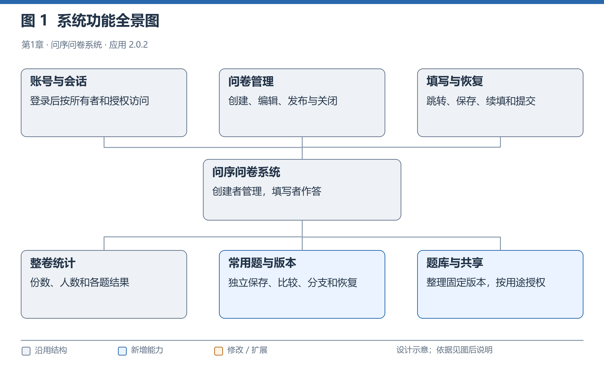

**图 1 系统功能全景图**

灰色部分是第一阶段已有能力，蓝色部分是第二阶段新增能力。原来的账号、问卷、填写和统计继续使用，新功能主要围绕可复用题目的管理展开。

### 1.2 核心概念、功能范围与验收方式

#### 1.2.1 核心概念

为了避免混淆，先区分以下六个对象。

| 概念 | 通俗解释 | 主要标识 |
|---|---|---|
| 题目系列 | 同一道常用题的整体记录，例如“年龄题” | `question_id` |
| 题目版本 | 这道题某一次保存下来的固定内容，例如年龄题 v1、v2 | `question_version_id` |
| 问卷实例 | 题目放进某份问卷后的具体一次使用 | 问卷内题目 `id` |
| 问卷发布版本 | 问卷发布时保存的完整内容，也叫发布快照 | `version_id` |
| 填写过程 | 记录尚未正式提交的输入和进度，用于恢复 | `attempt` |
| 正式答卷 | 完整校验通过后保存的一次正式提交 | `response` |

例如，同一个年龄题 v1 可以导入问卷 A 和问卷 B，形成两个不同实例。两份问卷可以分别设置必答和跳转；发布后，各自保存完整快照。填写者提交的答卷再关联相应的问卷发布版本。

因此，“题目版本”和“问卷发布版本”是两种不同的版本，后文分别说明。

#### 1.2.2 八项需求与验收方式

| 编号 | 需求 | 本阶段实现目标 | 主要验收内容 |
|---|---|---|---|
| R01 | 保存常用题 | 支持独立创建，以及从自有问卷保存题目 | 创建、另存、来源关联及历史答案不自动合并 |
| R02 | 共享题目 | 向指定账号授予确定版本的使用权 | 双账号隔离、撤销、未来版本不可见及禁止越权转授 |
| R03 | 修改不影响已有问卷 | 使用固定题目版本和完整发布快照 | 旧快照不变，旧填写过程仍按原版提交 |
| R04 | 历史、比较与恢复 | 查看修改历史、比较内容并恢复历史版本 | 父版本、恢复来源、分支和旧内容保留 |
| R05 | 不同版本并存 | 不同问卷或题库成员可以保留不同版本 | 不自动替换，不混合不同版本统计 |
| R06 | 使用追踪 | 查询草稿、当前发布和历史发布中的使用情况 | 按问卷去重，保护他人私密标题和详情 |
| R07 | 题库管理 | 支持个人题库、成员、排序、更新和移除 | 成员唯一性、修订冲突、分页、搜索及授权检查 |
| R08 | 跨问卷统计 | 汇总同一确定版本在有权限问卷中的回答 | 答卷数、作答条数、分布、均值及统计授权 |

这里的验收方式同时包括接口、数据库和前端组件检查。具体结果与尚未完成的人工验收在第七章说明，不能只凭功能存在就认定全部使用场景已经验证。

#### 1.2.3 本阶段的范围边界

本阶段采用以下约定：

- **不同题目版本分别统计。** 不因题型或选项 ID 相同，就自动认定它们可以合并。
- **统计范围受权限限制。** 题目作者不会因为他人使用了自己的题，就自动获得对方问卷的答案访问权。
- **旧题目继续可用。** 没有独立来源的第一阶段题目可以继续运行，但不会自动加入新常用题的历史统计。
- **复杂扩展后置。** 跨问卷去重人数、跨版本合并、旧答卷人工关联、共享题派生与转授、团队题库权限及公网部署不属于本轮范围。

以上约定需要在报告和验收演示中说明，避免把“有权限范围内的汇总”写成能够无条件查看所有问卷的数据。

### 1.3 新需求带来了哪些问题

第一阶段的题目保存在各自问卷中，适合设计和发布一份完整问卷。但当题目需要跨问卷使用时，原有结构还需要补充以下能力。

**第一，复制内容不能代替来源管理。**  
如果几份问卷分别复制同一道题，系统无法可靠判断它们是不是同一道常用题，也就难以查询使用情况或汇总答案。为此，需要独立的题目身份和明确的来源记录。

**第二，新修改不能改变旧答案的含义。**  
假设年龄题已经被两份问卷采用，其中一份已经有人开始填写。此时作者修改题干，系统必须知道哪些问卷继续使用旧版、哪些主动升级，以及过去的答案对应哪次内容。

**第三，允许使用题目不等于允许读取数据。**  
共享接收者可以把题目用于自己的问卷，但不应因此获得其他问卷的答案。题目使用权与统计访问权需要分别设计。

**第四，旧功能必须与新结构同时工作。**  
第一阶段没有题目来源字段，旧问卷、旧发布快照和旧填写过程仍应继续使用。新增结构不能强迫旧数据补齐未知来源，也不能直接改写历史答案。

**第五，更新和撤销可能与其他操作同时发生。**  
多人操作、多个页面以及请求先后返回，都可能造成状态冲突。例如预览后切换题目、导入时撤销授权、切换版本后收到旧统计结果，都需要明确处理。

因此，第二阶段需要同时实现题目复用、历史保护、权限隔离和旧功能兼容。后续设计围绕这些问题展开。

### 1.4 修改过程与后续章节的对应关系

报告需要说明的八项“修改过程”，与前面的八项“功能需求”是两组不同内容。

功能需求使用 R01～R08 编号；修改过程则按下面的顺序说明。

| 必须说明的内容 | 报告中的主要位置 |
|---|---|
| 第一阶段的设计是什么 | 第二章 2.1 |
| 新需求带来了哪些问题 | 第一章 1.3、第二章 2.2 |
| 为什么需要修改原设计 | 第二章 2.3 |
| 修改了哪些部分 | 第二章 2.6 |
| 数据结构如何变化 | 第三章 |
| 程序如何调整 | 第二章 2.7～2.8及关键逻辑说明 |
| 是否遇到兼容性问题 | 第八章 |
| 如何保证旧功能仍然可用 | 第七章 7.4及第九章 |

八项功能需求的具体修改链集中在第二章 2.8，顺序与 R01～R08 一致。图 2 展示需求、设计和验证之间的对应关系。

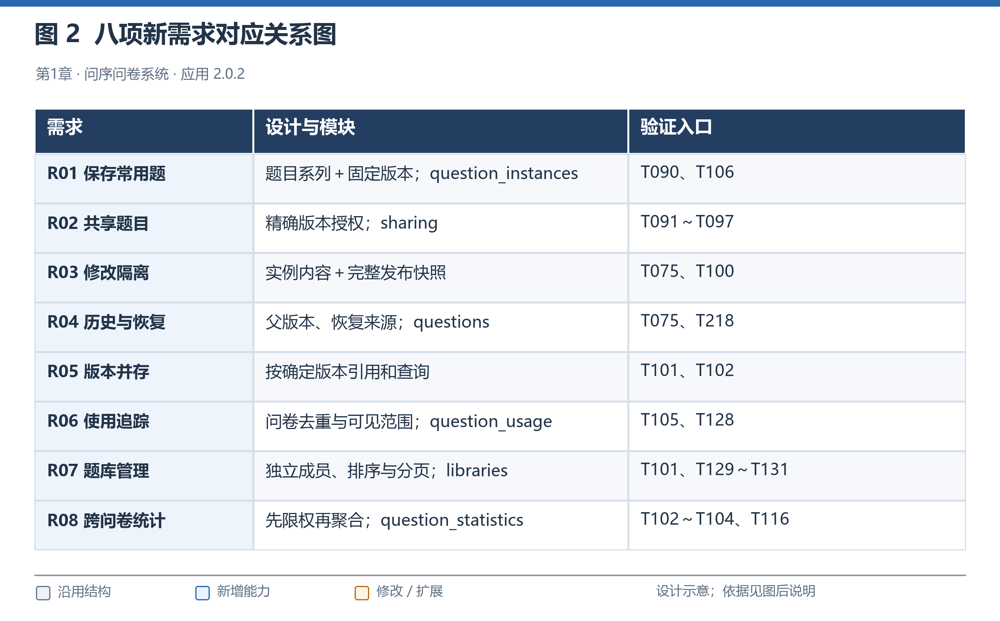

**图 2 八项新需求对应关系图**

一项设计可以支持多个需求。例如，固定版本既支持版本并存，也保护历史答案；来源记录既支持复用，也为使用查询和跨问卷统计提供依据。

后文的 `T001～T260` 是自动测试索引编号；测试文档中的“场景 T01”等是业务场景编号，两者分别使用，不按编号或场景行数重复累计测试数量。

完整对应关系见[需求设计实现验证对照](../3_测试用例/测试证据/需求设计实现验证对照.json)，具体测试名称和执行依据见[逐项测试索引](../3_测试用例/测试证据/逐项测试索引.json)。
## 二、系统设计

### 2.1 第一阶段的设计是什么

第一阶段采用Vue前端、FastAPI后端和MongoDB副本集。界面负责编辑和输入反馈，后端负责规则、权限、校验及事务，数据库负责持久化结构和唯一性。填写者通过应用访问数据，不需要直接连接MongoDB。

|原集合|保存什么|原有结构为何保留|
|---|---|---|
|users|账号及密码哈希|第二阶段仍使用同一账号归属体系|
|sessions|服务端会话摘要和过期时间|新接口复用登录依赖，不另建认证|
|surveys|问卷归属、草稿、状态、revision、当前发布号|仍是问卷编辑和发布的聚合根|
|survey_versions|完整definition、发布版本号和引擎版本|历史作答必须按原定义解释|
|attempts|原始输入、绑定发布版本、恢复位置、状态、revision|保留跨设备续填、冲突和原子提交|
|responses|正式答案、路径、提交时间、关联发布快照|保持原统计及匿名去重的解释基础|

每道题记录题型、题干、选项和校验条件，问卷再单独设置必答和跳转。填写时，程序根据答案决定下一题；发布前检查配置是否能正常作答，提交时再检查实际走到的必答题。以前填过但后来被跳过的答案会被清理。

自动保存允许不完整原始输入，正式提交才进行完整验证。attempt与response分离，避免把半份回答当成正式统计。发布快照与草稿分离，避免问卷编辑立即改变正在填写的内容。这些设计均继续使用。


图 3 从相同的三层结构出发，说明第一阶段已经具备哪些能力。

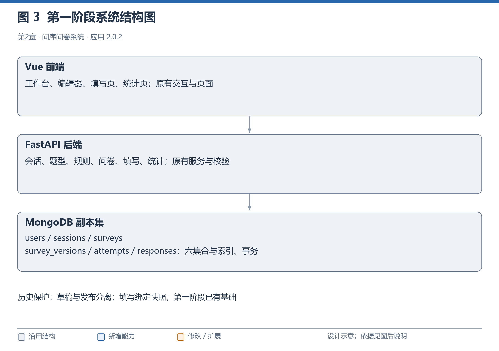

**图 3 第一阶段系统结构图**

前端通过后端访问数据库。发布快照、恢复填写和事务提交是后续扩展的基础。

核对依据：报告2.1、2.6；第一阶段至第二阶段文件变化.json。

### 2.2 新需求对原模型的压力

原系统已经保存了问卷发布时的完整内容，因此具备保护旧问卷的基础。现在缺少的是独立管理题目的办法：题目属于谁、有哪些版本、谁可以使用、被哪些问卷采用，都需要有明确记录。

这些信息不能仅靠问卷里的题目ID表达，因为这个ID只用来区分当前问卷中的题目。第二阶段保留原问卷结构，在旁边增加题目和授权管理，再把两部分连接起来。


对照图 3，图 4 标明第二阶段在各层增加和调整的内容。

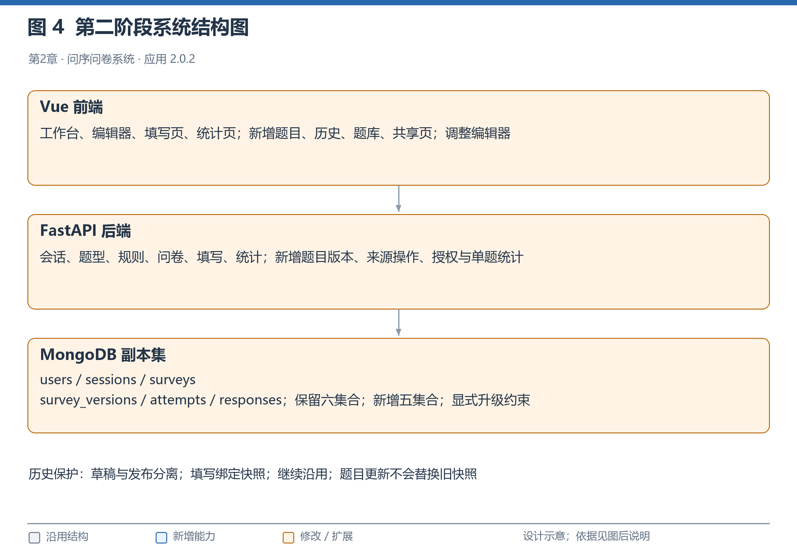

**图 4 第二阶段系统结构图**

第二阶段保留 Vue、FastAPI 和 MongoDB 核心结构，新增工作集中在题目管理与授权。原填写、规则和整卷统计继续复用。

核对依据：报告2.1、2.6；第一阶段至第二阶段文件变化.json。

### 2.3 为什么需要修改原设计：方案比较与总体选择

最直接的办法是增加一个复制题目的按钮，但这样只能复制内容，不能管理来源和版本。另一个办法是让所有问卷都读取常用题的最新内容，但这会带来更严重的问题：题目一改，旧问卷也跟着变，已经提交的答案可能失去原来的含义。

本项目选择保留发布时的完整内容。常用题修改后保存成新版本，已经采用旧版本的问卷不自动改变。问卷创建者需要主动选择新版本，检查是否影响跳转，再发布更新后的问卷。这样既能复用题目，也能沿用第一阶段保护历史内容的做法。

具体实现分成四层：先保存独立题目，再保存它的各个版本；导入问卷时复制所选版本的内容，并记下来源；问卷发布时继续保存整份定义。正式答卷仍关联问卷的发布版本，不另外复制一套题目来源。可选方案和代价的详细比较放在数据库设计文档中。


图 5 沿实际使用顺序串起一份问卷的完整过程。

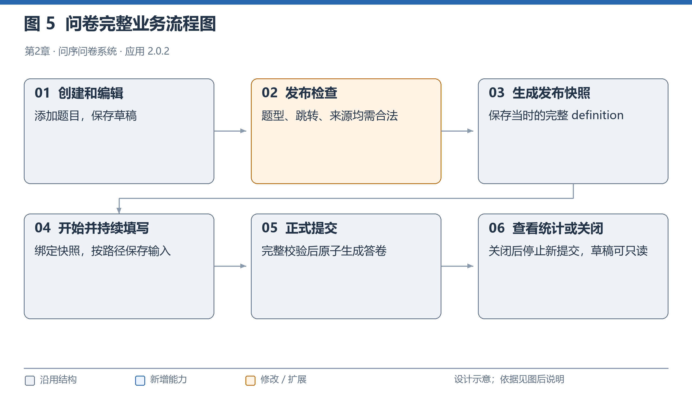

**图 5 问卷完整业务流程图**

编辑草稿和发布是两件事。修改草稿不会立即改变正在填写的内容，提交后的统计只读取正式答卷。

核对依据：services/surveys.py、attempts.py；报告2.7。

### 2.4 对象关系与标识

术语已在1.2定义。这里进一步说明对象之间如何关联。

```text
题目系列 → 题目版本 → 导入为问卷实例 → 发布为完整问卷快照
填写过程 --version_id--> 问卷发布版本 <--version_id-- 正式答卷
```

两个版本编号分别属于题目和问卷；填写与正式答案绑定问卷发布快照。共享授权作用于确定题目版本，汇总授权还限定问卷范围，不能从题目所有权推导答卷读取权。

### 2.5 版本与权限原则

题目每次修改都新增一个版本，不覆盖旧内容。用户可以基于旧版继续修改，也可以把历史内容恢复成一个新版本。版本号表示创建顺序，编号最大不代表其他问卷必须采用它。

共享也以某一个版本为单位。作者把v1共享给另一位用户，不会同时把以后创建的v2也共享出去。接收者可以使用获授权的版本，但不能通过另存、解除来源等操作把共享题变成自己的题目。

此外，使用题目和查看答卷是两种权限。题目作者不能因为别人采用了自己的题目，就自动看到对方问卷的数据。需要跨问卷统计时，由相应问卷的所有者另外授权。

### 2.6 修改了哪些部分

|模块|保留的职责|新增或调整的程序|
|---|---|---|
|认证与数据库基础|会话、连接、索引初始化、事务|新路由复用原依赖；通过显式迁移扩展约束|
|请求模型|原问卷与答案模型|增加题目内容、来源、版本、授权、题库操作模型|
|问卷服务|创建、保存、发布、关闭|保存及发布核对来源，增加专用实例操作|
|领域逻辑|题型与有限跳转引擎|question_versions处理内容/差异，question_sources核对来源|
|新增服务|原填写及问卷统计继续使用|questions、sharing、libraries、question_instances、question_usage、question_statistics|
|填写与提交|原状态机和事务|返回给填写者的定义移除内部来源字段|
|前端问卷编辑|原题型、规则、截止与保存保护|选题、来源只读、升级预览和确认|
|新增前端页面|原工作台、填写和统计|Questions、QuestionEditor、QuestionHistory、Libraries、Sharing、QuestionUsage、QuestionStatistics|
|测试和材料|原回归用例继续运行|新增版本、授权、兼容、统计和交互回归|

关键文件入口为backend/app/phase2_routes.py、schemas.py、services/surveys.py、domain/question_sources.py和services/question_instances.py；前端入口为views/Editor.vue及composables/useSurveyEditor.ts。本次比较排除README、清单与缓存：65个文件字节未变、19个修改、29个新增、0个删除。完整新增、修改和未变化清单见测试证据“修订差异/第一阶段至第二阶段文件变化.json”。

后端新增phase2_routes、question_versions、question_sources、questions/libraries/sharing/question_instances/question_usage/question_statistics，沿用原数据库、认证、异常、规则和题型处理器。前端新增题目管理、题目编辑、历史、题库、共享与单题统计页面，以及选题、共享、使用情况、内容编辑组件。

编辑器通过专门来源操作导入、预览升级、升级、允许的解除和保存常用题。来源操作锁定编辑区；普通保存与截止时间未发布提示沿用原保护机制。所有界面禁用只提供反馈，真正权限在后端检查。

### 2.7 程序如何调整

第一阶段的主要流程是：编辑题目，保存问卷草稿，发布，然后填写、提交和统计。第二阶段没有替换这条流程，而是在编辑前增加“创建或选择常用题”，在编辑时增加“导入和升级题目”。

导入时，后端读取用户选择的固定版本，生成新的问卷内题目，并记录它来自哪个系列和版本。此后，用户仍可为这道题设置必答、位置和跳转，但不能保留旧来源的同时直接改写题干或选项。内容变化应通过题目版本更新处理。

普通保存、发布和提交继续使用原服务。需要增加检查的地方主要是保存和发布：后端要确认来源没有被伪造，题目内容与所记录的版本一致。给填写者返回问卷时，则去掉内部的来源和授权信息。

后续的2.0.2修订还处理了几种页面操作问题。例如，预览A题的升级后再切换到B题，原确认必须失效；统计请求先后返回时，只能显示当前查询的结果。这些修改发生在编辑和查询环节，没有重写原填写与提交流程。

### 2.8 按R01～R08记录具体修改链

下面按八项需求说明具体做法。每项都从第一阶段的情况出发，再解释修改和验证；字段细节可查数据库文档。

#### 2.8.1 R01 保存常用题

第一阶段的一道题属于某份问卷，无法直接作为常用资源管理。第二阶段增加了独立题目和题目版本：前者记录所有者和最近版本，后者保存每次固定的题干、选项及校验。

新建常用题得到v1；从自己的问卷另存时，只提取题目内容，不带走问卷专属的必答和跳转。共享题不能借这个入口变成自己的题。旧题另存后，也只影响当前草稿，不会把过去的答案自动算到新常用题名下。相关测试检查了这些保存和拒绝情况。


保存常用题需要把题目内容与问卷专属配置分开，过程见图 6。

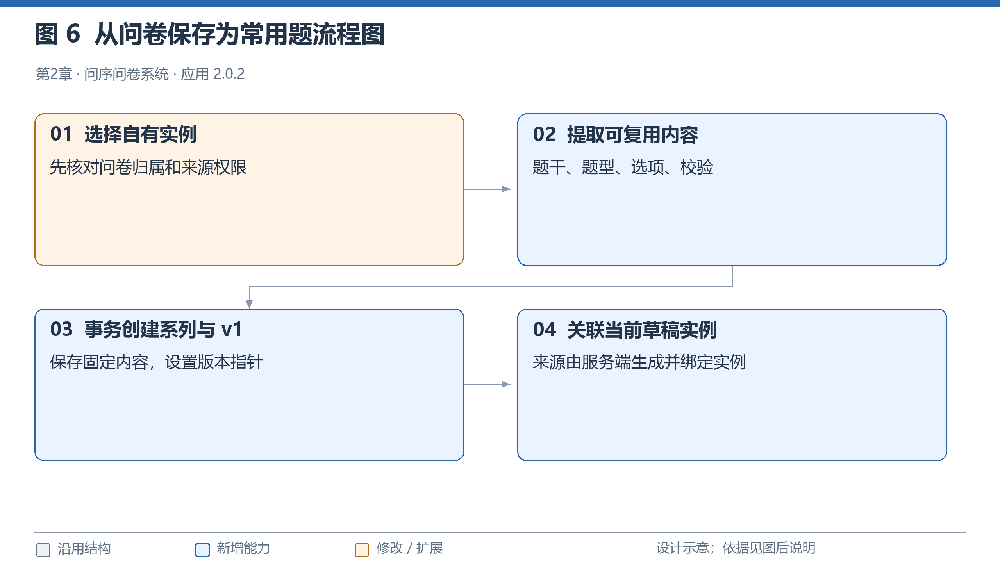

**图 6 从问卷保存为常用题流程图**

原问卷的必答与跳转不成为常用题内容；旧答卷也不自动归入新系列。来自他人的共享实例不能借此另存成自有题。

核对依据：services/question_instances.py；T090、T106。

#### 2.8.2 R02 共享给其他用户

共享的意思是允许另一个账号采用某个版本，而不是把题目和所有答案都交给对方。授权记录因此写明版本、接收者和用途，分别处理“使用题目”和“查看指定问卷的汇总统计”。

接收者只看到获授权版本，不能搜索到尚未共享的新版本。撤销后不能再新增导入，但撤销前已经合法导入的原实例继续可用。并发测试还分别检查了先导入、后撤销和先撤销、后导入的结果。


同一常用题版本可以有多次使用，图 7 以年龄题说明它们如何保持独立。

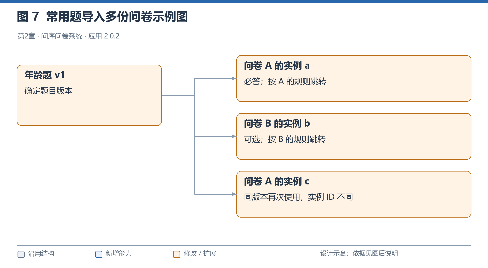

**图 7 常用题导入多份问卷示例图**

每次导入都有新的实例 ID，并保存当时内容。必答和 routing 属于实例；相同来源不意味着实例配置必须相同。

核对依据：services/question_instances.py；T090、T102。

#### 2.8.3 R03 修改不影响已有问卷

以年龄题为例，如果v1已经发布并有人开始填写，作者把题干修改成v2后，不应让这个人中途换题。因此，系统保存v1的固定内容，发布后的问卷也继续保留当时的完整定义。

只有问卷创建者主动选择v2、确认升级并重新发布，之后新开始的填写才采用新发布内容。旧过程仍按原版本完成。测试比较了旧快照是否变化，也验证了发布新版后旧过程能否继续提交。

#### 2.8.4 R04 修改历史、比较和恢复

题目历史需要记录“这次基于哪个版本修改”和“恢复时内容来自哪里”。这两个问题用不同字段保存，不能混为一谈。

例如，当前是v3，用户希望恢复v1的内容，系统会新建v4。v4可以记录直接父版本为v3，内容恢复自v1；v1和v3本身都不修改。恢复取消不发请求，确认时防止重复点击。版本关系、回滚及组件测试已有记录，真实浏览器确认弹窗仍待人工复核。

#### 2.8.5 R05 不同版本并存

同一道题的v1、v2可能同时被不同问卷使用，所以“这是哪道题”和“采用哪次内容”要分别记录。问卷中每次导入还会有自己的实例ID，即使同一个版本被放进同一份问卷两次，也能区分。

题库允许收录同系列多个版本，但不能重复加入同一个确定版本。创建新版本不会替换已有成员或问卷；统计时也分别查询不同版本。对应测试检查了重复成员、重复实例和版本隔离。

#### 2.8.6 R06 查看题目使用情况

有了来源记录，系统才能知道一道常用题被哪些问卷使用。查询会分别查看当前草稿、当前发布和全部发布历史，再按问卷ID合并，避免把一份问卷的多个历史版本误算成多份问卷。

用户能看自己的问卷明细。题目作者可以看到外部使用的脱敏数量，但不能直接看到他人问卷标题和内容。历史发布包含当前发布，所以几个分类不能相加。已有测试验证了去重、隐私和共享接收者的页面入口。

#### 2.8.7 R07 题库管理

题库用于个人整理题目：记录名称、收录的固定版本和排序。它本身不是授权渠道，把共享题加入题库并不意味着可以再共享给第三人。更新题库成员也不会改变已经导入的问卷。

成员更新时检查目标版本的使用权。如果旧版授权已撤销，但新版仍有授权，用户应当能够选择新版。页面切换题库时关闭旧窗口，提交时固定原目标，避免更新错库。排序、搜索、分页、撤销和切库场景都有相应回归记录。

#### 2.8.8 R08 单题跨问卷统计

原来的整卷统计继续使用。新增统计则回答另一个问题：同一道题的某个版本，在多份有权查看的问卷中，总共收到了什么回答。

程序先确定权限范围，再从正式答卷找到发布快照，按其中的来源识别目标题目。答卷数和作答条数分开计算：一份答卷里如果有两个该版本实例，就是一份答卷、两条作答。时间按正式提交时间筛选。

选择题统计选项次数和比例，数字题统计均值与分布。没有收到答案的问卷仍可能计入覆盖数，但不计入有作答问卷数。测试包含两份答卷、三条作答、均值40的例子，并检查权限撤销、版本隔离和异常边界。

## 三、MongoDB 设计

本阶段的数据库设计围绕三个问题展开：题目怎样独立复用，修改后怎样保留历史，以及新结构怎样与第一阶段的数据共存。

整体方案保留第一阶段的六个集合，新增五个集合管理题目、版本、题库和授权。问卷继续保存完整定义，正式答卷继续关联发布快照，避免新功能改变旧答案的含义。

### 3.1 为什么这样设计

#### 3.1.1 根据职责划分集合

第一阶段主要围绕“一份问卷从创建到提交”的流程组织数据，第二阶段则增加了可跨问卷使用的题目资源。

这些对象的用途和变化方式不同，不适合全部放进同一个集合或文档。

| 集合 | 保存内容 | 单独保存的原因 |
|---|---|---|
| `users` | 用户账号及密码哈希 | 统一管理账号身份 |
| `sessions` | 服务端会话及过期信息 | 会话有独立的产生、退出和过期过程 |
| `surveys` | 问卷归属、草稿、状态及修订信息 | 集中处理问卷编辑和管理 |
| `survey_versions` | 发布时的完整问卷定义 | 保留历史内容，供填写和答案解释使用 |
| `attempts` | 尚未正式提交的输入、进度和状态 | 支持自动保存和恢复，不混入正式统计 |
| `responses` | 正式答案、路径和提交信息 | 答卷持续增长，需要独立存储和查询 |
| `questions` | 常用题系列的所有者、状态和版本指针 | 管理“这是哪一道题” |
| `question_versions` | 每次固定的题目内容和版本关系 | 管理“这道题某一次是什么内容” |
| `question_libraries` | 个人题库的名称、归属和修订信息 | 题库基本信息独立管理 |
| `question_library_items` | 题库收录的确定版本及排序 | 方便成员分页、排序、更新和移除 |
| `resource_grants` | 使用或汇总授权的范围、接收者和状态 | 授权能够单独授予、撤销和核对 |


**图 8 十一集合总体关系图**

例如，撤销一次共享只应改变授权状态，不应删除题目，也不能破坏已经发布的问卷。因此，授权与题目内容分开保存。题库名称和成员也分开，避免成员增加时不断扩大同一个题库文档。

图中的关联由应用程序维护，不代表 MongoDB 会自动执行关系数据库式的外键检查。版本是否属于对应题目、用户是否拥有资源等关系，仍需后端核对。

#### 3.1.2 根据生命周期决定修改方式

不同数据不能采用同一种更新规则。

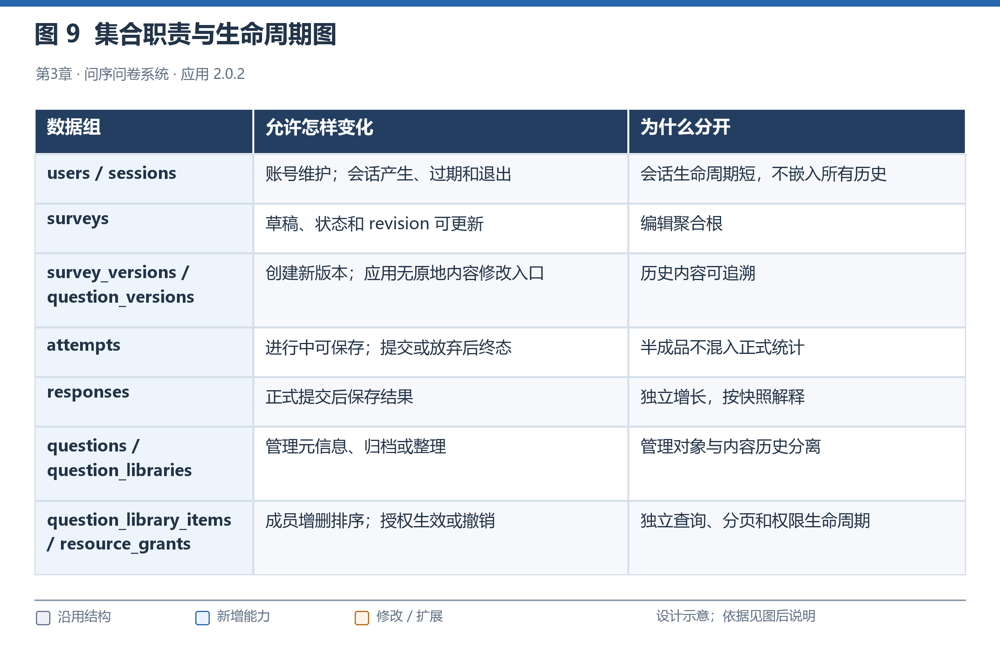

**图 9 集合职责与生命周期图**

问卷草稿需要反复修改；题目版本和发布快照需要保留当时内容；填写过程会从进行中进入已提交或已放弃状态；授权则可以生效和撤销。

将这些数据分开，可以缩小一次操作的影响范围。例如，修改题目管理信息不会覆盖历史内容，保存半份回答也不会生成正式答卷。

这里的“版本不可变”是指应用不提供覆盖旧版本内容的入口，不表示数据库管理员无法直接修改文档。

#### 3.1.3 保留问卷内部的完整结构

一份问卷中的题目、选项、校验和跳转通常需要一起读取、检查和发布，因此继续嵌入问卷定义。


**图 10 问卷文档内部结构图**

`draft.questions[]` 中的每个元素都是一个问卷实例，保存实例 ID、题目内容、必答和跳转。第二阶段增加可选的 `source`，记录采用哪个独立题目版本。

`source` 用于说明来源，并不替代实例中的题目内容。这样，问卷不会在填写时因为题库更新而自动换题。

### 3.2 为什么没有采用全关系式拆分

关系数据库同样能够实现问卷系统。用户、题库成员和授权都有明确关系，可以通过表、外键和关联查询表达；关系数据库配合 JSON 保存问卷定义，也是可行方案。

本项目继续使用 MongoDB，主要基于以下考虑：

1. **符合课程要求，并延续第一阶段实现。**  
   第二阶段需要在原代码和数据库基础上扩展，更换数据库会扩大修改范围。

2. **问卷经常需要整份读取。**  
   编辑、发布和填写都需要题目、选项、校验及跳转条件。完全拆表后，读取完整定义通常需要关联查询或程序组装。

3. **历史版本需要完整重建。**  
   直接保存发布时的文档，能够明确保留当时的题目与规则，减少历史读取时重新拼装的工作。

这属于访问方式和开发范围的取舍，不能据此认定关系数据库无法实现，或未经测量就声称 MongoDB 一定更快。


**图 11 嵌入与引用选择图**

本项目采用混合方式：一起使用的问卷定义嵌入保存，独立管理或持续增长的数据通过引用关联。

### 3.3 为什么适合 MongoDB

#### 3.3.1 文档能够表达不同题型

选择题需要选项，数字题需要范围和整数限制，文本题需要长度限制。不同题型既有共同字段，也有各自配置，适合通过文档中的嵌套结构表达。

跳转条件还可以包含 `all`、`any` 等组合，文档能够直接保留条件层次。但字段允许不同，不代表可以随意写入，结构仍受 Schema 和后端校验约束。

#### 3.3.2 完整版本适合整体保存

题目版本保存某次固定内容，问卷发布版本保存完整定义。读取历史答案时，可以找到当时使用的内容，不必读取题目最新版。


**图 12 独立题目与题目版本关系图**

`question_id` 识别题目系列，`question_version_id` 识别确定版本。`latest_version_id` 用于管理和提示，问卷不会因为这个指针变化就自动升级。

#### 3.3.3 独立增长的数据分别存储

答卷、题目历史、题库成员和授权记录会增加，因此使用独立集合，避免一个文档无限增长。


**图 13 题库与成员关系图**

题库成员指向确定版本。同一题库可以收录同系列不同版本，但不能重复加入同一个确定版本。

题库只是整理工具，不是新的授权渠道。把共享题放入自己的题库，不会获得转授给第三人的权限。

### 3.4 来源记录与冗余控制

#### 3.4.1 为什么同时保存内容和来源

导入题目时，问卷实例保存两部分信息：

- **题目内容**：保证问卷能够按当时定义独立运行。
- **来源记录**：说明来自哪个系列、哪个版本，以及这次合法导入属于哪个问卷和实例。

这是为历史稳定性保留的内容副本，需要明确一致性维护方式。

后端在导入时读取真实版本生成实例，在普通保存和发布时核对来源与内容。不能保留 v1 来源，却将题干、选项或校验改成另一份内容。来源也不能复制到其他实例或问卷作为授权证明。

#### 3.4.2 为什么正式答案不重复保存来源

正式答卷已有 `version_id`，可以沿发布快照找到实例来源。


**图 14 题目来源追溯图**

追溯过程为：

```text
正式答卷的 version_id
    → 问卷发布快照
    → 按答案中的 question_id 找到问卷实例
    → 读取实例 source
    → 定位独立题目版本
```

答案中的 `question_id` 表示问卷实例 ID，不是独立题目系列 ID。沿原快照查找，才能准确解释当时的答案。

因此，正式答案不再保存第二套来源，减少重复数据和维护成本。没有来源的旧实例仍按原定义解释，不强行关联到新系列。

#### 3.4.3 为什么保留草稿和发布快照

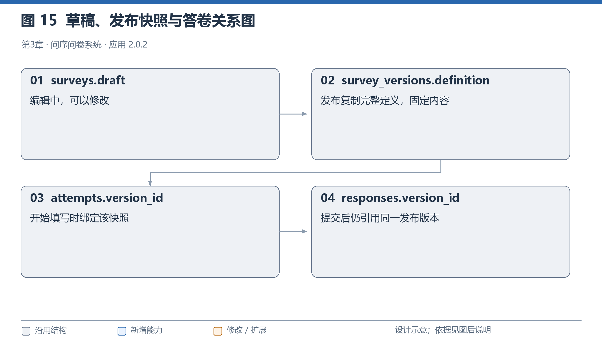

**图 15 草稿、发布快照与答卷关系图**

草稿负责编辑，发布快照负责固定内容，填写过程绑定开始时的发布版本，正式答卷继续关联该版本。

即使填写期间发布了新版，原 `attempt.version_id` 也不切换。当前使用追踪直接查询草稿和发布记录，没有额外维护使用缓存；后续如有性能问题，应先测量，再决定是否增加冗余。

### 3.5 Schema、索引、事务与并发控制

#### 3.5.1 Schema 在哪里体现

数据库约束集中保存在：

- [collection_validators.json](../1_代码/database/collection_validators.json)：十一集合的结构约束。
- [indexes.json](../1_代码/database/indexes.json)：唯一索引和查询索引。
- [database.py](../1_代码/backend/app/database.py)：连接、初始化检查、索引和事务基础。
- [migration.py](../1_代码/backend/app/migration.py)：已有约束的显式升级与恢复保护。

Schema 不只要求顶层是对象，还约束必要字段、类型、嵌套结构、枚举和适用的范围。错误结构即使绕过 API 直接写库，也应被拒绝。

但 Schema 不能独自证明来源真实、版本归属正确或用户拥有权限，这些仍由后端判断。

#### 3.5.2 索引解决查找和重复问题

本阶段共有 **22 个显式索引**，包括第一阶段的 11 个和第二阶段新增的 11 个，不包含 MongoDB 自动创建的 `_id` 索引。

索引主要用于：

- 按所有者、问卷、来源和题库查询。
- 防止同系列出现重复版本号。
- 防止同库重复收录确定版本。
- 配合原填写与提交机制控制重复记录。

索引可以支持查询，但本项目没有据此给出未经测试的性能提升比例。

#### 3.5.3 事务保证关联修改完整

创建版本需要同时分配序号、插入内容版本并更新最近版本指针。如果插入失败，其他修改也应撤销。

题库成员变更与题库修订号更新、正式答卷写入与填写过程完成，也需要保持一致。

| 机制 | 主要职责 |
|---|---|
| Schema | 检查文档结构和字段值范围 |
| 索引 | 支持查询并约束唯一性 |
| 事务 | 保证相关写入一起完成或撤销 |
| `revision` | 检查请求是否基于过期状态 |
| 后端业务校验 | 判断来源、权限、跳转和状态是否合法 |

并发导入与撤销还需要共同的写入边界。只读授权、再写其他文档，不一定发生冲突。因此，操作会触及共同协调记录；冲突重试后重新检查授权，以成功提交顺序决定结果。

### 3.6 升级与旧数据兼容

兼容处理保留以下原则：

1. **旧题可以没有来源。**  
   `source` 为可选扩展，旧问卷继续使用，不猜测其来源。

2. **旧填写过程继续绑定原快照。**  
   不因题库或问卷更新，替换已经开始的填写内容。

3. **正式答案结构保持原样。**  
   来源通过快照追溯，不批量重写旧答案。

4. **普通启动不覆盖旧约束。**  
   发现结构不一致时，先检查并通过显式迁移处理。

已有记录核对了原六集合文档，约束升级前后未改写业务文档；独立测试也检查了纯第一阶段样本的读取、升级和回退保护。

这说明已验证样本可以兼容，不代表未知未来需求已经得到保证。

### 3.7 数据结构如何变化

| 对象 | 第一阶段 | 第二阶段调整 | 兼容方式 |
|---|---|---|---|
| `users`、`sessions` | 账号与会话 | 继续使用 | 保留原身份体系 |
| 问卷草稿中的实例 | 内容、必答和跳转 | 增加可选 `source` | 旧题不要求补来源 |
| `surveys` 管理信息 | 状态与修订信息等 | 增加草稿问题提示和协调字段等 | 提示不能代替发布校验 |
| 发布快照中的实例 | 完整发布内容 | 新发布可以包含来源 | 不回写旧快照 |
| `attempts` | 原始输入、状态、绑定版本、修订号 | 集合结构保留 | 继续读取原快照 |
| `responses` | 正式答案、路径和提交信息 | 集合结构保留 | 答案项仍为实例 ID 与值 |
| `questions` | 无 | 新增系列管理信息 | 不影响旧题 |
| `question_versions` | 无 | 新增固定内容和版本关系 | 新版本追加，不覆盖旧内容 |
| 题库及成员 | 无 | 新增两个集合 | 成员固定到确定版本 |
| `resource_grants` | 无 | 新增使用与汇总授权 | 按资源、用途和接收者检查 |

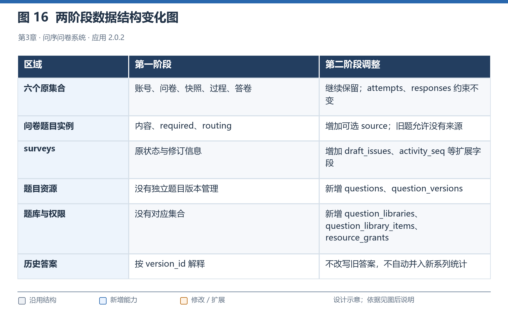

**图 16 两阶段数据结构变化图**

“结构保留”不等于全部原文件未修改。例如，为了不向填写者暴露内部来源，返回定义的处理有所调整，但填写状态机和正式答案格式继续使用。


**图 17 Schema、索引与事务分工图**

例如，题库成员不能重复由唯一索引约束，目标版本是否可用由后端检查，相关写入是否完整由事务保证。几层机制需要配合，前端禁用按钮不能替代它们。

完整字段类型、索引组合和边界说明见[数据库设计](../2_文档/数据库设计.md)。

### 3.8 为什么增加 source 而不重写答案

第一阶段的旧实例可以没有来源，例如：

```json
{
  "id": "age_local",
  "type": "number",
  "title": "年龄",
  "required": true,
  "options": [],
  "validation": {
    "min": 0,
    "max": 120
  },
  "routing": {
    "rules": [],
    "default_target": null
  }
}
```

第二阶段通过合法导入生成来源，以下仅展示 `source` 的示意内容：

```json
{
  "question_id": "series_age",
  "question_version_id": "age_v1",
  "version": 1,
  "survey_id": "survey_demo",
  "instance_id": "age_local",
  "imported_by": "owner_demo",
  "imported_at": {
    "$date": "2026-10-26T00:00:00Z"
  },
  "grant_id": null
}
```

这个片段不是完整集合文档，时间采用 MongoDB Extended JSON 表示，不能直接当作完整 API 请求提交。实际来源由后端生成，客户端在普通保存时携带它，只用于一致性核对。

正式答案仍然可以是：

```json
{
  "question_id": "age_local",
  "value": 25
}
```

其中 `age_local` 是问卷实例 ID。通过答卷的发布版本找到该实例，再读取来源，即可确定独立题目版本，无须在答案中重复保存来源。

### 3.9 升级顺序、失败恢复和限制

数据库升级由 `backend/scripts/migrate_phase2.py` 提供入口，处理顺序为：

1. **保存基线并做好完整备份。** 保留旧源码、业务数据和集合约束，在维护窗口停止相关写入。
2. **运行检查。** 识别已有约束，检查旧文档是否符合目标结构。
3. **明确执行升级。** 保存原约束、目标和恢复日志，逐集合应用并记录进度。
4. **初始化缺失集合并确保索引存在。** 新集合初始化与已有约束升级分别处理。
5. **验证旧数据和原功能。** 检查读取、填写、提交和统计，再恢复正常使用。

集合约束修改不是一个能够跨所有集合统一回滚的业务事务，因此必须保留日志。恢复前还要检查日志归属、约束是否被其他操作改变，以及是否已经产生新业务数据。

如果已有第二阶段题目或来源数据，程序会阻止仅恢复旧约束；需要依据维护前完整备份安排恢复，不能让旧程序直接读取不兼容的新结构。

如果数据库已经是第二阶段 2.0.1，更新到 2.0.2 不需要再次迁移本轮数据库结构，只需更新对应程序和前端构建。

另外，更新时应保留原 `SECRET_KEY`，避免影响已有凭证及匿名身份、填写恢复等相关机制。若未来需要关联旧答案，应另行设计并确认对应关系，不能按题干相同自动补写来源。

## 四、跳转设计

跳转解决的是“回答完这一题，下一步去哪里”。本章先说明完整执行过程，再介绍条件、匹配顺序和异常处理，最后对照第二阶段的变化。图中的四题问卷用于解释机制，不作为新增测试执行记录。

### 4.1 跳转的整体过程

创建者先为题目配置条件和目标；发布时，后端检查这些配置是否合法；填写时，页面与服务端根据有效答案计算路径；正式提交时，后端再按原发布快照重新计算，不能直接相信页面传来的路径。

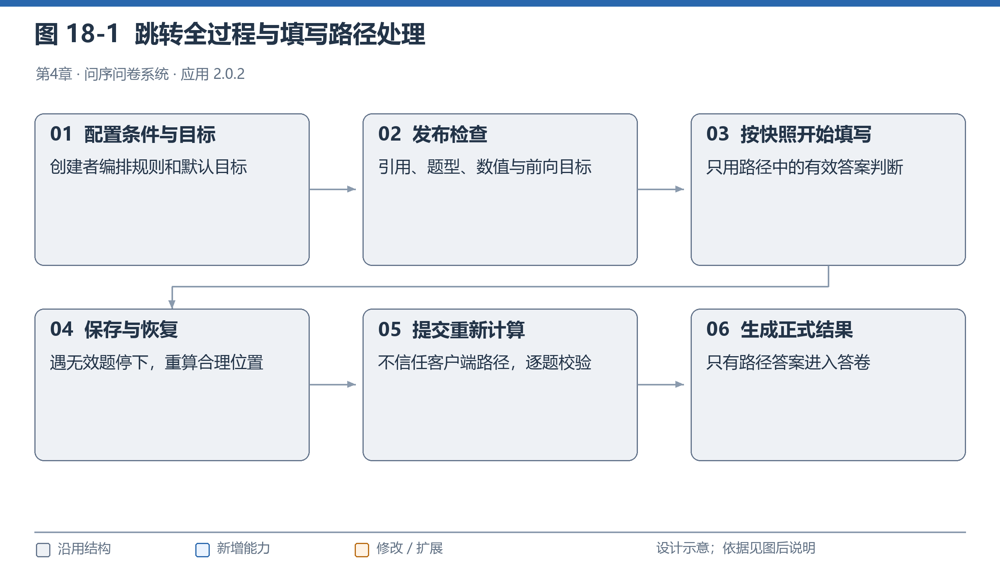

**图 18-1 跳转全过程与填写路径处理**

这条流程贯穿配置、发布、填写、恢复和提交。保存草稿不代表已经可以发布；页面显示到最后一题也不代表可以跳过提交检查。配置错误在发布前反馈，答案错误在填写和提交时反馈。

### 4.2 一条规则由什么组成

一条普通条件包含引用题目、运算符和比较值，再配上跳转目标。多条规则与默认目标一起保存在当前实例的 `routing` 中。

|字段|表示什么|四题示例|
|---|---|---|
|`condition.question_id`|读取哪道题的有效答案|`q1`|
|`condition.operator`|采用什么比较方式|`eq`，即等于|
|`condition.value`|和什么值比较|选项 ID `no`|
|`target`|该规则成立时去哪里|`q3`|
|`default_target`|所有规则均未命中时去哪里|`null` 表示继续下一题|

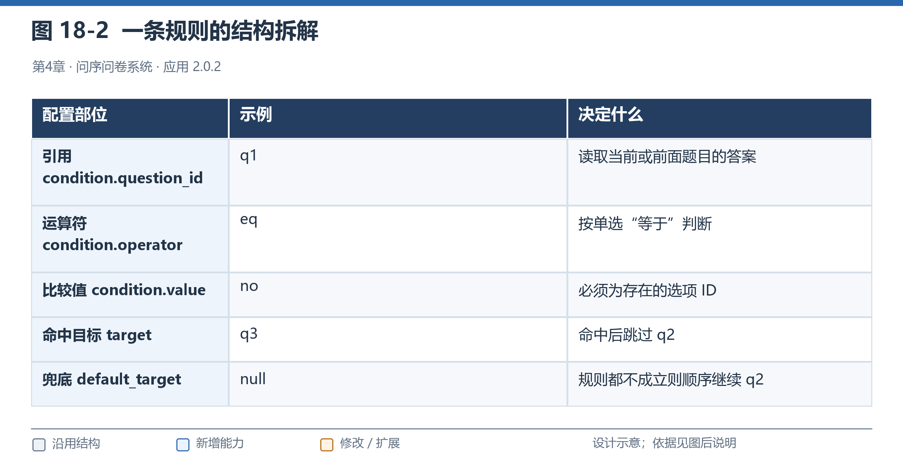

**图 18-2 一条规则的结构拆解**

下面是 Q1 的示意配置：选择“否”时跳过 Q2，其他情况下顺序进入 Q2。`yes/no` 是选项 ID，不能直接把显示文字当作所有问卷通用的 ID。

```json
{
  "rules": [
    {
      "condition": {"question_id": "q1", "operator": "eq", "value": "no"},
      "target": "q3"
    }
  ],
  "default_target": null
}
```

这是局部配置，不是完整问卷。`END` 表示结束路径；`null` 表示没有指定跳转目标，继续下一题，两者含义不同。通过正常 API 保存的每条规则 target 必须是非空目标字符串；空值用于 default_target，不能把缺少规则目标当成合法规则。

### 4.3 各题型怎样判断条件

运算符必须与被引用题目的类型匹配，不能把数字比较放到选择题上，也不能把未实现的文本关键词匹配写成已有功能。

|题型或组合|代码中的运算符|判断方式及示例|
|---|---|---|
|单选|`eq`、`ne`|等于或不等于某个有效选项 ID|
|多选|`contains_any`|与指定选项集合至少有一项相同|
|多选|`contains_all`|包含指定集合的全部选项，可额外选择其他项|
|多选|`set_equals`|两个选项集合完全相同，不要求排列顺序相同|
|数字|`eq`、`ne`、`gt`、`gte`、`lt`、`lte`|等于、不等于、大于、大于等于、小于、小于等于|
|数字|`between`|位于闭区间内，例如 `[18,30]` 包含 18 和 30|
|文本|无|当前不提供文本条件运算符|
|组合|`all`|所有子条件成立才成立|
|组合|`any`|至少一个子条件成立就成立|

例如，已选工具为 `[MongoDB,Redis]` 时，“包含任意 `[MongoDB,MySQL]`”成立，“包含全部 `[MongoDB,MySQL]`”不成立，“集合等于 `[Redis,MongoDB]`”成立。

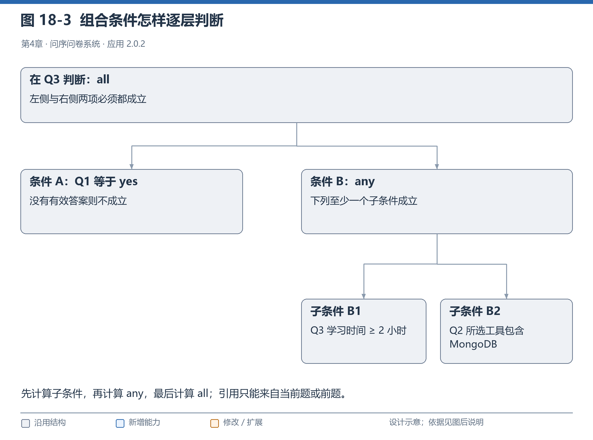

**图 18-3 组合条件怎样逐层判断**

图中示例在 Q3 配置：Q1 为“是”，并且“Q3 学习时间至少 2 小时”或“Q2 选择了 MongoDB”至少满足一个。这里用当前题和前题说明嵌套关系，不新增另一份问卷。

没有有效答案时，普通条件返回不成立，连 `ne` 也一样。因此，“未回答”不能被当成“不等于某选项”的有效答案；已跳过的旧答案也不能通过组合条件重新参与分支。

### 4.4 多条规则按什么顺序执行

规则按列表顺序检查，第一条命中就停止。若两条条件都能成立，排在前面的优先；系统不会自动选择“更具体”的条件，也不会同时跳向两个目标。

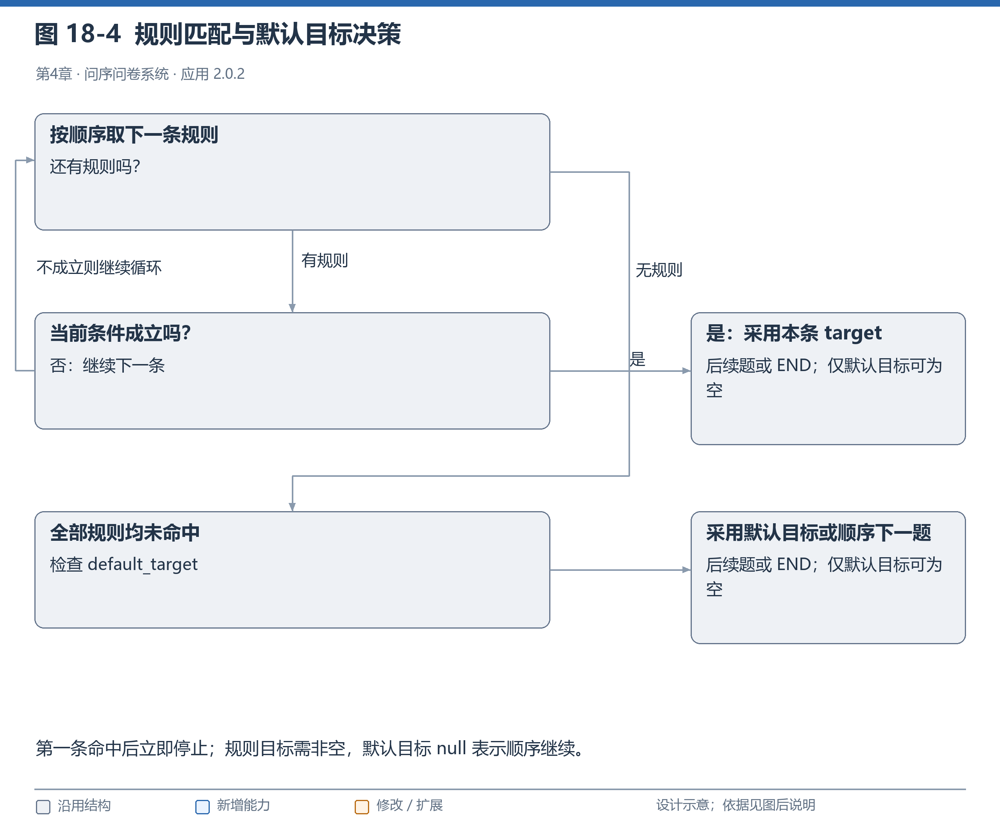

**图 18-4 规则匹配与默认目标决策**

|检查结果|下一步|
|---|---|
|某条首先命中，目标为后续题|跳到该题|
|某条首先命中，目标为 `END`|结束路径，仍需提交检查|
|全部未命中，默认目标为后续题或 `END`|采用默认目标|
|全部未命中，默认目标为空|继续下一题；已是末题则自然结束|

如果规则配置合法但与创建者意图不符，例如过于宽泛的规则排在前面，这是配置优先级问题，需要调整顺序或条件，不能由程序猜测。

### 4.5 配置怎样才算合法

发布检查不仅验证 JSON 能否解析，还检查题目引用、类型、比较值和目标位置。问卷需要 1～100 道题；实例 ID 不能重复或使用保留值 `END`。

|检查项|合法要求|会被拒绝的例子|
|---|---|---|
|规则结构|每条规则包含 `condition` 与 `target`；普通条件字段完整|缺少 `condition`|
|条件引用|引用存在的当前题或前题|Q1 的规则依赖 Q3 的回答|
|跳转目标|规则指向存在的后续题或 `END`；默认目标可为空|跳到自身、前题或不存在的题|
|单选比较值|存在的选项 ID|引用已删除的选项 c|
|多选比较值|非空数组，无重复，全部选项存在|`[a,a]` 或空数组|
|题型与运算符|与表 4.3 对应|文本使用 `gt`|
|数字条件|有限安全数值，绝对值不超过 `10^15`|无穷大或超范围值|
|数字区间|两个值，下界不大于上界|`between=[30,18]`|
|数量限制|每题至多 20 条规则；每组 1～20 个子条件|空的 `all` 或超量规则|
|嵌套限制|从根深度 0 递归检查，深度不得超过 5|过深条件树|

只允许向后或结束，可以避免循环。但“无循环”不等于所有条件一定会触发，也不承诺自动证明每道题都能被访问。当前校验聚焦结构、引用、类型与前向目标，不应夸大为任意复杂逻辑的数学证明。

### 4.6 回答变化后路径怎样改变

以下四题贯穿本章：Q1 是否使用数据库；Q2 使用哪些工具；Q3 计划学习多少小时；Q4 有什么建议。

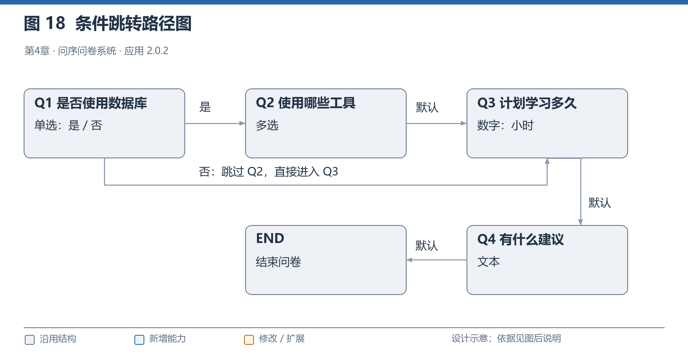

**图 18 条件跳转路径图**

Q1 选择“是”时，路径为 `Q1 → Q2 → Q3 → Q4`；选择“否”时，路径为 `Q1 → Q3 → Q4`。Q2、Q3 默认顺序前进，Q4 后自然结束或明确指向 `END`。

如果先选“是”并回答 Q2，再把 Q1 改为“否”，程序必须重新计算，不能只隐藏 Q2。

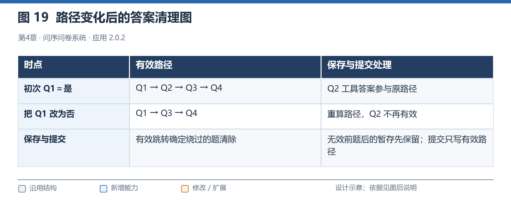

**图 19 路径变化后的答案清理图**

服务端保存时清除已经由有效跳转确定绕过的答案；有效 `END` 后的答案也被清除。若前题输入尚不合法，程序不能确定后续完整路径，会先保留其后的暂存原始输入，等前题修正后重新判断，而不是一概删除。

正式提交只写入重新计算出的有效路径答案。被跳过的旧内容不参与分支和正式统计，路径外的必答题也不要求填写。

### 4.7 保存、恢复和提交怎样使用路径

同一引擎参与几个时点，但严格程度不同，可结合图 18-1 理解。

|时点|路径怎样计算|遇到错误怎样处理|
|---|---|---|
|页面填写|根据当前答案提示路径|页面提示用于交互，不能作为提交凭据|
|自动保存|按原快照解析、校验当前输入，从第一题前进|到第一道无效题停止，不用无效答案决定分支或默认路径；保存允许不完整|
|恢复|读取原快照与服务端已保存输入，重算路径|优先回到需修正题；位置提示只能在合理路径内使用|
|正式提交|服务端重新规范化草稿答案，再运行完整 `evaluate`|收集实际路径中的逐题错误，有错误则拒绝；无错误才生成正式答案与路径|

例如 Q3 输入 `-` 可以作为尚未完成的数字输入暂存，但不能拿它与数字比较。自动恢复不能信任客户端声称“已经到了 Q4”。提交阶段也不能因出现 `END` 就忽略此前路径上的错误：结束路径后仍检查收集到的问题。

### 4.8 第二阶段怎样扩展原逻辑

第二阶段保留规则引擎，变化集中在题目来源和升级对配置的影响。

|内容|第一阶段|第二阶段|变化理由|
|---|---|---|---|
|规则执行|首条命中、默认、向后或结束|继续沿用|原引擎可以处理新实例|
|跳转归属|问卷内题目配置|仍属于问卷实例|不同问卷的前后关系不同|
|题目导入|没有独立题目版本导入|新实例 ID，初始化空规则与空默认目标|不复制其他问卷的目标 ID|
|题目升级|编辑当前问卷内容|保留实例 ID、必答和 routing，替换版本内容|由用户修复受影响规则|
|发布检查|检查原题型与跳转|增加来源内容一致性|不能标旧来源却写新内容|
|历史填写|绑定完整发布快照|继续沿用|新版题目不改变旧过程|

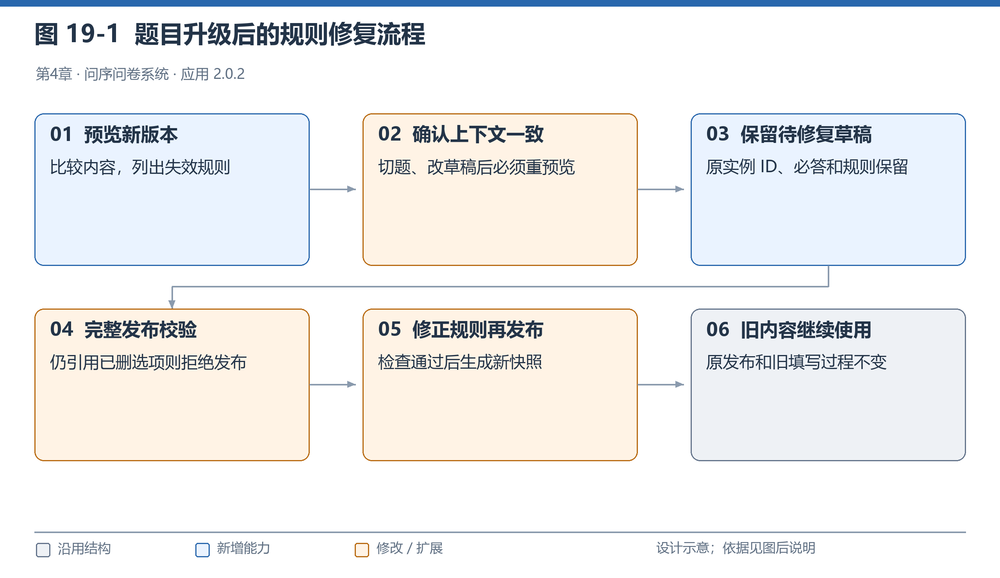

**图 19-1 题目升级后的规则修复流程**

例如新版删除选项 c，旧规则仍判断 c：预览列出问题，确认后可保留待修复草稿；系统不偷偷删除规则。修复前不能发布，修复后完整检查通过才生成新快照，旧快照和旧填写过程不变。

依据：`domain/rules.py`、`services/attempts.py`、`services/question_instances.py`；现有测试 T099、T100 及原路径、条件和失效答案测试。这里说明已有实现，不声称本次重新执行业务测试。

## 五、校验设计

校验解决的是“这份配置能否使用、这次操作有没有权限、这些输入能否保存或提交”。本章按层次和生命周期展开，区分问卷设计草稿、填写草稿和正式答卷，最后对照两阶段变化。

### 5.1 为什么需要多层校验

页面提示帮助用户及时改错，但请求也可能由其他客户端直接发送，所以后端不能省略检查。数据库负责最后的文档结构和唯一性约束，也不能代替业务权限判断。

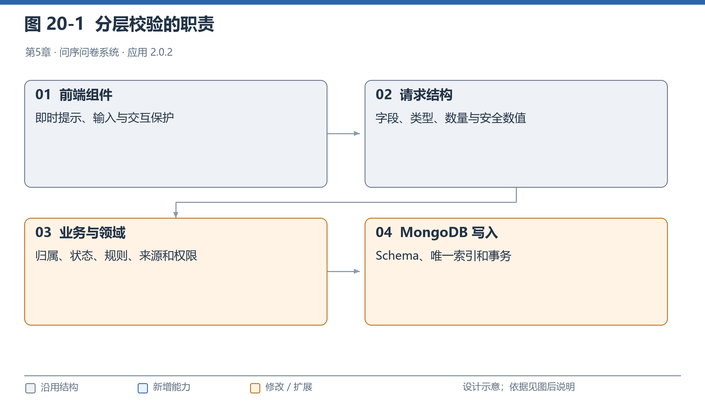

**图 20-1 分层校验的职责**

|层次|检查什么|不能代替什么|
|---|---|---|
|前端组件|输入提示、规则 JSON 检查、保存状态与操作保护|服务端校验和权限|
|请求模型|字段、类型、数量、嵌套与安全数值|跨集合归属和真实来源|
|业务服务与领域逻辑|所有权、授权、状态、revision、题型、路径和来源|数据库唯一性与关联写入原子性|
|MongoDB|集合 Schema、唯一索引及事务写入|题意、可作答性和用户操作权限|

请求还会拒绝未知字段和过深嵌套，统一数值检查的递归深度上限为 32。问卷标题至多 200 字符、说明至多 5000，题干至多 500，选项 ID 采用 1～64 位限定字符，选项文字至多 200。具体字段类型和上限由 schemas.py 与集合约束共同定义。

账号也有入口检查：用户名为 3～40 字符并满足允许字符模式，密码为 8～128 字符；注册检查重名，登录核对密码，会话过期不能执行需登录操作。资源服务再分别核对问卷、题目、题库和过程归属，不能仅凭已登录就访问他人对象。

例如，数据库能拒绝答案项缺字段，却不能仅靠“最小值、最大值都是数字”判断必答整数题是否有合法答案。下文分别说明这些检查。

### 5.2 四种题型的配置与答案校验

配置校验面向问卷创建者，答案校验面向填写者，两者不能混用。

|题型|配置检查|非空答案检查|
|---|---|---|
|单选|2～100 个选项；选项 ID 唯一、文字非空；不接受不支持的 validation 字段|字符串且为有效选项 ID|
|多选|继承选项检查；`0≤最少项≤最多项≤选项数`，上下限为整数；必答至少允许选一项|字符串数组、无重复、选项都存在、数量在范围内|
|文本|无选项；长度为整数且 `0≤最短≤最长≤10000`；必答最长至少允许一个字符|字符串，去除首尾空白后按 Unicode 码点检查长度|
|数字|无选项；上下界为安全数值、下界不大于上界；整数限制为布尔值；必答整数范围中存在整数|真正的安全数字，范围合法，必要时必须为整数|

统一的数字安全边界为有限数值且绝对值不超过 `10^15`，布尔值不能冒充数字。数字填写框保存的字符串先经过格式检查和规范化，再进行题型校验；不能把任意字符串直接当作数值。

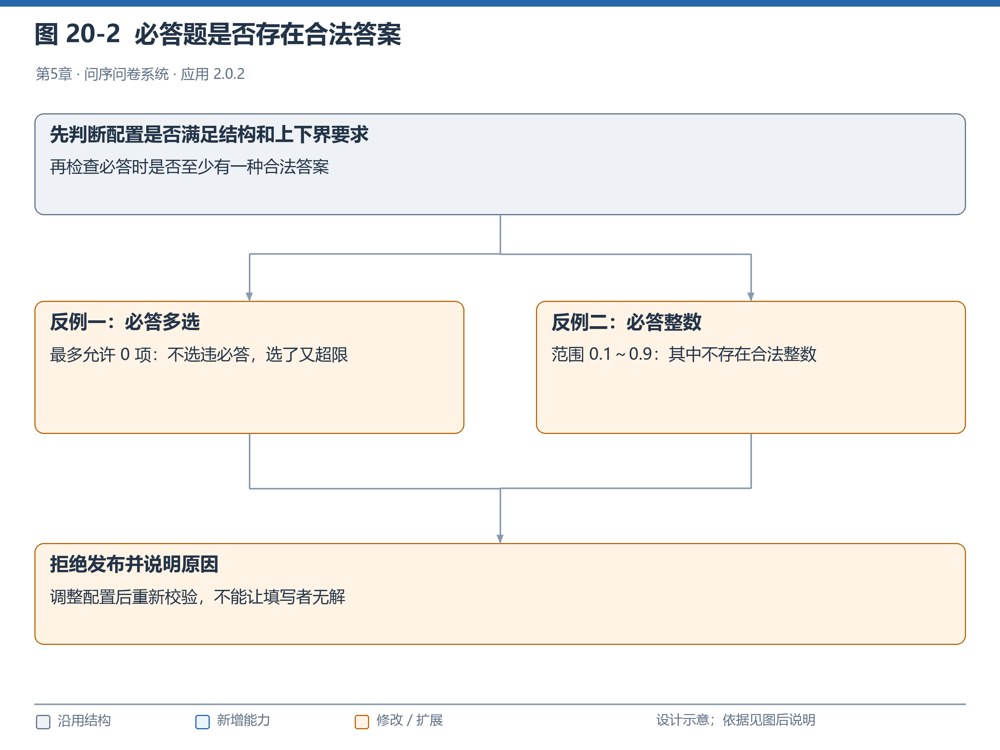

**图 20-2 必答题是否存在合法答案**

必答多选最多 0 项时，不选违反必答，选择又超过上限；必答整数题范围为 0.1～0.9 时，不存在整数。两者都应在发布配置检查中拒绝。必答文本最多 0 个字符也同理。

空值包括 `null`、空字符串、空数组和纯空白字符串。必答题遇到空值返回“此题必须回答”；可选题遇到空值归一为 `null`，不继续执行非空答案校验。但可选题一旦提交非空内容，仍须满足题型要求。

文本采用去除首尾空白后的码点长度，`😀` 计一个码点。前端不以原生 UTF-16 `maxlength` 阻止后端允许的输入；组合输入期间与最终输入的反馈也由组件处理。这些能力来自第一阶段修订，第二阶段继续保留。

### 5.3 问卷发布校验

发布前检查的是“这份定义能不能正式使用”，不要求当时就有填写答案。

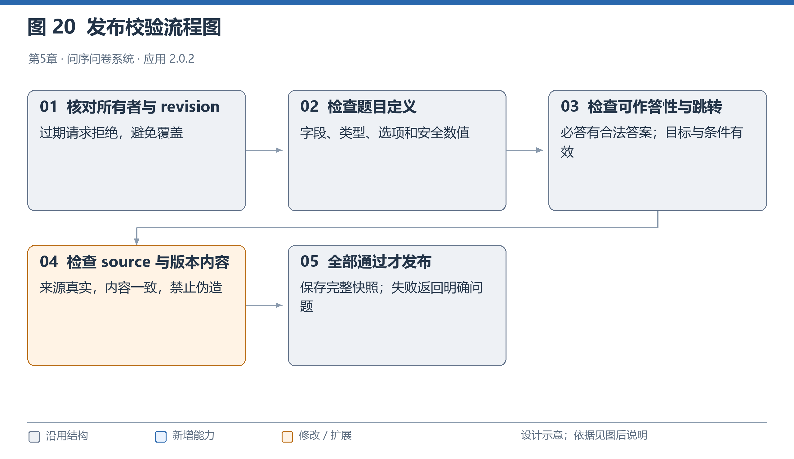

**图 20 发布校验流程图**

检查覆盖：所有者和 revision；截止时间必须为空或带时区且晚于当前时间；问卷标题非空；1～100 道题；实例 ID 唯一且不为 `END`；题干和选项文字非空；题型配置有合法答案；第四章中的条件与目标限制；来源真实且内容一致。

全部通过后，在事务中保存完整发布快照并更新问卷发布信息。检查失败时返回原因，不生成一个可填写但定义错误的新版本。`draft_issues` 只是编辑提示，不能代替发布时重新检查。

设计草稿可以暂时有不完整或失效规则，但仍受请求结构、所有权、revision 和来源保护约束，不代表任何损坏 JSON 都可保存。

### 5.4 自动保存校验

填写草稿保存的是过程，不要求每道题已经完成。后端仍检查登录与归属、进行中状态、revision，以及问卷是否允许继续写入，再读取原发布快照。

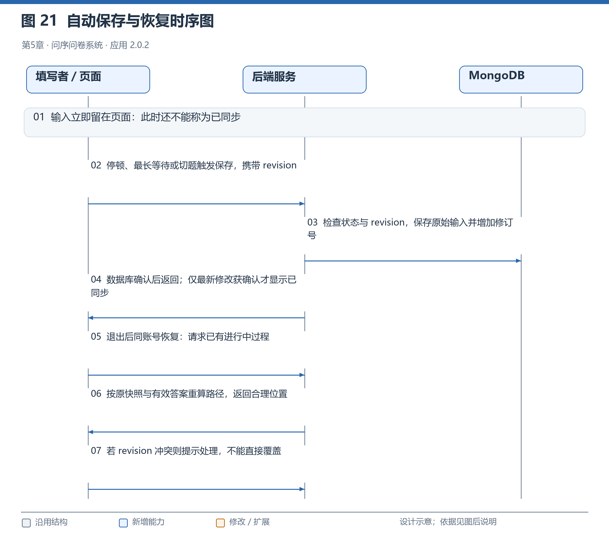

**图 21 自动保存与恢复时序图**

答案不能包含未知题目；单项允许空值、字符串、安全数字或受限制的字符串数组。数组至多 100 项、每项字符串长度至多 64，草稿单项文本至多 20000 个码点。这个过程输入上限不等于正式文本题的 10000 上限；不完整或超出题目正式限制的内容可暂存为待修正输入，但不参与条件计算。

保存携带读到的 revision，成功后增加修订号。客户端在停顿、最长等待或切题时同步，只有当前最新修改被服务器确认，才能表示已同步；旧请求成功不代表等待期间的新输入也保存了。保存失败保留页面输入并反馈，不能承诺浏览器退出后未同步内容也能跨设备恢复。

### 5.5 恢复填写校验

恢复先核对过程是否属于当前账号，再读取该过程绑定的快照。服务端不依赖当前题库最新版，且检查快照 Schema 和规则引擎版本是否受支持。

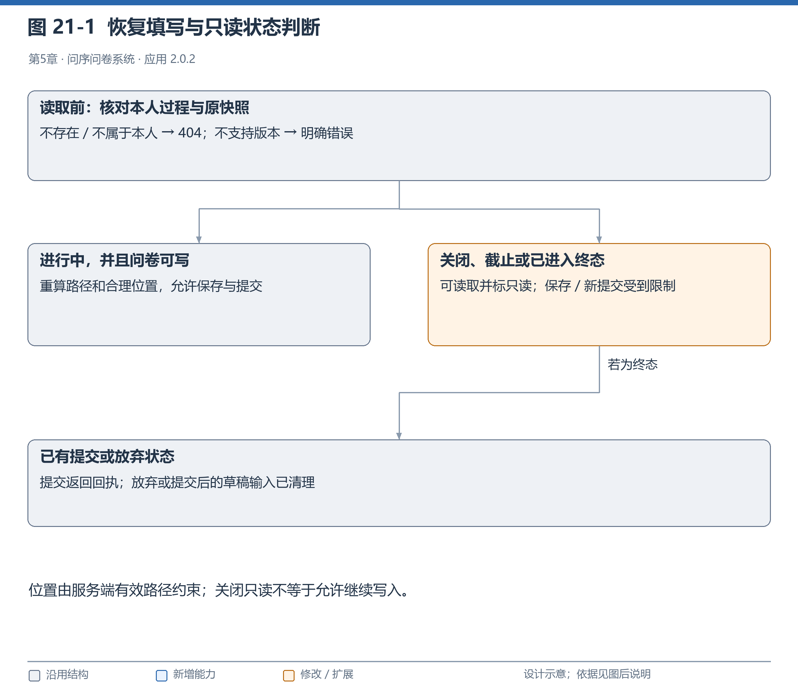

**图 21-1 恢复填写与只读状态判断**

|情况|读取与后续处理|
|---|---|
|过程不存在或不属于本人|按接口返回 404，不暴露他人草稿|
|快照版本不受支持|返回明确版本错误，不能猜测执行|
|进行中且问卷仍开放|重算路径，返回合理位置，允许继续保存和提交|
|问卷关闭、截止或不再可写|仍可读取过程，标记只读并说明原因；拒绝新增保存和提交|
|过程已提交|返回终态及回执，原始草稿答案副本已清理|
|过程已放弃|只读终态，停止保存，已清除原始输入|

恢复位置只是提示：前面有无效题时应回到需处理的位置；提示题不在当前路径时不能原样采用。开始填写时还检查匿名是否允许、是否已提交过，以及同账号同问卷是否已有进行中过程；并发开始由唯一性保证只产生一份进行中草稿。已有过程恢复时不会因页面默认值改变原匿名选择。

### 5.6 正式提交校验

当前支持恢复填写的主流程提交请求携带过程 ID 与 revision，答案以服务器已保存草稿为准，不再发送另一套独立答案。页面应先完成最新保存，再使用对应 revision 提交。

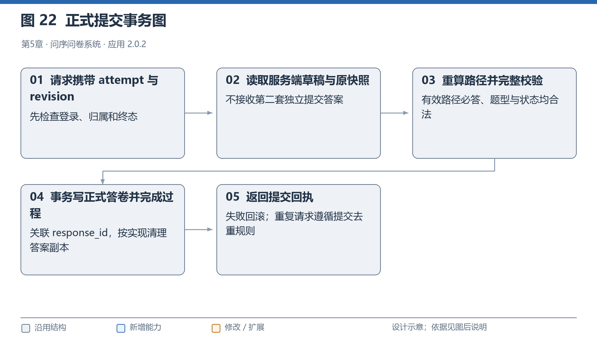

**图 22 正式提交事务图**

提交依次核对归属、状态、revision、问卷可写状态、原快照与重复填写策略；再规范化数字输入，按第四章规则重新计算路径并检查有效路径答案。可选空值可以通过，路径上的必答和非空错误答案不能通过。

有逐题错误时返回问题，不创建正式答卷；通过后，同一事务写入 response、记录实际路径、将 attempt 标为 `submitted`、关联 `response_id` 并清除 `raw_answers` 副本。匿名答卷不增加实名 `user_id`，但仍使用受保护的参与标识处理相关限制。

已经提交的同一过程再次请求提交时，返回原回执，不新增第二份答卷；已放弃过程返回冲突。问卷是否允许重复填写是另一条规则：允许时可新开过程，不等于同一过程可以重复生成答卷。

兼容保留的旧接口 `POST /api/responses` 仍接收签名 token 与 answers，不应与以上过程提交请求混为一谈。它校验凭证有效期、当前账号、绑定的发布版本、问卷状态、匿名与重复策略，仍调用同一规则引擎清理和校验；相同 token 的 attempt_id 已提交时返回原回执。旧接口没有可恢复草稿，不将其请求答案说成来自 attempts.raw_answers。

### 5.7 来源与操作权限校验

第二阶段在原账号和问卷归属检查之上，增加来源、题目版本和授权检查。来源由服务器生成，不能仅靠页面锁定字段。

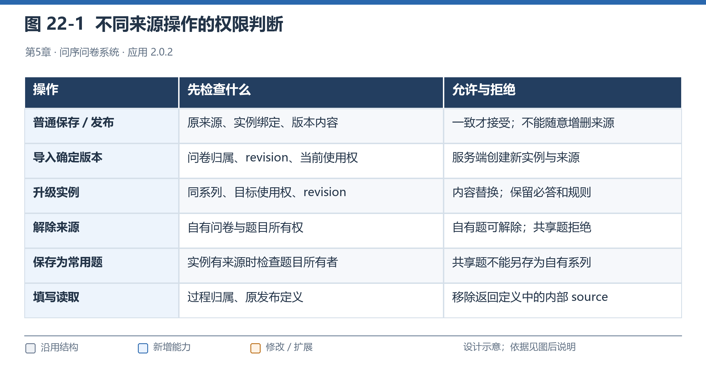

**图 22-1 不同来源操作的权限判断**

|操作|服务端判断|拒绝的情况|
|---|---|---|
|普通保存／发布|与数据库已有实例来源比较，核对版本内容和实例绑定|新建、删改来源，复制凭据，保留旧来源改内容|
|删除整道题|按问卷编辑与归属规则处理|不能用“保留实例但不传 source”代替解除|
|导入|读取所选版本，检查当前使用权、归档状态和 revision，生成新实例|无权、已归档或过期修订|
|升级|检查目标当前使用权、同系列和 revision，重新生成绑定来源|跨系列替换，使用撤销授权或过期草稿|
|解除关联|专门操作，要求题目属于自己|他人共享题不能解除后据为己有|
|保存为常用题|提取允许内容；有来源时核对题目所有者|共享实例不能借另存创建自有系列|

来源中的系列、版本、问卷、实例、导入人等均需可信。普通保存保留相同 source 只是供核对，不赋予客户端修改资格。发布后的填写定义会移除内部来源字段，服务端快照仍保留追溯依据。

撤销前合法导入的原实例可以继续按原版本保存和发布；再次导入、升级目标需要当前授权。既有使用规则不适用于统计授权撤销，后者会缩小后续查询范围。

### 5.8 统计参数与数据范围校验

统计先检查参数，再确定允许读取的问卷，最后聚合同一确定版本的正式答案，不能先统计所有数据再隐藏标题。

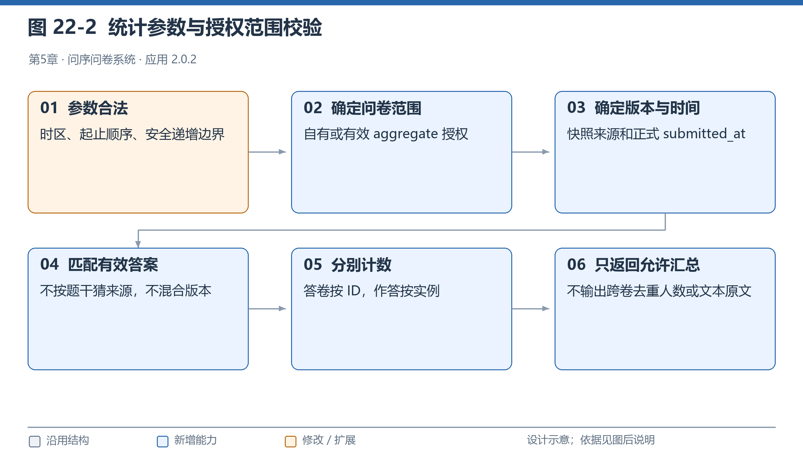

**图 22-2 统计参数与授权范围校验**

|内容|检查与口径|
|---|---|
|时间|包含时区，开始不晚于结束；筛选正式 `submitted_at`，包含端点|
|数字分组|2～30 个边界，严格递增，有限且绝对值不超过 `10^15`；显式空数组拒绝|
|默认分组|未传边界时采用 `[0,18,30,45,60,121]`，不等于任意数值都落入默认桶|
|权限|自有问卷与有效指定版本 aggregate 授权；显式越权范围拒绝|
|版本|按发布快照 source 匹配确定版本，不按题干或类型合并|
|份数和条数|答卷 ID 去重；同卷重复实例分别贡献作答|
|多选比例|选项次数除以有效作答条数，比例总和可超过 100%|
|覆盖与实际作答|发布引用该版本但零作答的授权问卷可计入覆盖，不计入有作答问卷|

例如 2 份答卷含 3 条作答 20、40、60，应得到答卷数 2、作答数 3、均值 40。本轮没有跨问卷去重人数、跨版本合并或文本原文列表。2.0.1 曾修复 `safe_number` 返回值被忽略的问题，现有拒绝检查不能只停留在调用函数上。

### 5.9 并发、重复和失败处理

revision 可以理解为“这份数据当前修订到哪次”。页面 A 和 B 都读到 1，A 保存后变为 2，B 再以 1 保存就要拒绝，避免覆盖。

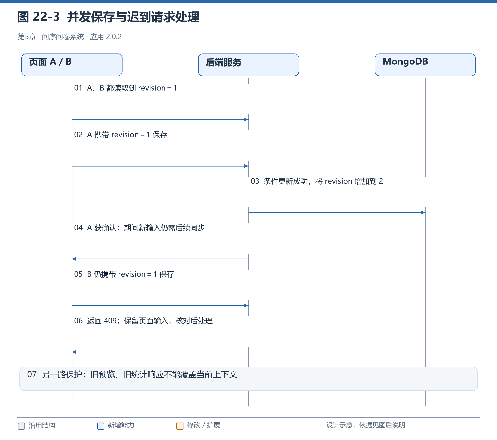

**图 22-3 并发保存与迟到请求处理**

|场景|处理方式|
|---|---|
|修订过期|通常返回 409，提示核对或重新加载；不自动强制覆盖|
|输入或配置错误|通常返回 422 和问题说明；路径错误可包含逐题详情|
|无权访问|视接口返回 403 或 404，不把所有权限错误写成同一状态码|
|登录过期|前端暂停同步，保留当前页面输入；同账号重新登录后再尝试保存|
|已提交／放弃后迟到保存|终态检查拒绝，不重新打开进行中状态|
|事务中途失败|相关写入回滚，不留下半个版本、半个来源实例或半份提交|
|升级预览后继续编辑|核对本地草稿及交互上下文；失效后重新预览|
|确认升级|必须匹配预览，不允许通用操作先自动保存来换 revision|
|旧预览／统计／明细请求迟到|成功、失败和结束回调均核对上下文；不能覆盖当前选择或重开已关闭窗口|
|导入与撤销／归档同时发生|通过共同协调写入及事务重试重查权限，以成功提交顺序决定|

事务并不自动解决所有竞争。版本创建还要原子分配序号，撤销和导入要共同写入协调记录；页面异步请求则要使用请求代次和目标上下文。不同问题分别处理，不能用“有事务”概括全部保护。

### 5.10 第一阶段到第二阶段的变化与验证

|能力|第一阶段基础|第二阶段变化|已有验证入口|
|---|---|---|---|
|题型、必答和可作答性|四题型、安全数值、Unicode 码点及不可回答配置修订|继续保留，不重复算新增|`test_domain.py`、`test_review_fixes.py`、输入组件测试|
|路径、恢复和提交|有效路径、原快照、revision、终态及事务|沿用核心；对外定义隐藏来源|`test_attempts.py`、原集成测试；T098、T100|
|来源与版本|没有独立题目来源管理|增加来源绑定、内容一致性、专门操作和固定版本|T075～T100、T106|
|共享与权限|原账号和问卷所有权|增加确定版本 use 与指定范围 aggregate|T091～T097、T104、T127|
|统计参数与入口|整卷统计|新增跨卷统计；2.0.1 修复边界判断及入口|T102～T104、T117～T131|
|升级确认与异步交互|已有保存响应保护|2.0.2 增加预览上下文、禁自动保存和迟到请求隔离|T198～T221|
|数据库兼容|原集合 Schema 与索引|可选来源、五新集合和显式升级保护|T107～T113|

第一阶段 1.1.0 与第二阶段 2.0.2 的比较用于说明演进；2.0.1、2.0.2 又是第二阶段内部修订。现有结果仍为 154 后端、90 组件、16 逻辑，共 260 项；本次说明与插图核对不增加业务测试次数。真实浏览器人工验收限制继续保留，不能把图示当成已执行测试。

核对入口：[完整测试步骤、输入与输出](../3_测试用例/测试用例与结果.md)、[逐项测试索引](../3_测试用例/测试证据/逐项测试索引.json)。本章主要依据 `domain/questions.py`、`domain/numbers.py`、`domain/question_sources.py`、`services/attempts.py`、`services/surveys.py`、`services/question_statistics.py` 和前端对应保存、预览及统计逻辑。


## 六、AI使用过程

### 一、AI 帮了什么

本项目使用 Codex 辅助完成需求分析、程序实现、测试和材料整理。AI 的主要作用，是把讨论中的需求转化为具体方案、代码和验证记录。

帮助梳理第二阶段需求。
AI 根据需求文档整理八项新增功能，分析它们与第一阶段的关系，并提出在原系统上扩展独立题目、版本、题库和共享管理的实现思路。

帮助完善 MongoDB 数据设计。
AI 辅助划分新增集合，编写字段约束和索引，并说明题目内容、问卷实例、发布快照和正式答卷之间的关系。设计中保留原有六个集合，增加五个职责明确的新集合。

帮助实现后端业务。
AI 辅助编写常用题保存、导入、版本创建、比较、恢复、共享撤销、题库管理、使用追踪和跨问卷统计等功能，同时增加来源、权限和修订号检查。

帮助实现前端页面和交互。
AI 辅助增加题目管理、历史版本、题库和共享等页面，并在问卷编辑器中加入选题、升级预览和确认操作，补充错误提示与操作保护。

帮助处理兼容与并发问题。
AI 辅助实现显式数据库约束升级、回退保护、版本创建事务，以及导入和撤销授权之间的并发控制，并检查旧问卷、旧快照和旧填写过程是否继续可用。

帮助编写和执行测试。
AI 辅助补充正常流程、非法输入、权限隔离、事务回滚和页面请求先后顺序等测试。现有记录中，后端 154 项、前端组件 90 项、前端逻辑 16 项，共 260 项测试通过，类型检查和生产构建也有通过记录。

帮助整理提交材料。
AI 辅助编写系统说明、数据库设计、API 说明、关键逻辑、测试材料和项目报告，并整理原始失败记录、修改差异、文件清单及独立解压核对结果。

### 二、AI 做错了什么

AI 生成的方案和代码需要持续审阅。项目中既出现过业务实现遗漏，也出现过测试和材料处理错误。

最初提出了不必要的来源冗余。
初始方案考虑在正式答卷中增加题目来源字段。经过讨论，发现已有发布快照能够完成追溯，因此调整为只在问卷实例和快照中保留来源，减少重复存储和一致性维护。

遗漏了数字统计的有效校验。
代码调用了安全数值检查函数，却没有使用其返回结果，导致部分无穷大或超范围输入未被正确拒绝。后来修改拒绝条件，并补充非法边界测试。

部分功能有接口，却缺少可用的页面入口。
例如，仅获得统计授权的用户难以进入统计页面，共享接收者也无法方便地查看自己的使用情况。后来分别补充入口，并保持原有权限范围。

题库分页和搜索处理不完整。
选题窗口最初只加载前二十个题库，选中题库后搜索关键词也没有正确参与查询。后来增加后续加载，并将搜索放在分页之前处理。

没有充分处理连续操作和迟到响应。
升级预览与确认可能对应不同实例，旧统计请求也可能覆盖当前选择。后来将操作目标、版本、修订号和本地草稿状态一起核对，并让失效请求不能再更新页面。

部分测试代码自身存在错误。
实际出现过错误的测试钩子返回值、不存在的页面定位文字、错误的模拟响应，以及未允许匿名却使用匿名提交的配置。修正这些问题时保留了业务校验，没有通过放宽权限让错误测试通过。

材料处理也出现过疏漏。
例如临时数据库名称过长、生成脚本遗漏变量、文件比较误纳入运行缓存等。修正后重新核对，同时保留失败过程。此外，早期对“测试全部通过”的表述过于宽泛，后来明确区分自动测试、接口验证和真实浏览器人工验收。
### 三、自己改了什么

本人主要通过调整需求、审阅方案和提供问题反馈推动项目修改。具体代码编辑、测试执行和材料生成由 Codex 辅助完成，以下按实际参与内容说明。

1. **调整了项目的关注重点。**  
   本人没有只关注功能能否运行，还持续要求考虑可扩展性，避免后续增加功能时需要推倒重来。

2. **明确了第二阶段的修改方式。**  
   要求在第一阶段代码基础上扩展，保留主要功能和核心结构，并清楚记录新旧设计之间的关系。

3. **补充了数据拆分要求。**  
   提出不要把全部数据放在一个集合中，要求根据用途、增长规模和修改方式划分集合，并解释拆分原因。

4. **收紧了冗余设计。**  
   要求谨慎保存重复信息，尤其是能够通过发布快照追溯的来源，不应再次复制到正式答案中。

5. **要求业务规则能够调整。**  
   提出不要把跳转条件、题型限制等逻辑写死，尽量通过结构化配置表达，使后续扩展有明确入口。

6. **补充了填写人数的统计要求。**  
   在回答份数之外要求增加人数口径，避免同一账号多次填写被直接显示为多个人。

7. **明确了多人填写的验收规模。**  
   说明课程项目需要验证多个人填写同一问卷时逻辑是否正确，可以采用并发测试，不必为了展示功能强行增加复杂的公网部署。

8. **增加了未完成填写的保存要求。**  
   提出填写到一半退出后应能恢复，推动系统将进行中的填写与正式答卷分开处理。

9. **要求说明保存成功的含义。**  
   参与确认只有服务器已经确认保存的内容才能承诺恢复，页面不能因为旧请求成功就把最新输入显示为已保存。

10. **补充了多端冲突处理要求。**  
    要求同时打开多个页面或设备时检查修订号，避免较旧内容直接覆盖新的填写结果。

11. **提供了题目配置的审阅问题。**  
    将必答多选最多零项、整数题范围内不存在整数等问题交给 AI，要求发布检查不仅判断上下界，还判断是否存在合法答案。

12. **提供了极端数字输入问题。**  
    要求在转换和入库之前拒绝不安全数值，并返回明确错误，避免异常输入造成服务器错误。

13. **要求加强数据库约束。**  
    提出不能只检查顶层字段，还应约束嵌套题目、答案项和必要字段，使数据库结构与应用约定一致。

14. **推动区分数据库启动与升级。**  
    要求普通启动不直接覆盖旧约束，结构变化通过显式检查和升级完成，并保留失败恢复记录。

15. **补充了编辑器的数据保护要求。**  
    针对关闭问卷覆盖未保存修改、保存响应覆盖等待期间新输入等问题，要求增加相应保护。

16. **要求统一文本长度口径。**  
    提供表情字符长度不一致的问题，要求输入组件和后端使用一致的字符计数方式。

17. **要求截止时间也参与修改提醒。**  
    指出只修改截止时间时容易被误认为没有修改，要求明确提示尚未发布的时间设置。

18. **推动修复功能入口。**  
    对仅统计授权用户缺少统计入口、共享接收者缺少使用入口等问题，要求页面能够完整支持后端已经允许的操作。

19. **推动修复题库查询问题。**  
    要求选题窗口能访问后续题库，选择题库后关键词搜索仍然有效，并避免只筛选当前页。

20. **补充了异步交互的检查条件。**  
    针对升级确认错题、迟到统计覆盖当前版本等问题，要求绑定操作上下文，并处理切换、关闭和请求先后返回的情况。

21. **明确了复杂功能的优先级。**  
    参与确认将跨问卷去重人数、跨版本合并和旧答案人工关联后置，先完成核心要求及兼容验证。

22. **调整了报告和提交材料。**  
    确定四部分目录、Markdown 格式、详细数据库说明和真实 AI 日志，并要求报告逐项说明设计为什么变化、改了哪里以及怎样保证旧功能。

### 四、自己设计了什么

本人主要参与确定系统的使用规则、设计约束和验收方式。以下内容是在需求表达、方案比较和多轮审阅中逐步明确的，具体实现由 Codex 辅助落实。

1. **确定了以原系统为基础继续演进的原则。**  
   第一阶段负责问卷、填写和提交的核心继续保留，新功能围绕原结构扩展。

2. **确定了按职责组织数据的方向。**  
   将问卷、正式答卷、填写过程、独立题目和授权视为不同对象，根据各自生命周期安排存储方式。

3. **参与明确了嵌入与引用的选择依据。**  
   一起读取和发布的内容适合嵌入，独立增长或独立管理的数据适合分开保存并引用，不能只追求集合数量多或少。

4. **参与确定了正式答卷保持简洁的方案。**  
   优先通过问卷发布版本和实例来源追溯题目，不在每条答案中重复保存一套来源。

5. **参与区分了题目系列、题目版本和问卷实例。**  
   系列表示同一道常用题，版本表示某次固定内容，实例表示这道题在某份问卷中的具体使用。

6. **参与明确了可复用内容的边界。**  
   常用题保存题干、题型、选项和校验；必答、位置和跳转由采用它的问卷单独配置。

7. **参与确定了固定版本的使用方式。**  
   问卷采用一个明确版本，题目作者发布新版后，已使用旧版的问卷不会自动改变。

8. **参与确定了主动升级规则。**  
   创建者先选择目标版本、查看差异和受影响规则，再确认升级，避免系统替用户决定采用哪个版本。

9. **参与明确了“最新版本”的含义。**  
   编号最大只表示最近创建，不能据此认定它适合所有问卷，更不能自动替换已有版本。

10. **参与明确了分支版本的关系。**  
    允许基于旧版本继续修改，通过父版本记录演进来源，而不是强制每次都沿最近版本修改。

11. **参与明确了历史恢复方式。**  
    恢复旧内容时生成新版本，分别记录直接父版本和恢复来源，保留操作发生的时间顺序。

12. **参与确定了来源由服务端维护的原则。**  
    导入人、导入时间、版本和实例绑定等信息不能由客户端随意创建或替换。

13. **参与明确了普通编辑与来源操作的区别。**  
    导入、升级和解除关联使用专门操作；普通保存不能通过漏传或替换来源字段达到相同效果。

14. **参与确定了共享的授权单位。**  
    首轮授权作用于确定版本，分享旧版不自动包含未来版本，避免接收者获得未明确授予的新内容。

15. **参与区分了题目使用权和统计访问权。**  
    能导入题目，不代表能看到采用这道题的其他问卷答案；统计访问需要相应问卷的授权。

16. **参与明确了共享题的使用限制。**  
    接收者可以在授权范围内采用题目，但不能利用另存或解除来源，把共享题变成自己的系列再转授。

17. **参与确定了撤销后的已有使用规则。**  
    合法导入的原实例可以继续保存和发布；新增导入或替换其他版本，需要重新检查当前授权。

18. **参与明确了并发操作的生效依据。**  
    导入和撤销同时发生时，以受并发控制保护的成功提交顺序判断，不能只依据点击时间或请求开始时间。

19. **参与确定了升级后待修复草稿的处理方式。**  
    如果新版使旧跳转规则失效，应保留问题并允许修复，修复前禁止发布，不能静默删除规则。

20. **参与明确了题库成员规则。**  
    同一题库可以保存同系列不同版本，但不能重复收录同一个确定版本；题库管理也不产生额外转授权能力。

21. **参与明确了使用追踪的统计方式。**  
    分别展示草稿、当前发布和历史发布使用，并按问卷去重，避免把一份问卷的多次发布算成多份问卷。

22. **参与确定了使用追踪的隐私边界。**  
    用户查看自己的问卷明细；题目所有者按权限查看外部脱敏数量，不能直接读取他人的问卷详情。

23. **参与明确了跨问卷统计口径。**  
    同一确定版本在有权限的问卷范围内汇总，答卷数按提交记录去重，作答条数按匹配实例计数，多选比例以有效作答条数为分母。

24. **参与确定了全过程可追溯的交付方式。**  
    报告需要对应说明原设计、新问题、修改原因、数据变化、程序调整、兼容处理和回归证据；AI 日志则保留真实提示来源、产出、错误和修正过程。

以上贡献主要体现在需求细化、方案取舍和审阅约束。具体集合字段、事务代码、页面实现及测试执行由 Codex 辅助完成，个人贡献按实际参与范围记录。

### 6.3 用户调整了什么

用户通过对话明确需求优先级，要求保留第一阶段主要功能，提出集合拆分、谨慎冗余和逻辑可配置等约束；随后提供审阅问题，要求增加人数口径、填写恢复、版本隔离与权限保护，并确定 Markdown、四部分目录和详细程度。本轮又明确了 36 张图全部随九章正文展示、语言通俗和不单设附录。

这些是可核对的需求、设计取舍和审阅贡献。具体代码、测试执行及图文生成由 Codex 辅助完成，不能写成作者本人独立编码或亲自完成了全部人工验收。

### 6.4 日志与证据怎样保存

完整的 [40 条 AI 使用日志](AI使用日志.md) 单独保存，逐项说明工具、真实提示词或共享任务来源、得到的代码、实际修改及验证结果。多条实例可能来自同一次实施指令，不伪装成四十次独立提示。本章只保留总结和图示，不重复嵌入整份日志。

本次 2026-10-29 新增的是报告可视化及交付核对，不修改业务实现，不增加业务测试数量。2.0.2 真实浏览器人工验收仍待完成，图示、组件测试和历史截图不能替代该项工作。


图 23 用实际问题说明 AI 辅助编程仍需要审阅、复现和修正。

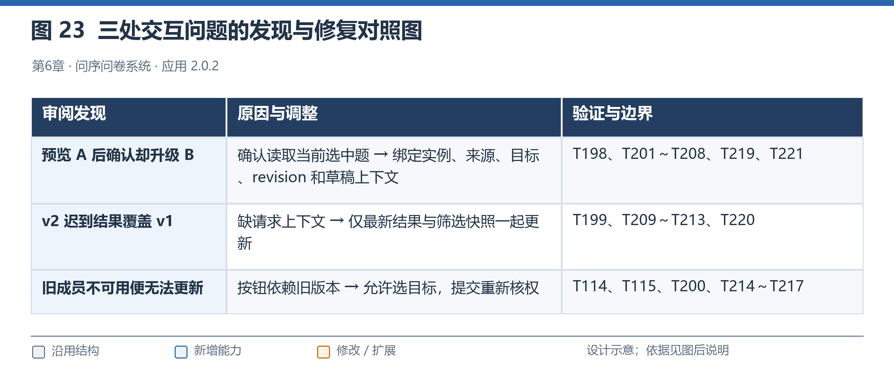

**图 23 三处交互问题的发现与修复对照图**

用户提出问题及约束，Codex 辅助修改代码、测试和材料。自动测试通过并不等于所有页面已经人工验收；2.0.2 原生弹窗等浏览器复核仍待完成。

核对依据：AI使用日志：实例13、32～38；逐项测试索引。

## 七、测试结果

### 7.1 测试方法与计数原则

本阶段不仅检查新增功能能否使用，还检查它们是否影响第一阶段的原有功能。测试分为以下几类：

| 测试类别 | 主要检查内容 |
|---|---|
| 后端测试 | 题型校验、跳转、来源保护、权限、版本、统计及旧功能 |
| 真实 MongoDB 测试 | 集合约束、唯一性、并发写入、事务回滚和数据库升级 |
| 前端逻辑测试 | 条件计算、答案校验和统计计算口径 |
| 前端组件测试 | 页面输入、按钮操作、请求延迟和连续切换 |
| 构建与启动检查 | 类型检查、生产构建、隔离启动和 API 定义 |
| 独立解压复核 | 提交包中的代码、材料和运行结果是否一致 |

本章的 **260 项**指不同自动测试用例的数量。重复执行同一批测试，不增加用例总数。材料中的 22 步 API 调用链另外记录，也不加进这 260 项。

测试步骤、输入、预期输出、实际输出和结果，详见[测试用例与结果](../3_测试用例/测试用例与结果.md)。其中，18 个后端业务场景已经补充具体状态码、返回字段或数据库检查结果。

### 7.2 当前版本的测试结果

2.0.2 版本的自动测试结果如下。

| 测试类别 | 用例数 | 结果 |
|---|---:|---|
| 后端测试 | 154 | 全部通过 |
| 前端组件测试 | 90 | 全部通过 |
| 前端逻辑测试 | 16 | 全部通过 |
| **合计** | **260** | **全部通过** |
| TypeScript 类型检查 | 单独检查 | 通过 |
| 前端生产构建 | 单独检查 | 通过 |

原有 233 项测试继续通过，本次版本增加了 27 项测试，包括 24 项组件测试和 3 项后端测试。原审查中的 4 项诊断也有通过记录，其中与正式回归重复的部分不再次计数。

首次完整结果记录于 **2026 年 10 月 25 日**。**2026 年 10 月 26 日**，在独立解压目录中再次执行同一批测试，仍为 260 项通过；包内类型检查、生产构建、隔离启动及 50 个 API 定义检查也通过。

这次独立复测使用了本机已有的 Python 依赖和前端依赖缓存，因此只能说明提交包在该环境下能够运行，不能写成已经完成全新电脑的安装验证。

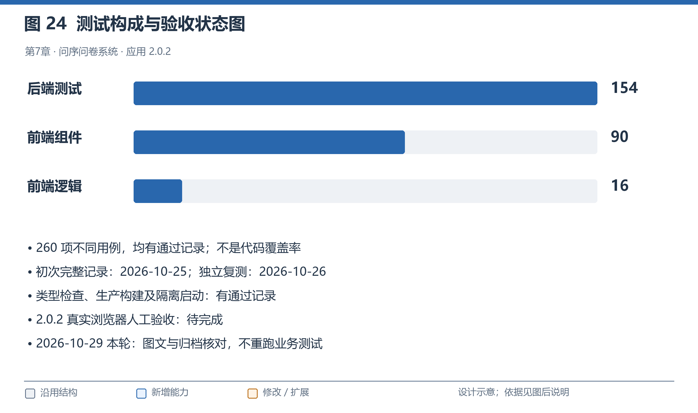

**图 24 测试构成与验收状态图**

图中展示的是已有测试记录。本次完善报告、插图和测试说明没有重新执行业务测试，也没有增加测试数量。测试项数不等于代码覆盖率，不能据此推导系统容量或性能上限。

### 7.3 八项新需求的验证结果

下表按需求列出主要操作、输入和实际结果。具体请求、动态 ID 和完整断言可通过对应测试索引核对。

| 需求 | 测试操作与输入 | 实际输出与检查结果 | 结果 |
|---|---|---|---|
| R01 保存常用题 | 将旧问卷中的自有题目保存为常用题 | 当前草稿建立来源；旧发布快照保持不变；新版本统计的覆盖问卷数仍为 0，没有自动关联历史答案 | 通过 |
| R02 共享题目 | 授权指定版本，再撤销授权 | 新导入被拒绝；原合法实例仍能发布和提交；不能通过解除或另存变成自有题 | 通过 |
| R03 修改隔离 | 开始填写 v1，再升级题目并发布新版 | 恢复后仍显示旧题干；提交得到的正式答卷仍属于问卷发布版本 1 | 通过 |
| R04 历史与恢复 | 创建版本、从旧版分支，再恢复历史内容 | 恢复生成 v4；父版本与恢复来源分别正确；v1 内容未被覆盖 | 通过 |
| R05 版本并存 | 同系列两个版本加入题库，并分别使用 | 不同版本可以共存；重复成员返回 409；统计不会自动混合不同版本 | 通过 |
| R06 使用追踪 | 同一问卷使用该题并发布两次 | 使用问卷总数为 1；自己的明细列出发布版本 `[2,1]`；他人私密标题不返回 | 通过 |
| R07 题库管理 | 重复加入、使用旧修订号、更新已撤销旧成员 | 重复或修订冲突返回 409；旧版失效但新版有授权时，可以选择并更新为新版 | 通过 |
| R08 跨问卷统计 | 两份问卷提交三条数字答案：20、40、60 | 覆盖问卷数 2、有效答卷数 2、有效作答数 3，均值 40，最小值 20，最大值 60 | 通过 |

此外，还验证了以下容易出错的情况：

- **并发创建版本**：两个请求使用同一修订号，结果分别为 201 和 409，没有生成重复版本。
- **事务失败**：在版本插入处注入异常后，题目序号和最近版本指针保持原值。
- **来源篡改**：修改来源字段或保留旧来源改写内容，均被拒绝；重复实例 ID 返回 422。
- **多选统计**：两次回答 `[a,b]` 和 `[b,c]`，选项次数为 `[1,2,1]`，比例分别为 50%、100%、50%，合计 200%，符合按有效作答条数计算分母的规则。
- **统计权限撤销**：授权后可查询指定范围，撤销后新请求排除该范围，显式越权查询返回 403。
- **页面请求竞争**：迟到的旧预览、统计和候选结果不能覆盖当前操作对象。


### 7.4 如何保证旧功能仍然可用

第二阶段保留第一阶段的回归测试，并针对新旧功能交叉使用的情况补充检查。

| 原有功能 | 保留方式 | 验证内容 |
|---|---|---|
| 注册、登录和账号隔离 | 沿用原会话及所有权检查 | 登录、越权和新资源权限检查 |
| 创建、保存、发布和关闭问卷 | 沿用问卷服务和完整发布快照 | 原流程回归及新增来源检查 |
| 四种题型及限制 | 沿用题型处理器 | 数值范围、必答、多选数量、字符长度和合法答案检查 |
| 按回答跳转 | 沿用规则引擎和实例跳转配置 | 条件判断、路径变化、答案清理和结束问卷 |
| 自动保存与恢复 | 填写过程绑定原发布版本 | 新版发布后旧过程仍可恢复、提交，冲突不会直接覆盖 |
| 匿名、重复填写和并发提交 | 沿用原身份处理、唯一性及事务 | 重复请求、并发提交和失败回滚 |
| 正式答卷和整卷统计 | 保留原答案结构及统计服务 | 新功能不改写旧答案，原统计继续可用 |
| 旧数据读取 | 旧题允许没有来源字段 | 第一阶段样本升级、读取和回退保护 |

代码差异记录也用于核对哪些模块保留、哪些模块修改。不过，文件内容相同只能证明代码未变，不能单独证明行为正确，因此仍需要与实际回归结果结合判断。

### 7.5 材料示例的实际验证

2026 年 10 月 26 日，使用真实 MongoDB 临时数据库执行了材料中的 API 调用链，检查文档示例是否与实现一致。

| 操作与输入 | 实际输出 | 结果 |
|---|---|---|
| 创建数字题 v1、v2 | 同系列生成两个固定版本，父关系正确 | 通过 |
| 创建题库、加入 v1 并共享 | 成员和授权记录指向确定版本 | 通过 |
| 导入 v1、发布并开始填写 | 生成实例、发布快照和旧填写过程 | 通过 |
| 升级为 v2 并再次发布 | 新发布成功，旧填写过程没有切换版本 | 通过 |
| 旧过程保存答案 25 并提交 | 正式答卷仍属于发布版本 1 | 通过 |
| 分别查询 v1、v2 统计 | v1 有 1 条作答、均值 25；v2 覆盖 1 份问卷但作答数为 0 | 通过 |
| 写入十一集合的脱敏示例 | 各集合样本均被当前 Schema 接收 | 通过 |
| 直接写入缺字段的答卷文档 | MongoDB 拒绝，错误码为 121 | 通过 |
| 清理临时数据库 | 本次创建的测试库已清理 | 通过 |

这些记录用于验证材料示例和旧版本兼容，不作为新增业务测试计入 260 项。完整过程见测试证据中的 API 调用链记录和 MongoDB 设计核对记录。

### 7.6 历史版本结果与修复过程

历史结果用于说明项目如何逐步完善，不与当前 260 项相加。

| 版本 | 后端 | 组件 | 前端逻辑 | 合计 |
|---|---:|---:|---:|---:|
| 2.0.0 | 136 | 56 | 16 | 208 |
| 2.0.1 | 151 | 66 | 16 | 233 |
| 2.0.2 | 154 | 90 | 16 | 260 |

2.0.0 已有部分真实浏览器记录，包括创建年龄题版本、加入题库、导入问卷、发布、填写 25 并查看统计。

后续审阅发现，208 项测试通过仍遗漏了数字统计边界、统计入口、使用查询入口、题库分页和题库内搜索等问题。2.0.1 修复这些问题，增加 25 项测试，并在隔离临时库中进行了相应浏览器检查。

2.0.2 又修复了升级确认错题、迟到统计覆盖当前版本，以及旧题库成员失效后无法选择有效新版等交互问题，增加 27 项测试。

首次失败、修正过程和最终通过记录均保留。历史浏览器记录只证明对应版本、对应操作的检查情况，不能代替当前版本所有页面的人工验收。


## 八、遇到的问题

第二阶段的困难主要来自两方面：一是新增需求改变了题目的管理方式，需要补充版本、来源和权限设计；二是实际实现中出现了校验遗漏、页面入口不完整和连续操作错误。

两类问题需要分别说明。P01～P06、P10 是设计时需要解决的问题；P07～P09 是 2.0.0 阶段实际发现的问题，P11～P15 属于 2.0.1 修订，P16～P18 属于 2.0.2 修订。

### 8.1 主要问题及原因

| 编号 | 遇到的问题 | 产生原因或影响 |
|---|---|---|
| P01 | 无法可靠追踪同一道题在不同问卷中的使用 | 第一阶段的题目 ID 只区分当前问卷内的题目，没有独立的题目身份 |
| P02 | 题目修改可能影响旧问卷 | 如果旧问卷始终读取题目的最新内容，过去答案的含义可能随之改变 |
| P03 | 客户端可能伪造题目来源 | 仅接收页面传来的来源字段，不能证明该题确实经过合法导入 |
| P04 | 导入与撤销授权可能同时发生 | 只读取授权、再写问卷，不一定与撤销操作产生写入冲突 |
| P05 | 题目使用权与答案访问权容易混淆 | 允许别人采用题目，不代表允许其查看相关问卷的数据 |
| P06 | 升级题目后，原跳转规则可能失效 | 新版本可能删除选项或改变题型，而问卷仍保留原规则 |
| P07 | 旧数据库回退测试出现断言失败 | 测试错误地要求第二阶段新增集合也恢复成不存在的旧约束 |
| P08 | 旧数据迁移测试被新格式数据干扰 | 共用测试数据库中混入了此前测试产生的题目来源信息 |
| P09 | 窄屏下共享入口被隐藏 | 原导航样式隐藏了最后一项，导致新增入口不可见 |
| P10 | 答卷数和作答条数容易混算 | 一份答卷可以包含两个同版本实例，展开后会得到多条答案 |
| P11 | 非法数字分组边界未被完整拒绝 | 调用了安全数值函数，却忽略了函数返回的判断结果 |
| P12 | 只有统计授权的用户找不到统计入口 | 页面入口依赖题目使用列表，而统计授权不等于题目使用授权 |
| P13 | 共享接收者被引导到无权访问的历史页面 | 使用查询与所有者的历史管理入口放在一起 |
| P14 | 选题窗口只能选择前二十个题库 | 页面只请求题库列表第一页，没有继续加载 |
| P15 | 选择题库后搜索不生效 | 搜索关键词没有传给题库成员查询接口 |
| P16 | 预览 A 题后可能确认升级 B 题 | 确认时重新读取当前选中题目，没有绑定预览对象 |
| P17 | 页面显示的统计可能属于旧版本 | 较早请求返回较晚，覆盖了用户当前选择的查询结果 |
| P18 | 旧版本授权失效后无法更新到有效新版 | 页面根据旧版本是否可用，直接禁用了更新入口 |

这些问题说明，接口能够返回正确结果，并不代表页面操作已经完整；已有测试全部通过，也不代表所有边界都已经覆盖。

### 8.2 旧数据与新版本之间的兼容问题

第一阶段的问卷没有独立题目来源，但仍保存着完整题目内容。第二阶段不能要求这些旧问卷必须补齐来源后才能继续使用。

因此，兼容处理需要满足两点：

- 没有来源的旧题继续按原定义填写、提交和统计。
- 没有明确关联依据时，不把旧答案自动计入某个新建常用题的统计。

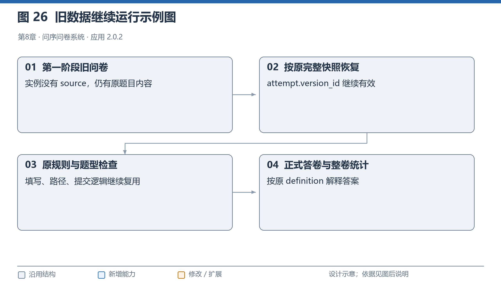

**图 26 旧数据继续运行示例图**

例如，把旧问卷中的年龄题另存为常用题，只会为当前草稿建立新的来源关系。已经发布的历史快照和旧答案保持原样，不能仅凭题干相同就自动合并。

另一个兼容问题是：题目作者修改内容后，已经采用旧版的问卷怎么办？

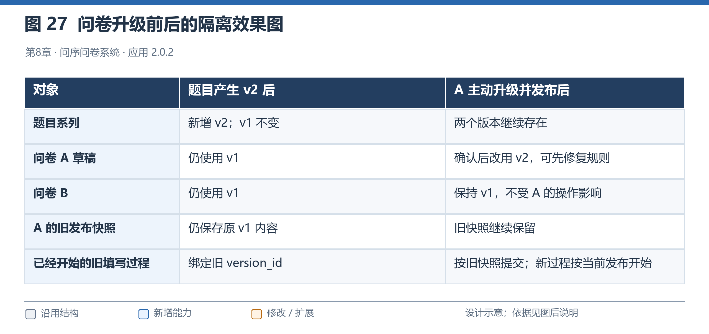

**图 27 问卷升级前后的隔离效果图**

问卷 A 可以主动升级，问卷 B 继续使用旧版。已经开始的填写过程仍读取原发布快照。这样，题库内容更新不会在填写中途替换题目，也不会改变历史答案的解释。

已有测试检查了旧快照不变、旧填写过程在新版发布后继续提交，以及旧数据约束升级和回退保护。具体依据包括 T075、T099、T100、T106～T108。

### 8.3 统计数量容易产生误解

跨问卷统计不能直接把展开后的答案行数当作答卷数，更不能当作人数。

例如，一份答卷中出现两个同版本实例，就会贡献两条作答，但仍然只有一份答卷。

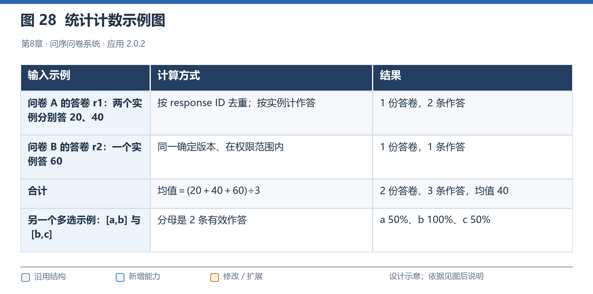

**图 28 统计计数示例图**

已有测试中，两份问卷收到两份答卷，共包含三条数字作答：20、40、60。因此，答卷数为 2，作答条数为 3，平均值为 40。

多选题也需要明确分母。两条回答分别为 `[a,b]` 和 `[b,c]` 时，选项比例为 50%、100%、50%，相加为 200% 是正常结果，因为每条回答可以选择多个选项。

本轮跨问卷统计没有实现去重人数，不能把作答条数换名显示为人数。相关测试见 T102、T103。

### 8.4 导入与撤销授权的并发问题

用户导入题目时，题目所有者可能同时撤销授权。如果只在导入开始时检查一次授权，就可能出现检查时有效、写入时已经撤销的情况。

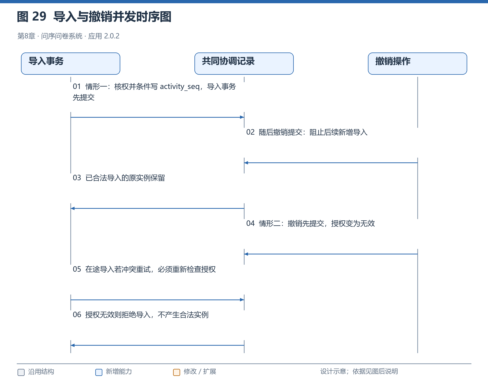

**图 29 导入与撤销并发时序图**

系统需要明确两种结果：

- 导入先成功提交，原实例属于已合法使用，可以保留。
- 撤销先成功提交，之后的新增导入应被拒绝。

这需要授权检查和写入操作共同配合。发生事务冲突并重试时，还要重新读取授权，不能继续使用第一次检查的结论。相关测试通过受控执行顺序分别验证这两种情况，见 T094～T097。

## 九、如何解决

针对第八章的问题，第二阶段采用了增加独立题目管理、固定历史内容、分开权限以及补充交互保护的方式。修改集中在题目管理、问卷编辑和新增统计层，原填写与提交核心继续复用。

### 9.1 问题与修改对应关系

| 问题 | 具体修改 | 验证方式 |
|---|---|---|
| P01 | 增加题目系列和确定版本，问卷内继续使用实例 ID | 同系列多问卷、多实例及旧题测试 |
| P02 | 实例保存内容，发布保存完整快照 | 比较旧快照，验证旧填写过程仍可提交 |
| P03 | 导入、升级和解除使用专门操作，普通保存核对原来源 | 来源篡改、复制、删除和共享另存拒绝测试 |
| P04 | 条件写入共同协调记录，事务重试时重新检查授权 | 控制导入与撤销、归档的两种提交顺序 |
| P05 | 分开使用授权和统计授权，先确定权限范围再统计 | 越权拒绝、授权后可见、撤销后排除 |
| P06 | 保留待修复草稿，发布时重新完整校验 | 无效规则可保存，修复前发布被拒绝 |
| P07 | 将旧约束回退断言限定到原集合 | 纯第一阶段样本回归 |
| P08 | 单独构造不含新来源的旧样本，保留降级保护 | 旧样本可回退，新业务数据拒绝仅恢复旧约束 |
| P09 | 修正导航显示样式 | 对应版本的窄屏浏览器记录 |
| P10 | 答卷按 ID 去重，作答按实例计数 | 两份答卷、三条作答及多选分母测试 |
| P11 | 将安全数值判断结果用于拒绝条件 | 无穷大、非数值和越界边界检查 |
| P12 | 在有效统计授权记录旁增加入口 | 仅统计授权用户的接口与组件测试 |
| P13 | 提供独立使用情况入口 | 接收者只查自己的使用，不调用所有者历史接口 |
| P14 | 增加题库后续加载和失败重试 | 第二页及第 21 个题库可达测试 |
| P15 | 传递关键词，对可读固定版本先搜索再分页 | 关键词、分页和私密标题保护测试 |
| P16 | 预览绑定实例、来源、目标、修订号和本地草稿状态 | 切题、延迟响应、草稿变化及确认参数测试 |
| P17 | 仅最新请求更新结果，结果与筛选范围一起保存 | 请求乱序、关闭明细和翻页竞争测试 |
| P18 | 允许选择新版，提交时重新检查目标权限 | 旧版撤销、新版有效及目标再次撤销测试 |

### 9.2 用固定版本保护历史内容

题目修改时创建新版本，不覆盖原文档。用户也可以从旧版继续修改，因此版本编号只表示创建顺序，不代表所有问卷都应该采用编号最大的版本。

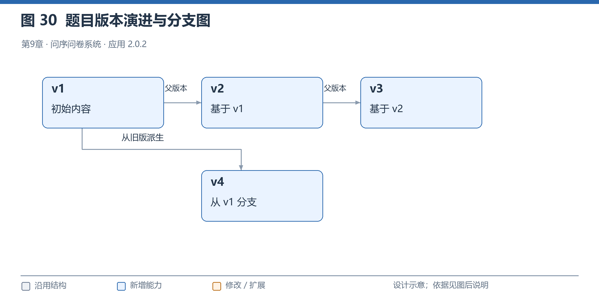

**图 30 题目版本演进与分支图**

图中 v4 虽然创建得最晚，却可以基于 v1 分支。创建版本时，序号分配、版本插入和最近版本指针更新放在同一事务中，避免失败后只写入一部分。

历史恢复同样创建新版本，但需要额外记录恢复来源。

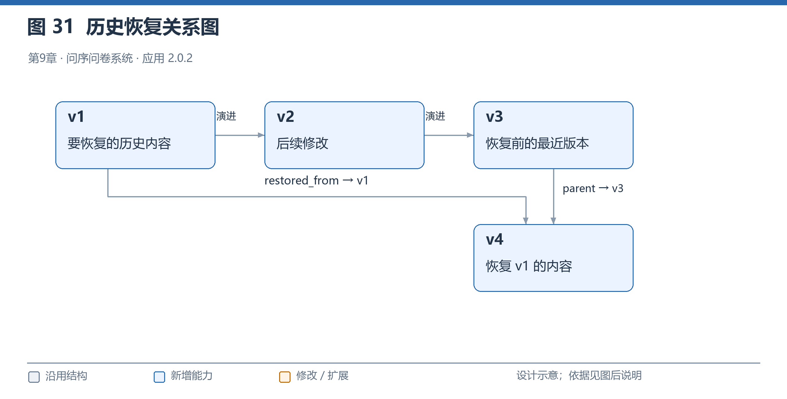

**图 31 历史恢复关系图**

例如，当前最近版本为 v3，用户恢复 v1 的内容后生成 v4：

- `parent_version_id` 指向 v3，记录直接演进关系。
- `restored_from_version_id` 指向 v1，记录内容恢复来源。

这里与图 30 是两种独立示例，旧版本在两种情况下都不覆盖。相关验证见 T075～T077、T218。

### 9.3 将升级预览与确认绑定

升级不仅涉及内容替换，还可能影响原跳转规则，因此先预览差异，再确认修改。

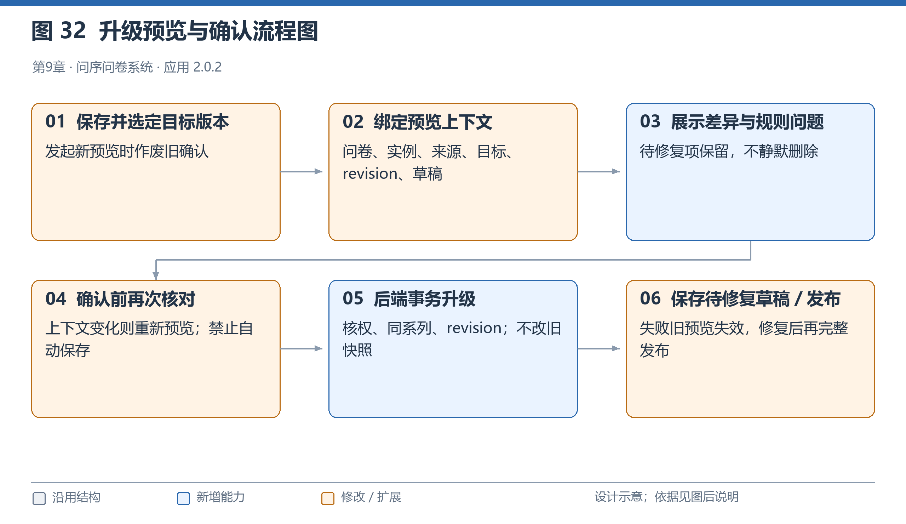

**图 32 升级预览与确认流程图**

预览记录问卷、实例、来源版本、目标版本、服务器修订号和本地草稿状态。切换题目、改变目标、继续编辑、关闭窗口或离开页面时，原确认失效。

确认阶段禁止自动保存后继续升级。否则，自动保存取得的新修订号可能绕过原预览约束。用户需要保存后重新预览，再确认。

升级后若规则失效，保留原规则并提示问题，允许继续修复草稿；只有完整校验通过才能发布。相关验证见 T099、T198～T208、T219、T221。

### 9.4 分开使用权和统计权

系统使用两类授权，分别回答两个问题：

| 授权 | 授权人 | 允许的操作 |
|---|---|---|
| `use` | 题目所有者 | 使用指定题目版本，新增导入问卷 |
| `aggregate` | 问卷所有者 | 查询指定问卷、指定题目版本的汇总统计 |

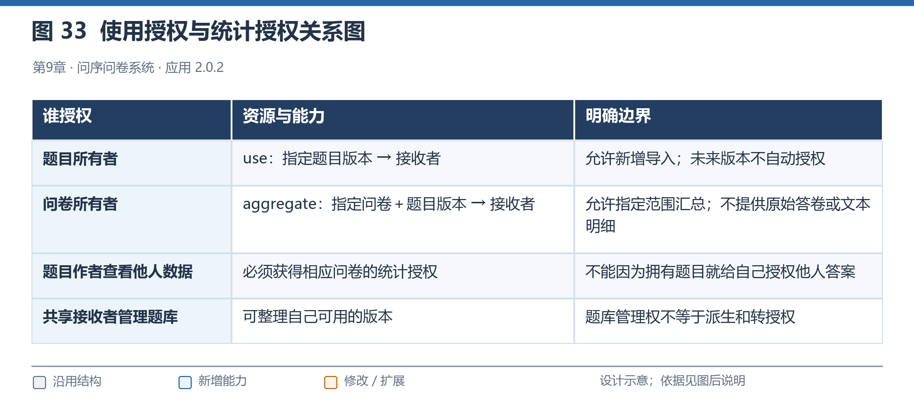

**图 33 使用授权与统计授权关系图**

题目作者不会因为拥有题目，就自动看到他人问卷中的答案。统计授权也不会开放问卷详情、原始答卷或文本明细。

撤销时，还需要区分既有使用和新的使用。

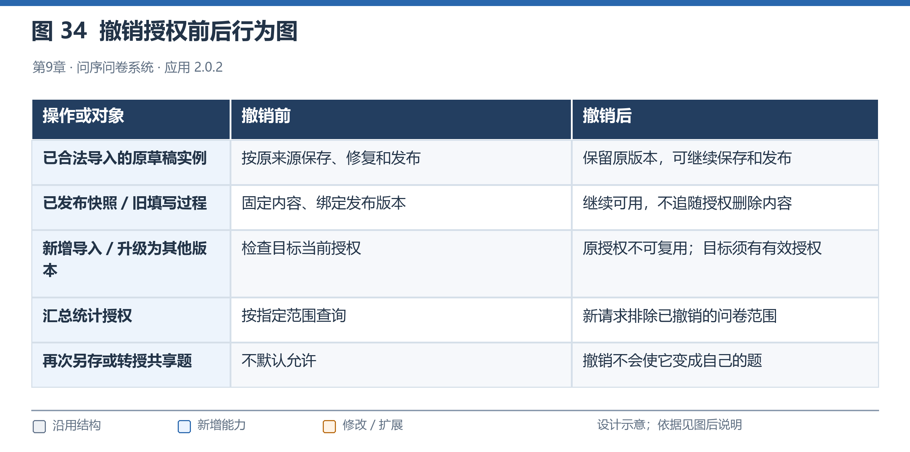

**图 34 撤销授权前后行为图**

已合法导入的来源绑定原问卷和原实例，可以继续保留；新增导入或替换版本需要检查当前授权。统计授权撤销后，新查询排除相应问卷范围，不能沿用过去的访问资格。

使用追踪只展示自己的问卷明细，题目所有者按权限查看外部脱敏数量。当前没有通用的他人问卷详情授权。相关验证见 T091～T097、T104、T127。

### 9.5 先确定权限范围，再计算统计

跨问卷统计先筛选有权访问的问卷，再匹配发布快照、题目实例和正式答案。

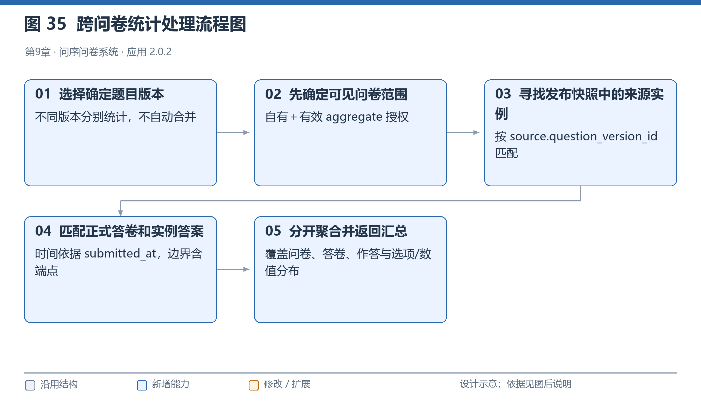

**图 35 跨问卷统计处理流程图**

统计口径明确如下：

| 指标或条件 | 计算方式 |
|---|---|
| 题目范围 | 同一确定版本，不自动合并不同版本 |
| 问卷范围 | 自有问卷或获得有效汇总授权的问卷 |
| 时间范围 | 按正式提交时间 `submitted_at` 筛选，包含起止边界 |
| 覆盖问卷数 | 有权限且发布快照引用该版本的问卷数，包括零作答问卷 |
| 有作答问卷数 | 筛选范围内实际收到该版本有效作答的问卷数 |
| 有效答卷数 | 按正式答卷 ID 去重 |
| 有效作答数 | 按匹配的问卷实例计数 |
| 多选比例 | 选项次数除以有效作答条数 |

使用追踪中的几个分类可以重叠：“历史发布使用”包含当前发布，不能将分类数量直接相加。

这些权限范围需要在验收时说明，不能无条件表述为能够查看所有使用问卷或所有问卷的数据。本轮未实现跨版本合并、旧答案自动关联和跨问卷去重人数。相关验证见 T102～T105、T116～T127。

### 9.6 显式升级数据库并保留恢复保护

普通启动负责连接、检查已有约束、初始化缺失集合和确保索引存在。已有集合约束的变化通过显式升级处理。

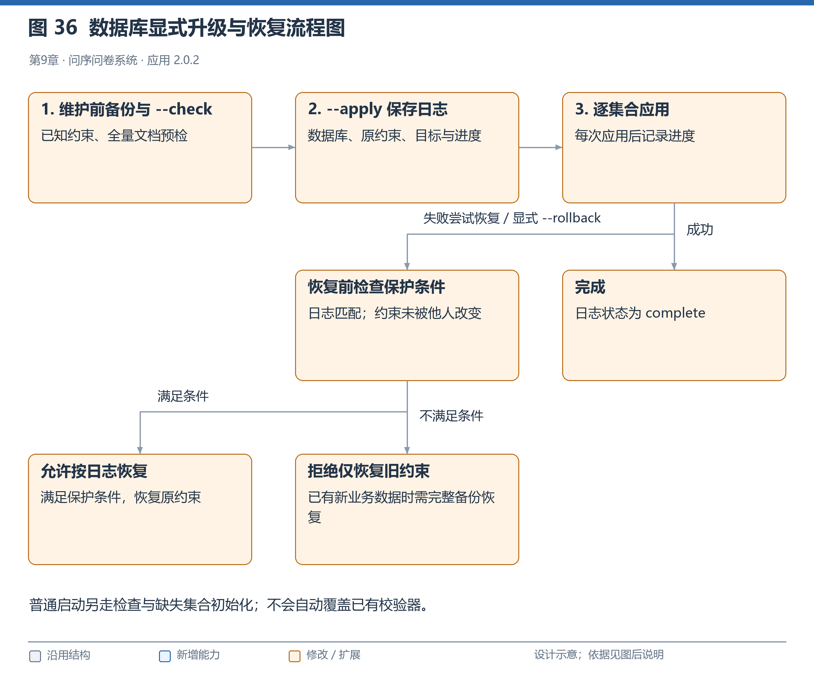

**图 36 数据库显式升级与恢复流程图**

升级时先检查旧文档是否满足目标结构，再保存原约束、目标信息和应用进度。逐集合应用成功后记录完成；失败时尝试依据日志恢复。

恢复也有条件：日志必须属于当前数据库，约束不能已经被其他操作改变。已有第二阶段题目或来源数据时，程序会拒绝只恢复旧约束，要求按维护前完整备份制定恢复处理。

因此，约束恢复不能代替业务数据备份，也不能承诺任意时刻都能无条件降级。相关验证见 T107、T108。

#